# AI624 — Assignment 3: Quantization — Report

| | |
|---|---|
| **Student** | Muhammad Ahmad |
| **Roll No.** | 25280065 |
| **Course** | AI624 AI on Edge Devices, School of Science and Engineering, LUMS |
| **Models** | GPT-2 small (Tasks 1–2), ResNet-18 CIFAR-10 (Task 3) |
| **Hardware** | Apple M2 Pro, MPS backend, 17.2 GB unified memory |
| **Notebook** | `AI624_A3_Quantization.ipynb` (all outputs visible) |

> **Execution note.** Apple MPS has no INT8/INT4 kernels for these layers, so every quantized result uses **simulated** quantize-dequantize operations around FP32 kernels. Storage reductions are **measured**; speed-ups are **not claimed**. Theoretical integer savings are reported separately and labelled as theory.

---

## Contents

1. [Executive summary](#executive-summary)
2. [Key results at a glance](#key-results-at-a-glance)
3. [Experimental pipeline](#experimental-pipeline)
4. [Reproducibility](#reproducibility)
5. [Experimental setup](#experimental-setup)
6. [Task 1 — GPT-2 baseline and profiling](#task-1--gpt-2-baseline-and-profiling)
7. [Task 2 — GPT-2 post-training quantization](#task-2--gpt-2-post-training-quantization)
8. [Task 3 — QAT on ResNet-18 / CIFAR-10](#task-3--qat-on-resnet-18--cifar-10)
9. [Requirement coverage](#requirement-coverage)
10. [Figure index](#figure-index)
11. [Limitations](#limitations)
12. [AI acknowledgment](#ai-acknowledgment)
13. [References](#references)

---

## Executive summary

| Question | Answer (with evidence) |
|---|---|
| What limits GPT-2 at **W8A8**? | **Activation outliers.** A few channels reach 8–23× the 99th percentile (§2.2); weight error is only ≈10⁻⁴. |
| Which method is best at **W8A8**? | **SmoothQuant** — PPL 72.58–72.66 vs FP32 71.76; activation error ↓ ≈8×. |
| What limits GPT-2 at **W4A8**? | **Weight error** (≈3×10⁻², ≈10× the activation error). |
| Which method is best at **W4A8**? | **GPTQ** — PPL 86.1–87.8 vs 121.5–125.1 (Linear); layer-output error ↓ 2.4–3.8×. |
| Does SmoothQuant help at W4A8? | **No** — it moves range into 4-bit weights; PPL rises to 148–152. |
| Static or dynamic activations? | Dynamic is slightly better (E_X ↓ ≈9%) but slower; the choice matters far less than SmoothQuant's scaling. |
| Measured storage saving? | GPT-2: 497.8 → 243.4 MB (−51%). ResNet-18: 44.8 → 11.3 MB (−75%). Packed 4-bit figures are theory only. |
| Does QAT recover 4-bit accuracy? | **Yes** — ResNet-18 W4A8 QAT reaches 94.86% vs 94.98% FP32 after 5 epochs (6.3 min). |

## Key results at a glance

**GPT-2 (test perplexity, FP32 = 71.76, lower is better)**

| Configuration | Linear PTQ | SmoothQuant | GPTQ | Best |
|---|---|---|---|---|
| Static W8A8 | 76.35 | **72.66** | 76.20 | SmoothQuant |
| Dynamic W8A8 | 75.47 | **72.58** | 75.36 | SmoothQuant |
| Static W4A8 | 125.13 | 151.79 | **87.77** | GPTQ |
| Dynamic W4A8 | 121.50 | 148.26 | **86.12** | GPTQ |

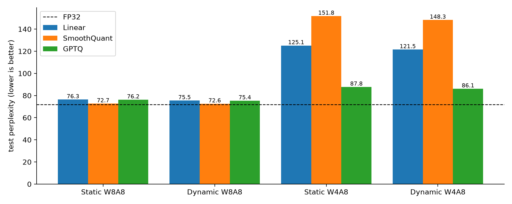

**ResNet-18 QAT (CIFAR-10 test)**

| Model | Top-1 | Top-5 | Macro-F1 | Integer export size |
|---|---|---|---|---|
| FP32 | 94.98% | 99.86% | 0.9498 | 44.77 MB |
| W8A8 QAT | 94.78% | 99.87% | 0.9478 | 11.32 MB |
| W4A8 QAT | 94.86% | 99.87% | 0.9486 | 11.32 MB (5.68 MB packed, theory) |

**Main findings**

1. **SmoothQuant wins at W8A8** (within 0.8–0.9 PPL of FP32): GPT-2 is limited by a few **activation outlier channels**, and smoothing cuts activation error ≈8×.
2. **GPTQ wins at W4A8** (ΔPPL 53 → 16): at 4 bits **weight error dominates**, and GPTQ lowers layer-output error 2.4–3.8× even though individual weight error rises ≈1.6×.
3. **SmoothQuant hurts at W4A8**: moving outliers into 4-bit weights costs more than it saves.
4. **QAT keeps W8A8 and W4A8 within 0.2% of FP32** on ResNet-18 while cutting real storage by 75%.
5. All quantized inference is **simulated** (fake quantization + FP32 kernels on Apple MPS): storage reductions are measured, **speed-ups are not**.

---

## Experimental pipeline

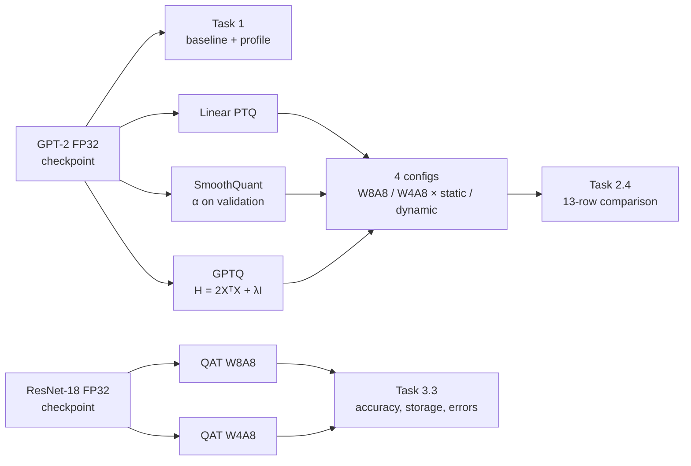

*(If the diagram does not render in your viewer: every method starts from the same original checkpoint; SmoothQuant and GPTQ are separate comparisons against Linear PTQ, not a combined pipeline.)*

---

## Reproducibility

| Item | Value |
|---|---|
| Seed | 42 (Python, NumPy, PyTorch, MPS) |
| Calibration | 128 training blocks, indices saved in `setup_record.json` |
| Batch sizes | Evaluation / calibration = 8, profiling = 1 |
| Block fingerprints (SHA-256) | train `c09f281474a95eeb`, validation `c033bf55a2004da2`, test `cde0f2d28878e25e`, calibration `04d77d5854d0d81f` |
| Precision | FP32 baseline, eval mode, gradients disabled, `use_cache=False` |
| Device | Apple M2 Pro, MPS backend |

Identical fingerprints in every experiment confirm the same blocks and target positions were used throughout.

---

## Experimental setup

- **Model:** GPT-2 small, `openai-community/gpt2` (Hugging Face Transformers), 124.44 M unique parameters [1, 3, 4].
- **Data:** WikiText-2, `wikitext-2-raw-v1` [5]. In each split, non-empty examples are tokenized, joined with `<|endoftext|>`, and cut into non-overlapping 128-token blocks; the last partial block is discarded.
- **Scoring:** 127 next-token targets per block (the first token is never scored).
- **Splits:** train → calibration only; validation → hyperparameter selection (SmoothQuant α); test → final results only.

| Split | Non-empty examples | Tokens | Blocks | Discarded tokens | Scored targets |
|---|---|---|---|---|---|
| Train | 23,767 | 2,415,650 | 18,872 | 34 | 2,396,744 |
| Validation | 2,461 | 249,749 | 1,951 | 21 | 247,777 |
| Test | 2,891 | 286,177 | 2,235 | 97 | 283,845 |

---

## Task 1 — GPT-2 baseline and profiling

### 1.1 Model architecture and quantization scope

GPT-2 small is an autoregressive, decoder-only Transformer: it predicts each token from the tokens before it.

| Setting | Value |
|---|---|
| Transformer blocks | 12 |
| Hidden size / heads / head size | 768 / 12 / 64 |
| MLP intermediate size | 3072 |
| Vocabulary | 50,257 |
| Unique parameters | 124.44 M (LM head tied to token embedding) |

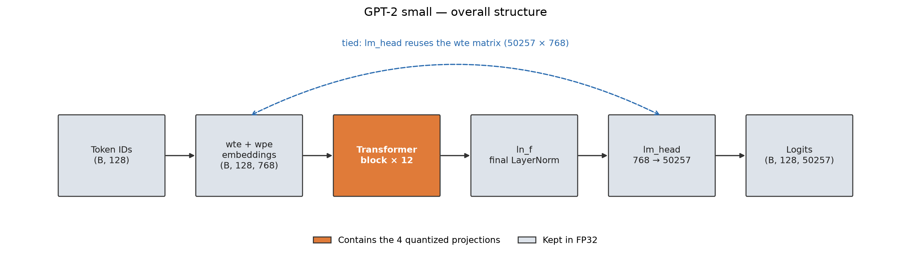

**Order of operations in one block (pre-LayerNorm):**

$$[Q,K,V] = \mathrm{LN}_1(x)\,W_{attn} + b_{attn}, \qquad
h = x + \mathrm{c\_proj}\Big(\mathrm{softmax}\big(\tfrac{QK^\top}{\sqrt{64}} + M\big)V\Big)$$

$$y = h + \mathrm{c\_proj}_{mlp}\Big(\mathrm{GELU}\big(\mathrm{LN}_2(h)\,W_{fc} + b_{fc}\big)\Big)$$

- **Pre-LayerNorm** normalizes each sub-layer input (`ln_1`, `ln_2`).
- **Causal multi-head self-attention:** `c_attn` (768 → 2304) produces Q, K, V; the causal mask $M$ stops a token from seeing future tokens; softmax weights mix V across 12 heads.
- **Attention output projection** `attn.c_proj` (768 → 768) combines the heads.
- **MLP:** `mlp.c_fc` (768 → 3072) → GELU → `mlp.c_proj` (3072 → 768).
- **Residual connections** add each sub-layer's output back to its input. Dropout is identity in eval mode.

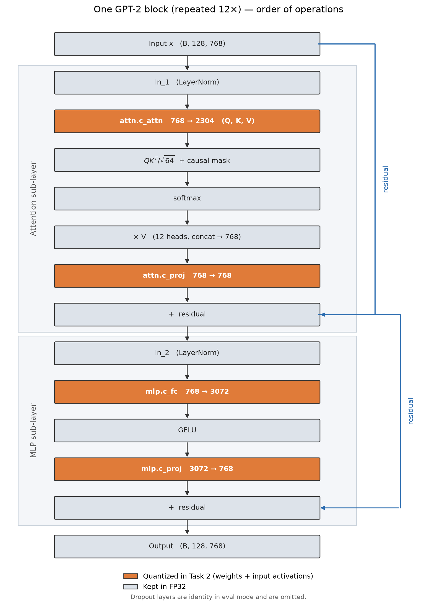

**Quantization scope (Task 2).**

| Component | Precision in Task 2 |
|---|---|
| `attn.c_attn`, `attn.c_proj`, `mlp.c_fc`, `mlp.c_proj` — weights | Quantized (W8 / W4) |
| Same 4 projections — input activations | Quantized (A8) |
| Projection biases | FP32 |
| Token + positional embeddings, tied vocabulary head | FP32 |
| LayerNorm, GELU, softmax, residual additions | FP32 |
| Attention matmuls $QK^\top$ and $A\cdot V$ | FP32 |
| KV cache | Not used (`use_cache=False`) |

**Conv1D layout check.** All 48 projections are `Conv1D` with weight shape **(in, out)** and compute $Y = XW + b$ (verified: max difference 0.0). One output channel is therefore one **column**, so per-output-channel scales are computed over dim 0: $S_W^{(c)} = \max_i |W_{ic}| / Q_b$.

| Projection | Weight (in, out) | Output channels (scales per layer) |
|---|---|---|
| `attn.c_attn` | (768, 2304) | 2304 |
| `attn.c_proj` | (768, 768) | 768 |
| `mlp.c_fc` | (768, 3072) | 3072 |
| `mlp.c_proj` | (3072, 768) | 768 |

The 48 projections hold **84.93 M of 124.44 M parameters (68.3%)**. The largest remaining tensor is the tied token embedding (38.60 M), which stays FP32.

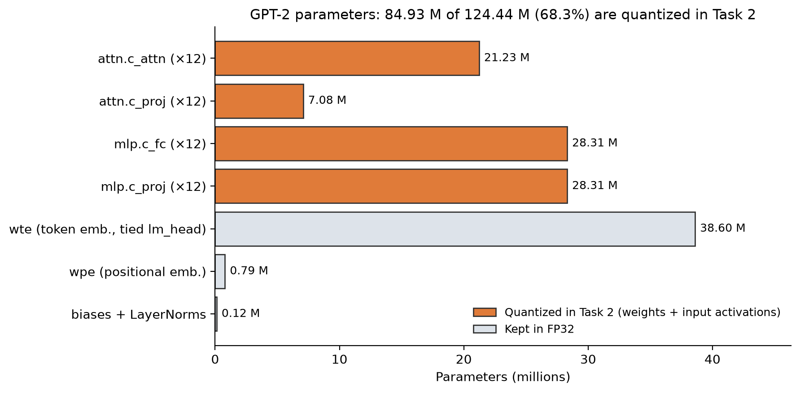

### 1.2 Baseline language-model performance

$$\text{Acc} = \frac{100}{N}\sum_{t\in\mathcal T}\mathbb 1\Big[\arg\max_v p(v\mid x_{<t}) = x_t\Big],\qquad
\text{NLL} = -\frac1N\sum_{t\in\mathcal T}\log p(x_t\mid x_{<t}),\qquad \text{PPL}=e^{\text{NLL}}$$

Loss is **summed over all target tokens and divided once** by $N$ (batch perplexities are never averaged), using the ground-truth prefix.

| Split | Top-1 accuracy | NLL | Perplexity | Scored targets |
|---|---|---|---|---|
| **Test (final)** | **29.28%** | **4.2734** | **71.76** | **283,845** |
| Validation (reference) | 29.07% | 4.2759 | 71.95 | 247,777 |

Perplexity is higher than the ≈30 often quoted for GPT-2 small, which uses 1024-token context. Here each block starts with no context, `<|endoftext|>` resets context at every paragraph, and WikiText-raw formatting (`@-@`, `@,@`) is unusual for GPT-2. The plot confirms the context effect: NLL falls from ≈7.4 at position 1 to ≈3.9 at position 127. Accuracy of ≈29% over a 50,257-token vocabulary is normal, because many next tokens are plausible but only one counts.

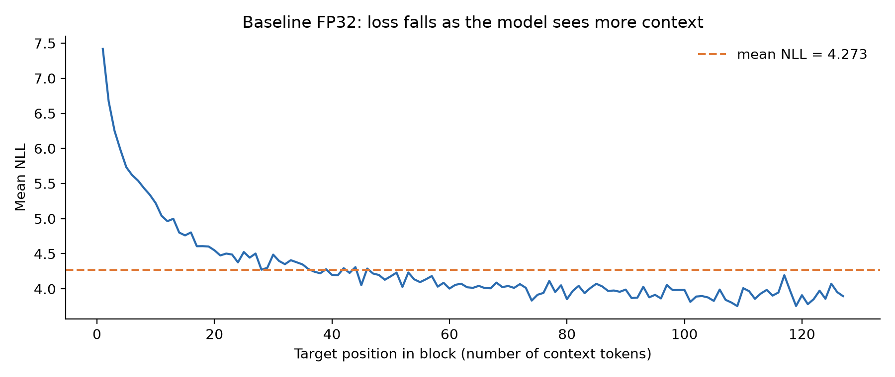

### 1.3 Baseline profiling

**Protocol:** batch size 1, one 128-token test block, 10 warm-up + 30 timed passes, `torch.mps.synchronize()` around each timed pass. Timing runs without the profiler attached; model loading and tokenization are excluded.

**Counting convention:** only multiply–accumulate operations in matrix multiplications are counted; **1 MAC = 2 FLOPs**. Attention matmuls are counted densely (masked entries included). Bias additions, LayerNorm, GELU, softmax, scaling and residuals are **not** included.

| Component | GMACs | GFLOPs | Share |
|---|---|---|---|
| Attention projections | 3.624 | 7.248 | 22.5% |
| Attention matmuls ($QK^\top$, $A\cdot V$) | 0.302 | 0.604 | 1.9% |
| MLP projections | 7.248 | 14.496 | 45.0% |
| Vocabulary head | 4.940 | 9.881 | 30.7% |
| **Total** | **16.114** | **32.228** | 100% |

PyTorch Profiler [8] counted **21.77 GFLOPs**, exactly the 48 `aten::addmm` projection ops (2 × (3.624 + 7.248) = 21.74 G, plus 0.03 G of element-wise ops). On MPS it does not count the vocabulary head (`aten::linear`, 9.88 GFLOPs) or the fused `scaled_dot_product_attention` (0.60 GFLOPs), so these are **supplemented analytically**.

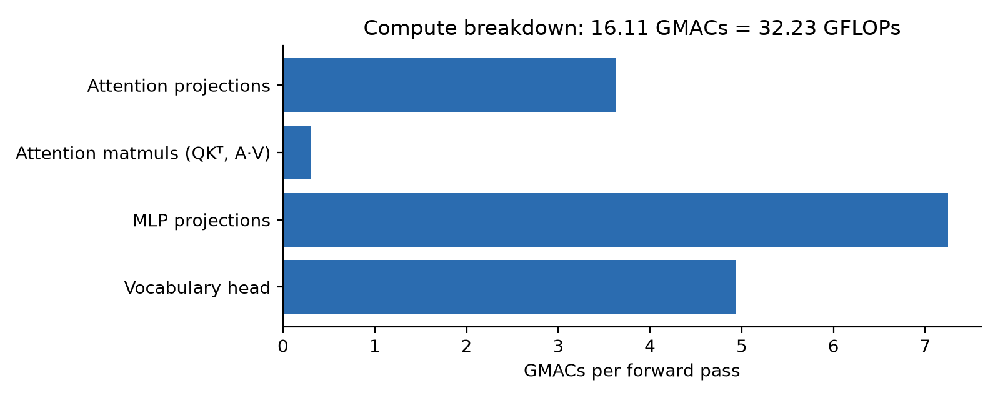

| Metric | Value | Tool |
|---|---|---|
| Unique parameters | 124.44 M | `model.parameters()` (tied weights once) |
| Serialized size | 497.80 MB | `torch.save(state_dict)` |
| MACs / FLOPs per pass | 16.11 G / 32.23 G | analytic + profiler |
| Latency | 13.54 ± 0.36 ms | `time.perf_counter` + MPS sync |
| Throughput | 73.86 seq/s, 9,455 tokens/s | from latency |
| Peak GPU allocated | 524.4 MB | `torch.mps.current_allocated_memory` after every module |
| GPU driver memory (allocated + cache) | 4,376.4 MB | `torch.mps.driver_allocated_memory` |
| Peak process RSS | 1,394.9 MB | `resource.getrusage` (lifetime peak) |
| CPU utilization | 41.2% of one core | `psutil` |
| GPU utilization, power, energy | **unavailable** | see note |

| Environment | |
|---|---|
| CPU / GPU | Apple M2 Pro (integrated GPU), MPS backend |
| Memory | 17.2 GB unified (shared by CPU and GPU) |
| Software | macOS 26.6.2, Python 3.14.2, PyTorch 2.14.1, Transformers 5.20.1 |

**Unavailable metrics.** NVIDIA tools (`pynvml`, `nvidia-smi`) do not exist on Apple Silicon. The macOS sensor (`powermetrics`) needs administrator access and reports whole-chip power, not per-process power, so power, energy, energy per MAC/FLOP and GPU utilization are marked unavailable. Unified memory means "GPU memory" is part of system RAM; tensor allocations are reported separately from driver-held memory.

---

## Task 2 — GPT-2 post-training quantization

Every method starts from the original checkpoint. Four configurations per method:

| Config | Weights | Activations |
|---|---|---|
| Static W8A8 | 8-bit | 8-bit, range fixed from calibration |
| Dynamic W8A8 | 8-bit | 8-bit, range recomputed per forward pass |
| Static W4A8 | 4-bit | 8-bit, fixed range |
| Dynamic W4A8 | 4-bit | 8-bit, runtime range |

**Granularity (all methods):** symmetric per-output-channel weights, asymmetric per-tensor uint8 activations, FP32 biases.

### 2.1 Static and dynamic linear PTQ

**Quantizers.**

$$q = \mathrm{clip}\big(\mathrm{round}(r/S) + Z,\ q_{min},\ q_{max}\big), \qquad \hat r = S\,(q - Z)$$

$$\text{Weights: } Q_b = 2^{b-1}-1,\quad S_W^{(c)} = \frac{\max_i |W_{ic}|}{Q_b},\quad Z_W = 0,\quad q\in[-Q_b, Q_b]$$

$$\text{Activations: } S_X = \frac{x_{max}-x_{min}}{255},\quad Z_X = \mathrm{clip}\big(\mathrm{round}(-x_{min}/S_X),0,255\big)$$

The activation range is forced to include 0; a zero range uses $S = 1$ so there is never a division by zero. **Static:** min/max aggregated over all 128 calibration blocks. **Dynamic:** min/max of the current projection-input tensor on every forward pass.

**Integer projection (derivation).** With $X \approx S_X(X_q - Z_X)$ and $W_{:,c} \approx S_W^{(c)} W_{q,:,c}$:

$$Y_{ic} \approx S_X\,S_W^{(c)}\Big(\underbrace{\sum_k X_{q,ik}\,W_{q,kc}}_{\text{INT32 accumulation}} \;-\; Z_X\underbrace{\sum_k W_{q,kc}}_{\text{precomputed per column}}\Big) + b_c$$

Products are uint8 × int8 (or int4) accumulated in INT32; the activation zero-point correction is a precomputed column sum times $Z_X$; the result is rescaled by $S_X S_W^{(c)}$ and the FP32 bias is added. Weights are symmetric, so there are no weight zero-point cross terms. **Verified numerically** on block 0 `attn.c_attn`: max $|Y_{int} - Y_{sim}| \approx 8\times10^{-6}$, and the largest accumulator (1.9×10⁵) is far below $2^{31}$.

**Results (test split, simulated quantization).**

| Config | Acc | NLL | PPL | ΔPPL | Size (MB) | Packed (MB, theory) | Latency (ms) | Peak GPU (MB) |
|---|---|---|---|---|---|---|---|---|
| FP32 | 29.28% | 4.273 | 71.76 | – | 497.8 | – | 13.54 ± 0.36 | 524.4 |
| Static W8A8 | 28.50% | 4.335 | 76.35 | +4.58 | 243.4 | 243.3 | 14.82 ± 2.05 | 609.6 |
| Dynamic W8A8 | 28.75% | 4.324 | 75.47 | +3.71 | 243.3 | 243.3 | 19.60 ± 1.42 | 609.6 |
| Static W4A8 | 23.94% | 4.829 | 125.13 | +53.37 | 243.4 | 200.8 | 15.20 ± 3.09 | 609.6 |
| Dynamic W4A8 | 24.18% | 4.800 | 121.50 | +49.74 | 243.3 | 200.8 | 16.86 ± 2.61 | 609.6 |

Serialized size includes all integer weights, scales, zero-points, biases and FP32 tensors. 4-bit weights are **stored unpacked in int8**, so W4 is the same size on disk; the packed size is theoretical. Peak GPU memory is higher than FP32 because the simulation keeps both int8 weights and a dequantized FP32 copy for the matmul.

**Layer-wise normalized error** on 32 fixed validation blocks, $E_A = \lVert A-\hat A\rVert_F^2 / (\lVert A\rVert_F^2+\epsilon)$ (mean over 12 blocks):

| Config | $E_W$ c_attn | $E_W$ attn.c_proj | $E_W$ c_fc | $E_W$ mlp.c_proj | $E_X$ c_attn | $E_X$ attn.c_proj | $E_X$ c_fc | $E_X$ mlp.c_proj |
|---|---|---|---|---|---|---|---|---|
| Static W8A8 | 7.8e-5 | 8.3e-5 | 6.7e-5 | 2.5e-4 | 1.42e-3 | 1.46e-3 | 3.90e-3 | 1.56e-2 |
| Dynamic W8A8 | 7.8e-5 | 8.3e-5 | 6.7e-5 | 2.5e-4 | 1.30e-3 | 1.10e-3 | 3.73e-3 | 1.42e-2 |
| Static W4A8 | 2.56e-2 | 2.65e-2 | 2.17e-2 | 5.49e-2 | 1.44e-3 | 1.47e-3 | 4.04e-3 | 1.64e-2 |
| Dynamic W4A8 | 2.56e-2 | 2.65e-2 | 2.17e-2 | 5.49e-2 | 1.34e-3 | 1.10e-3 | 3.86e-3 | 1.53e-2 |

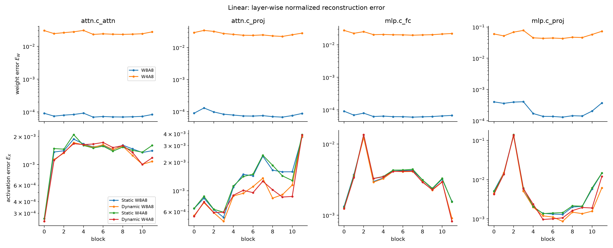

**Analysis.**

- **W4 vs W8 weight error:** $E_W$ is ≈330× larger at W4, matching the $(127/7)^2 \approx 324$ growth expected from an 18× larger step. `mlp.c_proj` has the largest weight error because its heavier-tailed columns stretch the per-channel scale.
- **Activation error:** `mlp.c_proj` inputs (GELU outputs) are worst (≈1.5×10⁻²), and block 2's MLP reaches $E_X\approx0.13$. A few outlier channels stretch the single per-tensor scale, leaving few integer levels for normal values. $E_X$ is nearly identical at W8 and W4 because the A8 quantizer is the same.
- **Static vs dynamic:** dynamic ranges fit each input instead of the worst case over 128 calibration sequences, lowering $E_X$ (≈25% on `attn.c_proj`, ≈9% on `mlp.c_proj`). At W8 this cuts ΔPPL by ≈19% (4.58 → 3.71); at W4 only by ≈7% (53.4 → 49.7), because weight error dominates. Dynamic is slower because of the per-pass min/max reductions. Dynamic ranges cannot remove outliers that appear in almost every input — this motivates SmoothQuant.

**Hardware and theoretical analysis.** Apple MPS has no INT8/INT4 matmul path for these layers, so all runs are **simulated** and the latency is not a real speed-up. If real integer kernels were used (45 nm energy estimates from Horowitz, ISSCC 2014: FP32 MAC ≈ 4.6 pJ, INT8 MAC ≈ 0.3 pJ, DRAM ≈ 160 pJ/byte):

| Config | Total GMACs | INT GMACs | FP32 GMACs | Extra quant ops (M) | Weight bytes/pass (MB) | Arith. energy (mJ) | pJ/MAC | pJ/FLOP | Weight DRAM energy (mJ) |
|---|---|---|---|---|---|---|---|---|---|
| FP32 | 16.114 | 0 | 16.114 | 0 | 497.8 | 74.13 | 4.60 | 2.30 | 79.64 |
| Static W8A8 | 16.114 | 10.872 | 5.242 | 54.3 | 243.0 | 27.38 | 1.70 | 0.85 | 38.87 |
| Dynamic W8A8 | 16.114 | 10.872 | 5.242 | 70.8 | 243.0 | 27.38 | 1.70 | 0.85 | 38.87 |
| Static W4A8 | 16.114 | 10.872 | 5.242 | 54.3 | 200.5 | 27.38 | 1.70 | 0.85 | 32.08 |
| Dynamic W4A8 | 16.114 | 10.872 | 5.242 | 70.8 | 200.5 | 27.38 | 1.70 | 0.85 | 32.08 |

MACs stay 16.11 G — quantization changes arithmetic precision, not the operation count. 10.87 G (67.5%) would become integer MACs; the FP32 vocabulary head (4.94 GMACs, 154 MB) limits the total saving. Quantization adds 54–71 M element-wise operations per pass (< 0.5% of MACs).

### 2.2 SmoothQuant and outlier analysis

**Before smoothing (original model, blocks 0 / 5 / 11, 8 validation sequences).**

| Layer | X max | X p99 | X top/median channel | W max | W p99 | W top/median channel | E_X static | E_W W4 |
|---|---|---|---|---|---|---|---|---|
| h.0.attn.c_attn | 0.80 | 0.32 | 2.2 | 2.84 | 0.66 | 2.8 | 0.0003 | 0.030 |
| h.0.mlp.c_proj | 11.07 | 0.71 | 8.2 | 6.14 | 0.23 | 21.5 | 0.0051 | 0.060 |
| h.5.attn.c_attn | 8.22 | 0.96 | 9.9 | 1.39 | 0.36 | 2.5 | 0.0016 | 0.023 |
| h.5.mlp.c_fc | 11.23 | 0.66 | 17.6 | 1.96 | 0.34 | 3.8 | 0.0043 | 0.020 |
| h.11.attn.c_proj | 13.63 | 1.87 | 11.4 | 8.88 | 0.46 | 9.4 | 0.0039 | 0.028 |
| h.11.mlp.c_proj | 29.48 | 1.28 | 18.8 | 9.21 | 0.54 | 12.9 | 0.0137 | 0.073 |

(Full 12-layer table in the notebook.)

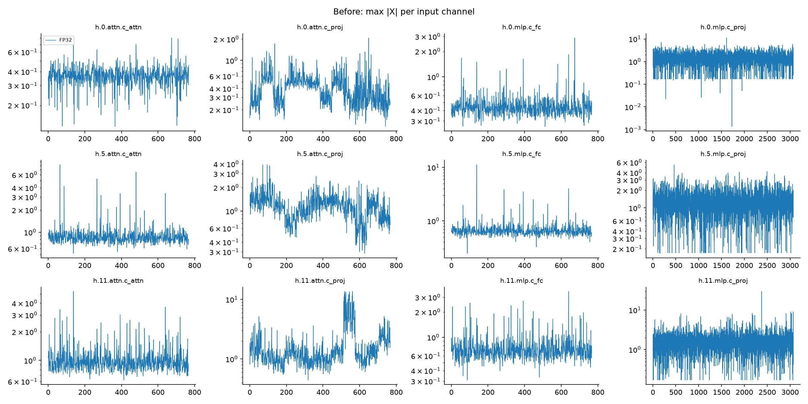
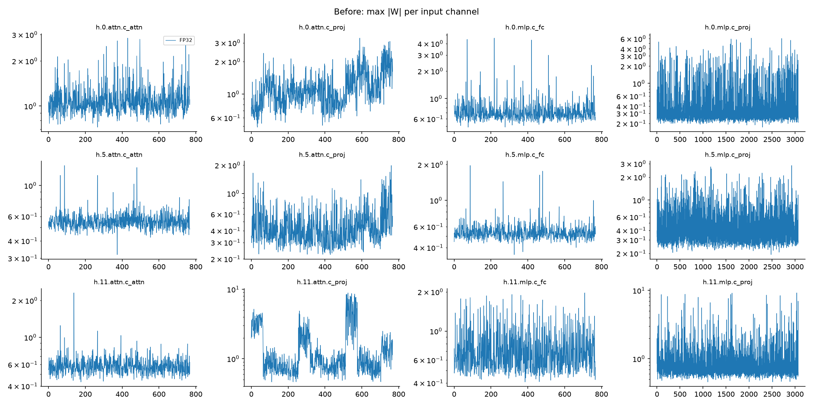
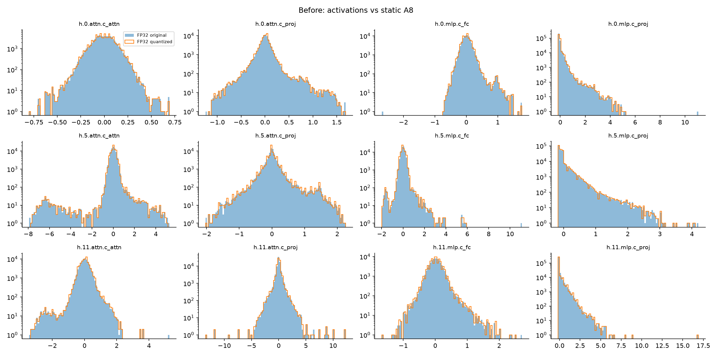
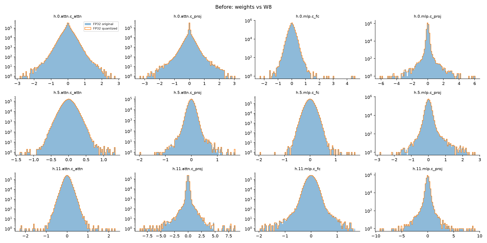

**Findings.** A few **activation channels dominate**: the max is 8–23× the 99th percentile, and the top channel is up to 18.8× the median channel (h.11.mlp.c_proj). h.5.attn.c_attn even shows a separate cluster of values at −6 to −8. **Weights have milder outliers** (top/median 2.5–7.5 for most layers; only `mlp.c_proj` and h.11.attn.c_proj stand out), and per-channel scaling handles them ($E_W$ at W8 ≈ 10⁻⁴).

**Transformation.** For $Y = XW + b$ and $D = \mathrm{diag}(s)$:

$$X' = XD^{-1},\qquad W' = DW,\qquad s_j = \frac{(\max|X_{:j}| + \epsilon)^{\alpha}}{(\max|W_{j:}| + \epsilon)^{1-\alpha}},\qquad X'W' + b = XW + b$$

Activation maxima come from the 128 calibration blocks only ($\epsilon = 10^{-5}$).

| Projection | Where $1/s$ is applied | Runtime cost |
|---|---|---|
| `attn.c_attn` | Folded into `ln_1` weight and bias (Q, K, V share one weight, so all three branches are scaled together) | None |
| `mlp.c_fc` | Folded into `ln_2` weight and bias | None |
| `attn.c_proj` | Explicit runtime division of the input (no preceding LayerNorm) | Included in profiling |
| `mlp.c_proj` | Explicit runtime division (GELU is non-linear, cannot fold) | Included in profiling |

**Floating-point equivalence (before quantization, 4 fixed validation blocks).**

| α | max \|Δ logits\| | Relative error ‖Δ‖/‖ref‖ |
|---|---|---|
| 0.25 | 9.2e-4 | 6.1e-7 |
| 0.50 | 5.0e-4 | 4.8e-7 |
| 0.75 | 7.6e-4 | 5.7e-7 |

The transformation is exact up to FP32 rounding.

**α selection (validation PPL; static ranges recalibrated after smoothing).**

| Config | α = 0.25 | α = 0.5 | α = 0.75 | Chosen α |
|---|---|---|---|---|
| Static W8A8 | 1044.05 | 81.23 | **72.79** | 0.75 |
| Dynamic W8A8 | 768.50 | 80.99 | **72.75** | 0.75 |
| Static W4A8 | 1323.29 | **152.52** | 191.91 | 0.50 |
| Dynamic W4A8 | 992.63 | **148.96** | 197.85 | 0.50 |

**Results (test).**

| Config | Acc | NLL | PPL | ΔPPL | Size (MB) | Packed (MB) | Latency (ms) | Peak GPU (MB) |
|---|---|---|---|---|---|---|---|---|
| Static W8A8 | 29.17% | 4.286 | **72.66** | +0.89 | 243.6 | 243.5 | 15.88 | 609.8 |
| Dynamic W8A8 | 29.15% | 4.285 | **72.58** | +0.82 | 243.5 | 243.5 | 18.13 | 609.8 |
| Static W4A8 | 21.90% | 5.023 | 151.79 | +80.03 | 243.6 | 201.0 | 16.05 | 609.8 |
| Dynamic W4A8 | 22.14% | 4.999 | 148.26 | +76.49 | 243.5 | 201.0 | 17.60 | 609.8 |

**After smoothing (α = 0.75), same validation sequences.**

| Layer | X max (before → after) | X top/median ch | W max (before → after) | Static clip % | E_X static | E_W W4 |
|---|---|---|---|---|---|---|
| h.5.attn.c_attn | 8.22 → 1.73 | 9.9 → 2.5 | 1.39 → 5.62 | 0 → 0 | 0.0016 → 0.0003 | 0.023 → 0.049 |
| h.5.mlp.c_fc | 11.23 → 1.64 | 17.6 → 2.5 | 1.96 → 4.39 | 0 → 0 | 0.0043 → 0.0002 | 0.020 → 0.069 |
| h.5.mlp.c_proj | 5.47 → 1.72 | 4.6 → 2.9 | 2.84 → 4.94 | 11.1 → 0 | 0.0013 → 0.0007 | 0.044 → 0.052 |
| h.11.attn.c_proj | 13.63 → 3.29 | 11.4 → 4.7 | 8.88 → 35.76 | 0 → 0 | 0.0039 → 0.0010 | 0.028 → 0.035 |
| h.11.mlp.c_proj | 29.48 → 3.46 | 18.8 → 5.0 | 9.21 → 57.58 | 41.4 → 0 | 0.0137 → 0.0017 | 0.073 → 0.094 |

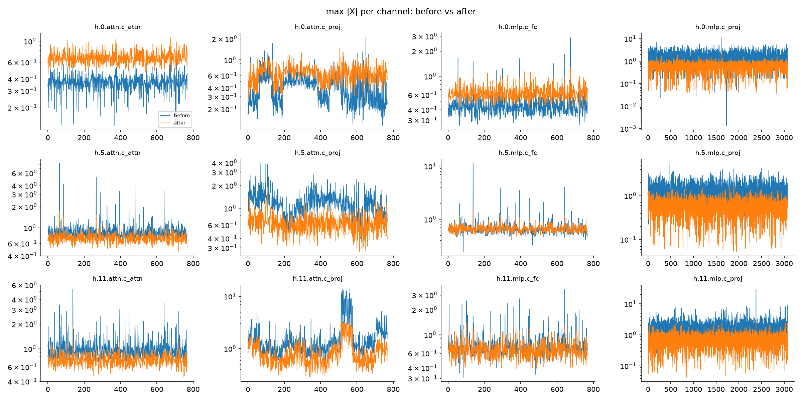
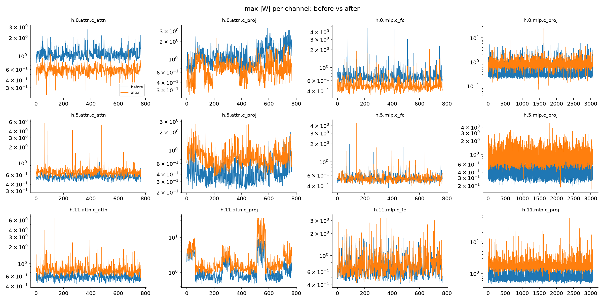
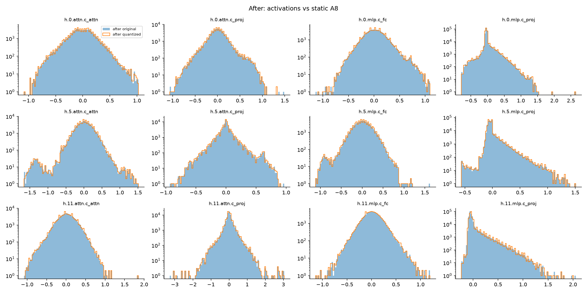
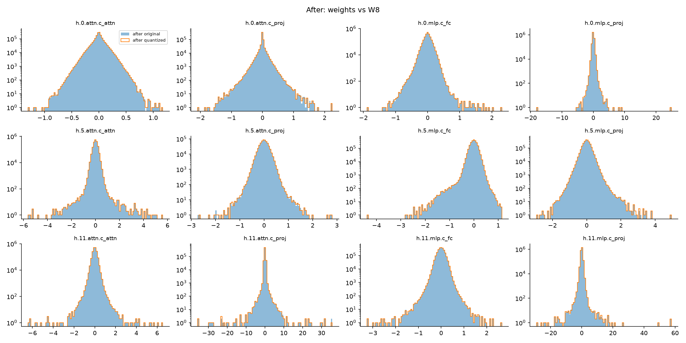
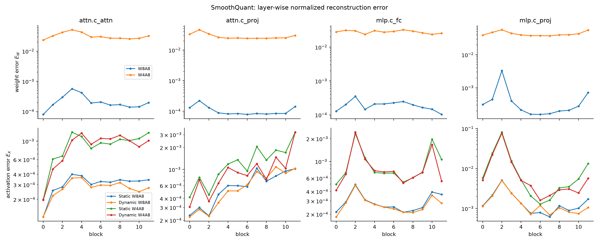

**Linear PTQ vs SmoothQuant (all 48 layers).**

| Config | Mean $E_X$ Linear → SQ | Mean $E_W$ Linear → SQ | Test PPL Linear → SQ |
|---|---|---|---|
| Static W8A8 | 0.0056 → **0.0007** | 0.00012 → 0.00027 | 76.35 → **72.66** |
| Dynamic W8A8 | 0.0051 → **0.0007** | 0.00012 → 0.00027 | 75.47 → **72.58** |
| Static W4A8 | 0.0058 → 0.0042 | 0.0322 → 0.0331 | 125.13 → 151.79 |
| Dynamic W4A8 | 0.0054 → 0.0037 | 0.0322 → 0.0331 | 121.50 → 148.26 |

**Analysis.**

- **Why it works at W8A8.** Smoothing flattens the outlier channels (top/median ratio 17.6 → 2.5 in h.5.mlp.c_fc), so one per-tensor scale fits all channels: mean $E_X$ drops ≈8×. Weight error doubles but stays tiny (≈3×10⁻⁴), so the trade is very favourable — ΔPPL falls from 4.58 to 0.89 (static) and 3.71 to 0.82 (dynamic), removing ≈80% of the loss.
- **α trade-off.** Larger α moves more difficulty into the weights. α = 0.75 is best at W8 because 8-bit weights absorb the extra range easily. α = 0.25 is catastrophic (PPL ≈ 1000): with small α, $s_j \approx 1/\max|W_j|^{0.75}$, so channels with large weights get $s<1$ and their activations are *amplified*, creating new outliers.
- **Why it fails at W4A8.** At 4 bits, weight error (≈3×10⁻²) is already ≈10× larger than activation error, so it dominates. Smoothing raises weight range (W max 9.2 → 57.6 in h.11.mlp.c_proj), which costs more than the activation gain saves; even the best α (0.5) is worse than no smoothing. **Answer to the experimental extension: no gain at W4A8.**
- **Range selection vs scaling.** Switching static → dynamic lowers $E_X$ by only ≈9% (it chooses a different grid for the *same* tensor). SmoothQuant lowers $E_X$ by ≈8× because it *changes the tensor itself*. After smoothing, the static–dynamic PPL gap shrinks from 0.88 to 0.08.
- **Clipping.** The large static clip fractions before smoothing (41% in h.11.mlp.c_proj, 11% in h.5.mlp.c_proj) come from GELU outputs sitting at its minimum (≈ −0.17) just below the zero-point-rounded lower bound; each value is clipped by less than one step, so the count is large but the error is small. After smoothing these fall to ≈0%.
- **Runtime.** SmoothQuant is slower than Linear PTQ (15.9 vs 14.8 ms static) because the 24 `c_proj` inputs are divided at runtime — extra element-wise GPU kernels. The `c_attn`/`c_fc` scales are free (folded into LayerNorm). Storage grows by 0.19 MB for the stored scale vectors.

### 2.3 GPTQ and reconstruction analysis

**Distribution analysis before quantization** is identical to the "before smoothing" analysis above (same original model, blocks and statistics).

**Objective and Hessian.**

$$\min_{\hat W}\ \lVert XW - X\hat W\rVert_F^2,\qquad H = 2X^\top X + \lambda I$$

**Implementation.**

| Item | Choice |
|---|---|
| Calibration inputs | The same 128 training blocks; $H$ accumulated from each projection's inputs |
| Layer order | 48 projections in execution order; each layer's inputs come from a model whose **earlier layers are already GPTQ-quantized** |
| Column order | Input channels in natural order 0 … in−1 |
| Block size | 128 columns (lazy batch updates, as in the paper [7]) |
| Damping | $\lambda = 0.01 \cdot \mathrm{mean}(\mathrm{diag}\,H)$ |
| Stabilization | Dead inputs ($H_{jj}=0$) set to 1 and their weights zeroed; Cholesky in float64; upper Cholesky factor of $H^{-1}$ |
| Grid | Same per-output-channel scales and integer grid as linear PTQ — only the integer values change |
| Activations | 2.1 A8 quantizer; static ranges calibrated on the GPTQ-weight model |

**How $H^{-1}$ guides compensation.** Each column is rounded to the grid; its error is divided by the corresponding diagonal of the Cholesky factor of $H^{-1}$ and subtracted from all not-yet-quantized columns, weighted by the matching row of $H^{-1}$. Inside a 128-column block this update is applied column by column; at the end of the block, the accumulated errors are applied to all later columns in one matrix product. Directions where calibration inputs are large (large $H$) are corrected strongly; directions where inputs are near zero barely affect the output and receive little correction.

**GPTQ cost.**

| | W8 | W4 |
|---|---|---|
| GPTQ time (calibration + reconstruction) | 89.8 s | 92.8 s |
| Peak GPU allocated during GPTQ | 2,354.5 MB* | 2,354.5 MB* |
| Process RSS at end | 864.9 MB | 349.7 MB |

\* Process-wide on MPS: includes other models resident in the notebook session and the Hessian accumulators.

**RTN vs GPTQ on identical validation inputs (mean over 12 blocks).**

| Precision | Projection | $E_W$ RTN | $E_W$ GPTQ | Output error RTN | Output error GPTQ | Output error reduction |
|---|---|---|---|---|---|---|
| W8 | attn.c_attn | 7.8e-5 | 1.25e-4 | 4.87e-5 | **1.57e-5** | 3.1× |
| W8 | attn.c_proj | 8.3e-5 | 1.34e-4 | 1.64e-4 | **4.72e-5** | 3.5× |
| W8 | mlp.c_fc | 6.7e-5 | 1.06e-4 | 2.38e-5 | **9.77e-6** | 2.4× |
| W8 | mlp.c_proj | 2.5e-4 | 4.03e-4 | 2.67e-4 | **1.03e-4** | 2.6× |
| W4 | attn.c_attn | 2.56e-2 | 3.98e-2 | 1.45e-2 | **5.12e-3** | 2.8× |
| W4 | attn.c_proj | 2.65e-2 | 4.23e-2 | 5.76e-2 | **1.50e-2** | 3.8× |
| W4 | mlp.c_fc | 2.17e-2 | 3.38e-2 | 7.82e-3 | **3.24e-3** | 2.4× |
| W4 | mlp.c_proj | 5.49e-2 | 8.60e-2 | 7.69e-2 | **2.74e-2** | 2.8× |

**Results (test).**

| Config | Acc | NLL | PPL | ΔPPL | Size (MB) | Packed (MB) | Latency (ms) | Peak GPU (MB) |
|---|---|---|---|---|---|---|---|---|
| Static W8A8 | 28.54% | 4.333 | 76.20 | +4.44 | 243.4 | 243.3 | 14.53 | 609.6 |
| Dynamic W8A8 | 28.76% | 4.322 | 75.36 | +3.60 | 243.3 | 243.3 | 16.40 | 609.6 |
| Static W4A8 | 27.12% | 4.475 | **87.77** | +16.00 | 243.4 | 200.8 | 14.32 | 609.6 |
| Dynamic W4A8 | 27.32% | 4.456 | **86.12** | +14.36 | 243.3 | 200.8 | 16.45 | 609.6 |

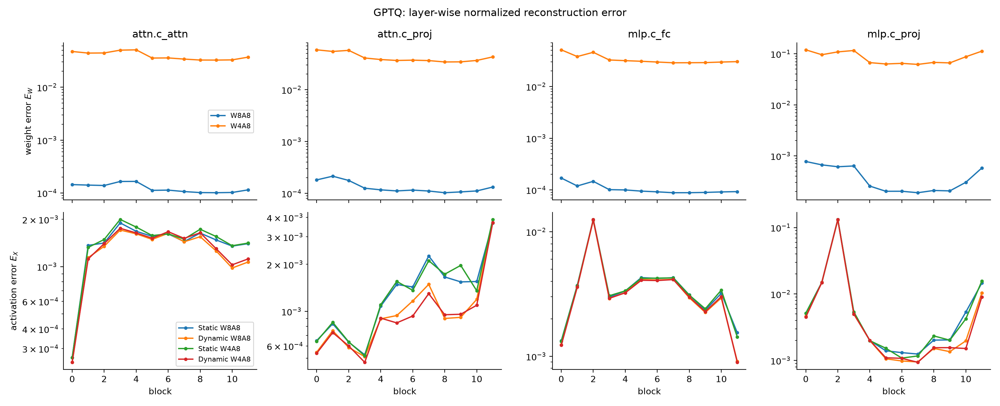

**Activation error and clipping after A8** on the GPTQ-weight models are essentially unchanged from linear PTQ (mean $E_X$ 0.0056 static / 0.0052 dynamic; clipping ≈41% in h.11.mlp.c_proj from the same GELU zero-point effect), because GPTQ changes only weights.

**Analysis.**

- **Output error, not weight error, is the objective.** GPTQ raises individual weight error ≈1.6× but lowers layer-output error 2.4–3.8×. It deliberately moves weights away from their nearest grid point so that rounding errors cancel along the input directions that matter (large $H$).
- **Large gain at W4A8:** PPL 125.1 → 87.8 (static) and 121.5 → 86.1 (dynamic), removing ≈70% of the linear-PTQ loss; accuracy 27.1–27.3% vs 23.9–24.2%.
- **Little gain at W8A8** (76.20 vs 76.35): 8-bit weight error is already tiny, and the result is limited by **activation error**, which GPTQ does not touch. SmoothQuant fixes that part and wins at W8A8.
- **No runtime cost:** GPTQ only changes weight values offline, so size, MACs and execution path are identical to linear PTQ (latency 14.3–16.4 ms, within run-to-run noise of linear PTQ).

### 2.4 Consolidated results

All 12 quantized configurations use **simulated** quantize-dequantize operations around FP32 kernels on Apple MPS. 4-bit weights are **not packed** (int8 storage). The full table with every column is in `results/task2_final_table.csv`.

| Config | Acc | NLL | PPL | Size (MB) | Packed (MB, theory) | GMACs | GFLOPs | INT ops (G, theory) | FP32 FLOPs (G, theory) | Latency (ms) | Throughput (tok/s) | Peak GPU (MB) | Energy |
|---|---|---|---|---|---|---|---|---|---|---|---|---|---|
| FP32 | 29.28% | 4.273 | 71.76 | 497.8 | – | 16.11 | 32.23 | 0 | 32.23 | 13.54 | 9,455 | 524.4 | n/a |
| Linear Static W8A8 | 28.50% | 4.335 | 76.35 | 243.4 | 243.3 | 16.11 | 32.23 | 21.74 | 10.49 | 14.82 | 8,640 | 609.6 | n/a |
| Linear Dynamic W8A8 | 28.75% | 4.324 | 75.47 | 243.3 | 243.3 | 16.11 | 32.23 | 21.74 | 10.49 | 19.60 | 6,529 | 609.6 | n/a |
| Linear Static W4A8 | 23.94% | 4.829 | 125.13 | 243.4 | 200.8 | 16.11 | 32.23 | 21.74 | 10.49 | 15.20 | 8,422 | 609.6 | n/a |
| Linear Dynamic W4A8 | 24.18% | 4.800 | 121.50 | 243.3 | 200.8 | 16.11 | 32.23 | 21.74 | 10.49 | 16.86 | 7,592 | 609.6 | n/a |
| SmoothQuant Static W8A8 | 29.17% | 4.286 | **72.66** | 243.6 | 243.5 | 16.11 | 32.23 | 21.74 | 10.49 | 15.88 | 8,062 | 609.8 | n/a |
| SmoothQuant Dynamic W8A8 | 29.15% | 4.285 | **72.58** | 243.5 | 243.5 | 16.11 | 32.23 | 21.74 | 10.49 | 18.13 | 7,060 | 609.8 | n/a |
| SmoothQuant Static W4A8 | 21.90% | 5.023 | 151.79 | 243.6 | 201.0 | 16.11 | 32.23 | 21.74 | 10.49 | 16.05 | 7,977 | 609.8 | n/a |
| SmoothQuant Dynamic W4A8 | 22.14% | 4.999 | 148.26 | 243.5 | 201.0 | 16.11 | 32.23 | 21.74 | 10.49 | 17.60 | 7,273 | 609.8 | n/a |
| GPTQ Static W8A8 | 28.54% | 4.333 | 76.20 | 243.4 | 243.3 | 16.11 | 32.23 | 21.74 | 10.49 | 14.53 | 8,808 | 609.6 | n/a |
| GPTQ Dynamic W8A8 | 28.76% | 4.322 | 75.36 | 243.3 | 243.3 | 16.11 | 32.23 | 21.74 | 10.49 | 16.40 | 7,805 | 609.6 | n/a |
| GPTQ Static W4A8 | 27.12% | 4.475 | **87.77** | 243.4 | 200.8 | 16.11 | 32.23 | 21.74 | 10.49 | 14.32 | 8,941 | 609.6 | n/a |
| GPTQ Dynamic W4A8 | 27.32% | 4.456 | **86.12** | 243.3 | 200.8 | 16.11 | 32.23 | 21.74 | 10.49 | 16.45 | 7,783 | 609.6 | n/a |

**Best method per setting.**

| Setting | Best | PPL | ΔPPL vs FP32 | Why |
|---|---|---|---|---|
| Static W8A8 | SmoothQuant | 72.66 | +0.89 | Activation outliers are the bottleneck |
| Dynamic W8A8 | SmoothQuant | 72.58 | +0.82 | Same |
| Static W4A8 | GPTQ | 87.77 | +16.00 | Weight error is the bottleneck |
| Dynamic W4A8 | GPTQ | 86.12 | +14.36 | Same |

**Trade-offs.**

- **Accuracy:** W8A8 is nearly free with SmoothQuant; W4A8 always costs accuracy, and GPTQ removes most of it.
- **Storage (measured):** 497.8 → 243.4 MB (−51%) for all 12 configs. Packed W4 would be 200.8 MB (−60%), **theory only**. The FP32 embedding / vocabulary head (154 MB) limits the saving.
- **Operations:** MACs stay 16.11 G. With integer kernels, 21.74 G operations would be integer arithmetic and 10.49 G would remain conventional FP32 FLOPs (vocabulary head and attention matmuls).
- **Runtime (measured, simulated):** no configuration is faster than FP32. No speed-up is claimed from bit-width.
- **Energy:** not measurable on this platform; in theory arithmetic energy falls 74.1 → 27.4 mJ per pass and weight-memory energy 79.6 → 38.9 mJ (W8) / 32.1 mJ (W4).

**Overheads.**

| Overhead | When | Cost |
|---|---|---|
| Static calibration | Offline, once | 128 calibration blocks to record min/max (and per-channel max for SmoothQuant) |
| Dynamic range estimation | Every forward pass | min/max reduction over each of 48 projection inputs (+1.5–5 ms measured) |
| SmoothQuant scaling | Every forward pass | Division of 24 `c_proj` inputs by $s$; `c_attn`/`c_fc` scales folded (free) |
| GPTQ reconstruction | Offline, once | ≈90 s per bit-width + Hessian memory |
| Fake quantization | Every forward pass | Quantize-dequantize of every projection input (simulation only) |

---

## Task 3 — QAT on ResNet-18 / CIFAR-10

### 3.1 Model setup

| Item | Value |
|---|---|
| Checkpoint | `edadaltocg/resnet18_cifar10` [9] — timm ResNet-18 with 3×3 stem, no max-pool |
| Preprocessing | `ToTensor` + normalize, mean (0.4914, 0.4822, 0.4465), std (0.2023, 0.1994, 0.2010) |
| Input | 3 × 32 × 32 |
| Split | 45,000 train / 5,000 validation from the CIFAR-10 training set (seed 42); 10,000 test held out |
| Independence | `load_resnet()` returns a fresh copy of the checkpoint for every experiment; identical split and budget for W8A8 and W4A8 |

**FP32 baseline.**

| Split | Loss | Top-1 | Top-5 | Macro-F1 |
|---|---|---|---|---|
| Train (45k) | 0.0008 | 99.998% | 100.00% | 1.0000 |
| Validation (5k) | 0.0007 | 100.00% | 100.00% | 1.0000 |
| **Test (10k)** | 0.2042 | **94.98%** | **99.86%** | **0.9498** |

Test accuracy matches the model card (94.98%). Train and validation are ≈100% because the public checkpoint was trained on all 50,000 CIFAR-10 training images, so the validation split is not unseen by the original model.

### 3.2 QAT implementation

| Item | Choice |
|---|---|
| Quantized layers | All `Conv2d` (stem, 16 block convs, 3 downsample convs) and the `Linear` classifier — weights and input activations; biases FP32 |
| Weights | Symmetric per-output-channel, $S = \max|W_c| / (2^{b-1}-1)$, recomputed each step from FP32 master weights |
| Activations | Asymmetric per-tensor uint8 with a min/max observer |
| Master weights | FP32 weights are updated by the optimizer; the forward pass uses their fake-quantized copy |
| Observers | Initialized from 20 training batches (running min/max), updated by EMA (momentum 0.9) during epochs 1–2 (training batches only), **frozen from epoch 3** and for final evaluation |
| BatchNorm | Kept separate in FP32, **not folded**; running statistics update during fine-tuning |
| Optimizer | SGD, momentum 0.9, weight decay 5×10⁻⁴ |
| Learning rate | 1×10⁻³ with cosine decay |
| Epochs / batch size | 5 / 128 |
| Augmentation | RandomCrop(32, padding 4) + RandomHorizontalFlip (training only) |
| Checkpoint selection | Best validation Top-1, ties broken by lowest validation loss (validation only) |
| Seed | 42 |
| Training time | **6.4 min (W8A8)**, **6.3 min (W4A8)** on MPS |
| Best epoch | 2 (W8A8), 5 (W4A8) |
| Evaluation | Observers frozen; fake quantization enabled (**simulated**) |

**Fake quantization with a straight-through estimator.**

$$\text{forward: } \hat x = S\big(\mathrm{clip}(\mathrm{round}(x/S) + Z,\ q_{min},\ q_{max}) - Z\big)$$

$$\text{backward (STE): } \frac{\partial \mathcal L}{\partial x} = \frac{\partial \mathcal L}{\partial \hat x}\cdot \mathbb 1\big[q_{min} \le x/S + Z \le q_{max}\big]$$

Rounding has zero gradient almost everywhere, so the STE treats it as the identity **inside the clipping range** (gradient passes unchanged) and sets the gradient to **0 outside it** (a clipped value does not change the output for small changes of the input). Weight scales use the per-channel maximum, so weights are never clipped and always receive the full gradient.

**Training history.**

| Epoch | W8A8 train loss | W8A8 val loss | W8A8 val acc | W4A8 train loss | W4A8 val loss | W4A8 val acc | Observers |
|---|---|---|---|---|---|---|---|
| 1 | 0.0026 | 0.0008 | 100.00% | 0.0038 | 0.0008 | 100.00% | EMA |
| 2 | 0.0024 | 0.0007 | 100.00% | 0.0035 | 0.0010 | 99.98% | EMA |
| 3 | 0.0024 | 0.0008 | 100.00% | 0.0026 | 0.0008 | 100.00% | frozen |
| 4 | 0.0027 | 0.0008 | 100.00% | 0.0028 | 0.0008 | 100.00% | frozen |
| 5 | 0.0022 | 0.0008 | 100.00% | 0.0028 | 0.0008 | 100.00% | frozen |

### 3.3 Results and profiling

Profiling uses the Task 1 methodology: batch 1, input 3×32×32, 10 warm-up + 30 timed passes with MPS synchronization. Peak GPU memory counts only the profiled model (memory held by other objects in the session is subtracted).

| Metric | FP32 | W8A8 QAT | W4A8 QAT |
|---|---|---|---|
| Train Top-1 | 99.998% | 100.00% | 99.996% |
| **Test Top-1** | **94.98%** | **94.78%** | **94.86%** |
| Test Top-5 | 99.86% | 99.87% | 99.87% |
| Test Macro-F1 | 0.9498 | 0.9478 | 0.9486 |
| Parameters | 11.17 M | 11.17 M | 11.17 M |
| QAT checkpoint (FP32 master + observers) | 44.77 MB | 44.79 MB | 44.79 MB |
| **Integer export (actual)** | 44.77 MB | **11.32 MB** | **11.32 MB** |
| Packed size (theory) | – | 11.26 MB | **5.68 MB** |
| MACs / FLOPs | 0.555 G / 1.111 G | 0.555 G / 1.111 G | 0.555 G / 1.111 G |
| Latency | 3.81 ± 2.74 ms | 14.80 ± 0.41 ms | 14.96 ± 0.56 ms |
| Throughput | 262.6 img/s | 67.6 img/s | 66.9 img/s |
| Peak GPU allocated | 45.8 MB | 45.8 MB | 45.8 MB |
| Process RSS | 795.6 MB | 773.0 MB | 830.0 MB |
| CPU utilization (one core) | 76.9% | 50.4% | 51.5% |
| GPU utilization / energy | unavailable | unavailable | unavailable |
| Execution | FP32 kernels | **Simulated** | **Simulated** |

The integer export stores int8 weights (4-bit values unpacked in int8), per-channel FP32 weight scales, per-tensor activation scale + uint8 zero-point, FP32 biases and FP32 BatchNorm.

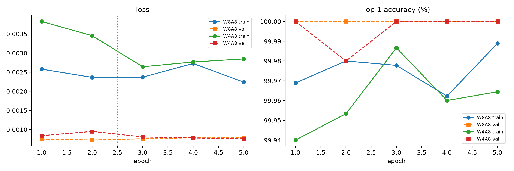

**Layer-wise reconstruction error** (frozen quantizers, 4 fixed validation batches). $E_W$ is measured against the FP32 master weights (and against the original pretrained weights), before fake quantization.

| Layer | W8A8 $E_W$ | W8A8 $E_X$ | W4A8 $E_W$ | W4A8 $E_X$ |
|---|---|---|---|---|
| conv1 | 3.2e-5 | 2.3e-5 | 1.01e-2 | 2.3e-5 |
| layer1.0.conv1 | 1.9e-4 | 1.8e-4 | 5.21e-2 | 1.6e-4 |
| layer2.0.downsample.0 | 6.1e-5 | 1.7e-4 | 2.00e-2 | 1.7e-4 |
| layer3.1.conv2 | 1.2e-4 | 3.1e-4 | 3.89e-2 | 2.7e-4 |
| layer4.0.conv1 | 1.3e-4 | 5.9e-4 | 4.17e-2 | 5.0e-4 |
| layer4.1.conv1 | 2.2e-4 | 1.9e-4 | 7.10e-2 | 1.9e-4 |
| fc | 1.1e-4 | 9.3e-5 | 3.93e-2 | 1.0e-4 |

(Full 21-layer table, including $E_W$ vs pretrained weights, in the notebook.)

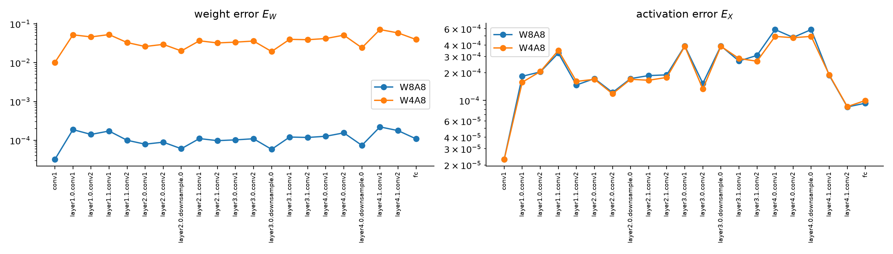

### 3.4 Analysis

**Accuracy and Macro-F1.** Both QAT models stay within 0.2 points of FP32 (Top-1 94.78% and 94.86% vs 94.98%; Macro-F1 0.9478 and 0.9486 vs 0.9498; Top-5 unchanged). The W8A8 vs W4A8 difference is 8 of 10,000 test images — noise. Both are equivalent to FP32.

**Convergence.** The curves show that W8A8 needs almost no adaptation (training loss ≈ 0.0023 throughout). W4A8 starts 46% higher (0.0038 vs 0.0026) and converges to the W8A8 level by epoch 3, right after the observers freeze. Validation accuracy saturates at ≈100% because the checkpoint was trained on the full training set, so the test set is the only truly held-out measure.

**Quantization error.** W4 weight error is ≈300× larger than W8 (≈4×10⁻² vs ≈1×10⁻⁴), yet accuracy is the same: QAT adapts the master weights and BatchNorm to the rounding it sees in every forward pass. Activation error is the same for both (≈10⁻⁴), since both use the same A8 quantizer; it is lowest at `conv1` (normalized images) and highest in `layer4` (wider post-ReLU ranges).

**Storage.** The integer export is 44.77 → 11.32 MB (−75%) for both. 4-bit weights are stored unpacked in int8; packed W4 would be 5.68 MB (−87%), theory only.

**Latency, memory, energy.** Inference is simulated, so QAT models are ≈4× slower (14.8–15.0 ms vs 3.8 ms) because of per-layer quantize-dequantize work and per-step scale computation. MACs (0.555 G) and FLOPs (1.111 G) are unchanged. Peak GPU memory is the same (≈45.8 MB) because simulated QAT still uses FP32 tensors. Energy is unavailable on macOS; real INT8 kernels would lower arithmetic and memory energy, but this is not measured.

**Training cost.** QAT needs fine-tuning (5 epochs per model): 6.4 min (W8A8) and 6.3 min (W4A8) on MPS. PTQ needs none.

**Conclusion.** QAT keeps both W8A8 and W4A8 at FP32-level accuracy while cutting real storage by 75%. Unlike 4-bit PTQ on GPT-2 (ΔPPL +14 to +80), training with quantization in the loop lets the model recover from the much larger 4-bit weight error.

---

## Requirement coverage

| Requirement | Where |
|---|---|
| Fixed 128-token blocks, discarded tokens, 127 targets, fixed seed | Experimental setup, `setup_record.json` |
| Architecture, order of operations, quantization scope, Conv1D check | §1.1 |
| Accuracy, NLL, PPL, scored targets (summed loss) | §1.2 |
| Size, MACs/FLOPs breakdown + convention, latency, throughput, memory, utilization, energy, environment | §1.3 |
| Quantizers, observers, static/dynamic ranges, zero-range safety | §2.1 |
| Integer projection derivation (INT32 accumulation, zero-point correction, rescale, FP32 bias) + numerical check | §2.1 |
| 4 configs × profiling, scale/zero-point storage, theoretical MACs/memory/energy | §2.1, §2.4 |
| Layer-wise $E_W$ / $E_X$, static vs dynamic explanation | §2.1 |
| Outlier analysis blocks 0/5/11 (histograms, channel max, max, p99) | §2.2 |
| Smoothing scales, where folded / explicit, equivalence check | §2.2 |
| α ∈ {0.25, 0.5, 0.75} on validation, recalibration, 4 configs | §2.2 |
| Before/after ranges, outliers, clipping, errors; range selection vs scaling | §2.2 |
| GPTQ: H, damping, blocks of 128, ordering, stabilization, same grid | §2.3 |
| GPTQ time and peak memory; RTN vs GPTQ weight + output error; A8 error + clipping | §2.3 |
| One 13-row table, best method per precision, trade-offs, execution/storage labelling | §2.4 |
| Checkpoint source, FP32 baseline, fixed split, independent runs | §3.1 |
| Fake quant + STE, per-channel/per-tensor, observers, BatchNorm, selection, settings | §3.2 |
| Train/test Top-1, Top-5, Macro-F1, storage, profiling, layer errors, curves | §3.3 |
| Accuracy, convergence, errors, storage, latency, memory, energy, training cost | §3.4 |

---

## Figure index

| Figure | File | Shows |
|---|---|---|
| GPT-2 overview | `figures/t11_model_overview.png` | Embeddings → 12 blocks → tied head |
| One block | `figures/t11_block_diagram.png` | Order of operations, quantized projections |
| Parameter breakdown | `figures/t11_param_breakdown.png` | 68.3% of parameters quantized |
| NLL by position | `figures/t12_nll_by_position.png` | Effect of context length |
| MAC breakdown | `figures/t13_mac_breakdown.png` | Compute per component |
| Linear PTQ errors | `figures/t21_layer_errors.png` | $E_W$, $E_X$ per block |
| Channel max (before) | `figures/t22_before_x_ch.png`, `t22_before_w_ch.png` | Activation and weight outliers |
| Histograms (before / after) | `figures/t22_before_*_hist.png`, `t22_after_*_hist.png` | Tensor vs quantized approximation |
| Channel max (before vs after) | `figures/t22_x_ch_compare.png`, `t22_w_ch_compare.png` | Effect of smoothing |
| SmoothQuant / GPTQ errors | `figures/t22_layer_errors.png`, `t23_layer_errors.png` | $E_W$, $E_X$ per block |
| PPL comparison | `figures/t24_ppl_comparison.png` | All 12 configs vs FP32 |
| QAT curves | `figures/t33_training_curves.png` | Loss and accuracy per epoch |
| QAT errors | `figures/t33_layer_errors.png` | $E_W$, $E_X$ per layer |

---

## Limitations

- **Simulated execution:** Apple MPS has no INT8/INT4 matmul path for these layers; all quantized results use fake quantization around FP32 kernels. Storage reductions are measured; speed-ups are not claimed.
- **Power and energy:** unavailable on macOS without administrator access; `powermetrics` would report whole-chip power only.
- **Memory:** MPS has no peak-memory counter, so peak allocation is sampled after every module. Process RSS is the process lifetime peak. The GPTQ peak (2.35 GB) is process-wide.
- **Validation saturation in Task 3:** the public ResNet-18 checkpoint was trained on the full CIFAR-10 training set, so validation accuracy is ≈100% and checkpoint selection relies on the validation-loss tie-break.
- **Perplexity level:** 128-token blocks with `<|endoftext|>` separators give a higher absolute PPL than 1024-token evaluations; only relative changes between methods matter here.

---

## AI acknowledgment

I have used **Claude (Anthropic)** to explain the assignment concepts,  debug the notebook code.

---

## References

1. A. Radford, J. Wu, R. Child, D. Luan, D. Amodei, I. Sutskever. *Language Models are Unsupervised Multitask Learners.* OpenAI, 2019.
2. OpenAI. *GPT-2: Official Code and Pretrained Models.* https://github.com/openai/gpt-2
3. Hugging Face. *Transformers: GPT-2 PyTorch Implementation.* https://github.com/huggingface/transformers/tree/main/src/transformers/models/gpt2
4. Hugging Face. *GPT-2 Small Pretrained Checkpoint.* https://huggingface.co/openai-community/gpt2
5. S. Merity, C. Xiong, J. Bradbury, R. Socher. *Pointer Sentinel Mixture Models.* ICLR 2017. https://huggingface.co/datasets/Salesforce/wikitext
6. G. Xiao, J. Lin, M. Seznec, H. Wu, J. Demouth, S. Han. *SmoothQuant: Accurate and Efficient Post-Training Quantization for Large Language Models.* ICML 2023. https://arxiv.org/abs/2211.10438
7. E. Frantar, S. Ashkboos, T. Hoefler, D. Alistarh. *GPTQ: Accurate Post-Training Quantization for Generative Pre-trained Transformers.* ICLR 2023. https://arxiv.org/abs/2210.17323
8. PyTorch. *Profiler Documentation.* https://docs.pytorch.org/docs/stable/profiler.html
9. E. Dadalto. *Detectors: Pretrained Models and Preprocessing Utilities.* https://github.com/edadaltocg/detectors — checkpoint: https://huggingface.co/edadaltocg/resnet18_cifar10
10. M. Horowitz. *Computing's Energy Problem (and what we can do about it).* ISSCC 2014 (45 nm energy estimates used in the theoretical analysis).
