# AI624 Assignment 4: Results

**Student:** Muhammad Ahmad  
**Student ID:** 25280065  

**Notebook:** `25280065_PA4_.ipynb` (all tasks, with visible outputs)  
**Figures:** `figures/` · **Result files:** `outputs/` (Task 1), `task2_outputs/` … `task5_outputs/`

### Setup used for all tasks

| Item | Value |
|---|---|
| Hardware | Apple Silicon MacBook Pro, GPU via PyTorch **MPS** backend |
| Software | Python 3.14, PyTorch 2.15.0, torchvision 0.29.2, transformers 5.22.2, peft 0.21.2, datasets 5.2.0, nats_bench 1.8, numpy 2.5.4, pandas 3.1.1, matplotlib 3.11.2 |
| Random seed | 42 (Tasks 1–4); seeds 0, 1, 2 (Task 5) |
| Latency protocol | batch size 1, 10 warm-up runs, 20 timed runs, **median**, GPU synchronized (`torch.mps.synchronize`), input already on device (no data loading) |
| Labels used in tables | **[measured]** = run in the notebook · **[analytical]** = computed from the architecture · **[benchmark]** = looked up from a published benchmark |

---

# Task 1: CNN Knowledge Distillation

**Setup.** Teacher = EfficientNet-B7 (torchvision `IMAGENET1K_V1`, frozen). Student = EfficientNet-B0, random init, 100-class head.
Data = ImageNet-100 (Hugging Face `clane9/imagenet-100`), **fixed stratified subset of 2,000 train (20/class) and 500 val (5/class)**, resized to 224×224, ImageNet normalization, no augmentation.
The teacher's 100 logits are selected from its 1000-way output using the class mapping in `outputs/class_mapping.csv` (ImageNet-100 class order → ImageNet-1K index, matched by class name; e.g. class 0 *bonnet* → 452, class 1 *green mamba* → 64).
Optimizer AdamW (lr 1e-3, wd 1e-4), batch 32, 5 epochs = **315 optimizer updates** per student. KD: T = 3, λ = 0.5, L = (1−λ)·CE + λ·T²·KL(p_T ‖ p_S).

## T1.1: Independent Training and Logit KD

| Model | Top-1 (%) [measured] | Top-5 (%) [measured] | Parameters (M) [analytical] | Latency (ms) [measured] |
|---|---:|---:|---:|---:|
| EfficientNet-B7 teacher (frozen) | **88.4** | **97.8** | 66.35 | 18.74 |
| B0: Cross-entropy (Student A) | 4.4 | 15.6 | 4.14 | 5.50 |
| B0: Logit KD (Student B) | **5.4** | **18.0** | 4.14 | 6.50 |

Both students started from **identical initial weights** (one random B0 state copied into both; checked with an assert) and saw the same batch order.

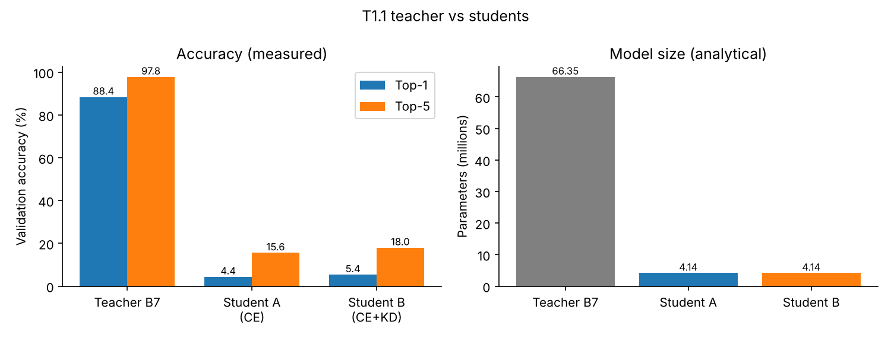
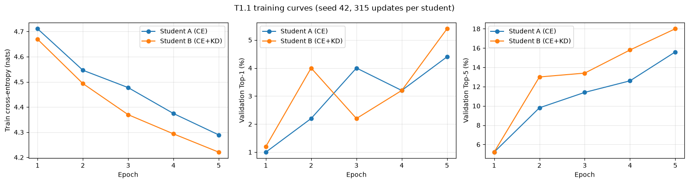

**Answer.**
- **Accuracy:** KD helped a little. Top-1 rose from 4.4% to 5.4% (+1.0 pp) and Top-5 from 15.6% to 18.0% (+2.4 pp). With only 500 validation images (1 image = 0.2%, standard error ≈ ±1.0 pp Top-1, ±1.7 pp Top-5), the Top-1 gain is within noise, but the Top-5 gain is larger and consistent.
- **Convergence:** KD converged faster. Student B's training cross-entropy is lower at **every** epoch (4.67 vs 4.71 at epoch 1, 4.22 vs 4.29 at epoch 5), even though CE is only half of its loss. Its Top-5 is ahead from epoch 2 onwards (13.0% vs 9.8%). Top-1 is noisy for both (0.2% steps), and the curves cross at epochs 2–4. The teacher's soft targets (e.g. "70% dog, 20% wolf") carry more information per example than one-hot labels.
- **Both students stay far below the teacher (88.4%)**, which is expected for a randomly initialized B0 trained on 20 images/class for 315 updates. (The teacher's published accuracy is 84.1% Top-1 on 1000-way ImageNet at 600 px [benchmark]; our 88.4% is 100-way at 224 px, so the two are not directly comparable.)
- **Inference cost:** unchanged. Both students are the same B0 with 4.14 M parameters, so they do exactly the same computation. The latency difference (5.50 vs 6.50 ms) is measurement noise: in another profiling run the order was reversed (6.14 vs 6.83 ms in T1.4; 6.49 vs 6.28 ms earlier). KD only changes the training loss.

## T1.2: Feature Matching Without an Adapter

| Item | Value |
|---|---|
| Teacher layer `features[1]` output | **(B, 32, 112, 112)** [measured] |
| Student layer `features[0]` output | **(B, 32, 112, 112)** [measured] |
| Loss | L = L_KD + 0.05·MSE(h_S, h_T), no adapter |
| Start / budget | T1.1 Student B checkpoint, 2 more epochs = 126 updates |

| Run (from Student B) | Val Top-1 (%) | Val Top-5 (%) | Final hint MSE |
|---|---:|---:|---:|
| Start (T1.1 Student B) | 5.4 | 18.0 | — |
| + 2 epochs KD + hint (T1.2) | 3.2 | 16.2 | 31.93 |
| + 2 epochs KD only (control, same budget) | 5.0 | 17.4 | 32.72 (not trained) |

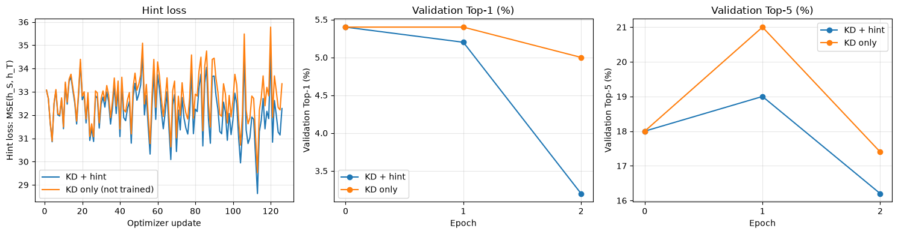

**Answer.**
- **Feature dimensions:** both layers output 32 × 112 × 112, verified before training.
- **Hint loss:** it barely moved (≈32.4 → 31.9) and stayed close to the control run, where the hint is not trained at all (32.7). The student could hardly match the teacher's raw features.
- **Validation accuracy:** the hint run ended at 3.2% Top-1 / 16.2% Top-5, below the KD-only control (5.0% / 17.4%). Direct feature matching hurt slightly.
- **Why they can be compared directly:** both tensors have the same shape and the same spatial resolution (stride 2 from a 224×224 input), so element-wise MSE is defined and position (i, j) in each map looks at roughly the same image region.
- **Same shape ≠ same information.** (1) Channel order is arbitrary: student channel 5 has no reason to detect what teacher channel 5 detects. (2) The depth differs: the teacher output has passed through the stem **and** a block stage, the student's through the stem only. (3) Activation scales come from different BatchNorm statistics. Forcing an exact element-wise copy pushes the student towards the teacher's arbitrary channel layout, which is why it helped nothing here.

## T1.3: Feature Matching With an Adapter

| Item | Value |
|---|---|
| Teacher `features[5]` | **(B, 224, 14, 14)** [measured] |
| Student `features[4]` | **(B, 80, 14, 14)** [measured] |
| Adapter r_θ | 1×1 Conv2d, 80 → 224 channels |
| Adapter output r_θ(h_S) | **(B, 224, 14, 14)** = shape(h_T) (verified) |
| Adapter parameters | **18,144** = 80·224 weights + 224 biases [analytical] |
| Gradient check | student gets gradient: **True** · adapter gets gradient: **True** · teacher frozen: **True** |
| Training | fresh copy of T1.1 Student B, 2 epochs (126 updates), hint weight 0.05 (same as T1.2), adapter trained jointly |

| Run (all from Student B, 126 extra updates) | Val Top-1 (%) | Val Top-5 (%) | Hint MSE (epoch 1 → 2) |
|---|---:|---:|---:|
| KD only (control) | 5.0 | 17.4 | — |
| T1.2 no adapter | 3.2 | 16.2 | 32.4 → 31.9 |
| **T1.3 1×1 adapter** | 3.4 | **19.0** | **41.3 → 35.8** |

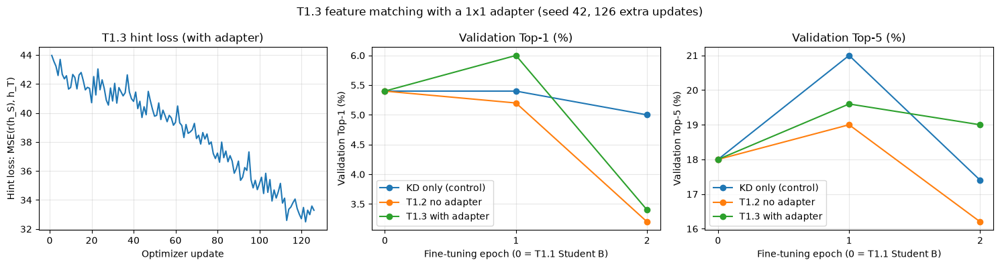

**Answer.**
- **With the adapter the hint loss actually decreases** steadily (≈44 → ≈33 per update, epoch mean 41.3 → 35.8), unlike T1.2 where it stayed flat. (The two MSE values come from different layers, so compare trends, not absolute values.)
- The adapter run gave the **best Top-5 (19.0%)** of the three runs and the best Top-1 after epoch 1 (6.0%). Its final Top-1 (3.4%) is below the control's, but the gap is 8 of 500 images, about the size of the noise.
- **Why the adapter is needed:** the channel counts differ (80 vs 224), so MSE cannot be computed without a projection. The 1×1 conv maps the student's 80 channels to 224 at every spatial position and keeps the 14×14 grid. Because it is **learned**, it can also reorder, mix and rescale channels, which removes the T1.2 problem of forcing an arbitrary channel layout. The student only needs features that *contain* the teacher's information. The adapter (18,144 params) is used only during training and discarded afterwards, so the deployed student is unchanged.

## T1.4: Final Comparison

| Configuration | Top-1 (%) [measured] | Top-5 (%) [measured] | Training time (s) [derived¹] | Updates | Deployed parameters (M) [analytical] | Latency (ms) [measured] |
|---|---:|---:|---:|---:|---:|---:|
| Independent (CE) | 4.4 | 15.6 | 100.4 | 315 | 4.14 | 6.14 |
| **Logit KD** | **5.4** | 18.0 | 124.9 | 315 | 4.14 | 6.83 |
| Direct hint (T1.2) | 3.2 | 16.2 | 170.7 | 441 | 4.14 | 5.90 |
| Adapted hint (T1.3) | 3.4 | **19.0** | 185.7 | 441 | 4.14 | 6.47 |
| *Reference: KD + 2 epochs (control)* | 5.0 | 17.4 | 164.1 | 441 | 4.14 | 5.82 |

¹ Measured median time per optimizer update × number of updates, plus one-time teacher passes (teacher logits 26.9 s; teacher `features[5]` cache 18.7 s). Measured per-update cost: CE 318.6 ms, KD 311.1 ms, direct hint 363.6 ms, adapter hint 334.3 ms.

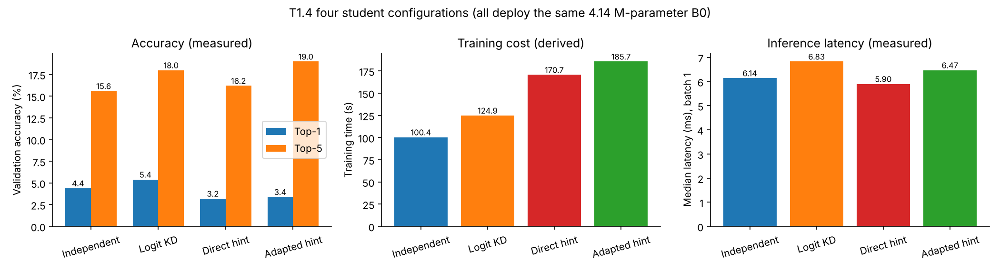

**Answer.**
- **Best configuration: logit KD.** It has the highest Top-1 (5.4%), a strong Top-5 (18.0%), the fewest updates (315), and it is the cheapest distillation method. Adapted feature matching has the best Top-5 (19.0%) but a lower Top-1. Direct feature matching is the weakest distillation method. With 500 validation images (≈±1–1.7 pp noise), these differences are small.
- **Extra training cost of feature matching:**
  - +2 epochs (126 extra updates; 441 instead of 315).
  - Per update: direct hint +17% (it runs part of the teacher at 112×112 every batch), adapter hint +7% (teacher features cached once; adds a 1×1 conv).
  - Total: +45.8 s (+37%) for direct and +60.8 s (+49%) for adapted vs logit KD. Against the control with the same 441 updates, the feature losses themselves add only +6.6 s and +21.6 s.
  - Memory: the cached teacher features take ≈350 MB (2,000 × 224 × 14 × 14 × 4 bytes); the adapter adds 18,144 training-only parameters.
- **No deployment cost:** all four configurations deploy the same 4.14 M-parameter B0, and the latencies (5.8–6.8 ms) differ only by noise.

---

# Task 2: LLM Reasoning Distillation

**Setup.** Student = `Qwen/Qwen2.5-0.5B-Instruct`. Teacher = `Qwen/Qwen2.5-1.5B-Instruct` (3× larger, run locally; no API key available). Every solution must end with `#### <number>`.

**Teacher / evaluation prompt (system message):**
```text
Solve the math problem step by step, showing each calculation.
End with a final line in exactly this format: #### <number>
```

## T2.1: Generate Held-Out Questions

**Generation prompt (Claude, claude.ai web interface):**
```text
Create a JSON file named synthetic_raw.json containing 120 new grade-school math word problems
in the style of the GSM8K dataset. I will use them as a held-out test set.
Requirements for the problems:
- Original problems only. Do not copy or paraphrase real GSM8K problems.
- Everyday situations (shopping, cooking, travel, school, sports, savings, time, measurements, etc.).
- Vary the difficulty: 2 to 6 reasoning steps each.
- Answers must be a single number (whole numbers preferred; simple decimals allowed for money).
- Use different topics and numbers; avoid repeating the same template.
Requirements for each solution:
- Step-by-step reasoning in plain sentences.
- Write EVERY calculation in GSM8K calculator format: <<expression=result>>
- Inside << >> use only numbers, + - * / and parentheses.
- The last line of the solution must be exactly: #### <number>
Output format: one JSON list: [{"question": "...", "solution": "... #### 36", "answer": 36}, ...]
```

**Dataset:** `task2_outputs/synthetic_raw.json` (120 generated) → `task2_outputs/synthetic_100.json` (100 kept). Example:
> *Maya bakes 4 trays of cookies with 18 cookies on each tray. She gives 25 cookies to her neighbors and eats 3 herself. How many cookies does she have left?*
> She bakes 4*18=<<4*18=72>>72 cookies. She gives away and eats 25+3=<<25+3=28>>28. She has 72-28=<<72-28=44>>44 left. **#### 44**

**How the answers were checked (automatically, in code):**
1. Every `<<expression=result>>` is re-computed in Python (only digits and `+ − × ÷ ( )` allowed) and compared with the written result.
2. The solution must end with a `#### <number>` line.
3. The number after `####` must equal the `answer` field.

**Result:** 120 generated → **0 errors found** → first 100 kept (`task2_outputs/synthetic_check.csv`). No arithmetic, format or answer-mismatch errors occurred, so no question had to be corrected or discarded. The check only verifies arithmetic and consistency; it cannot detect a badly worded question.

**These questions are never used for training**; they are only used in T2.3.

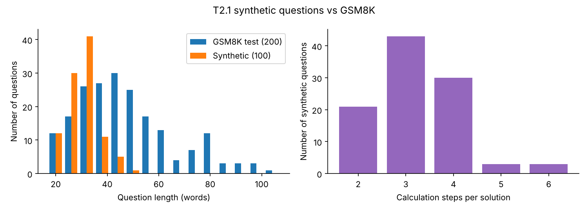

**Comparison with GSM8K:** the generated problems are **shorter and easier**: 29.8 words per question on average vs 47.3 for the 200 GSM8K test questions, 2–6 calculation steps (mean 3.2), with clean whole numbers. The original student scores **63% on them vs 37% on GSM8K**, which confirms they are easier. They follow GSM8K's style (everyday topics, `<<…>>` calculator notation, `####` answer).

## T2.2: Fine-Tune on Teacher Rationales

**Teacher solutions:** 1,000 questions sampled from the GSM8K train split (seed 42). The teacher wrote a worked solution for each, and the final number was compared with the GSM8K reference answer.

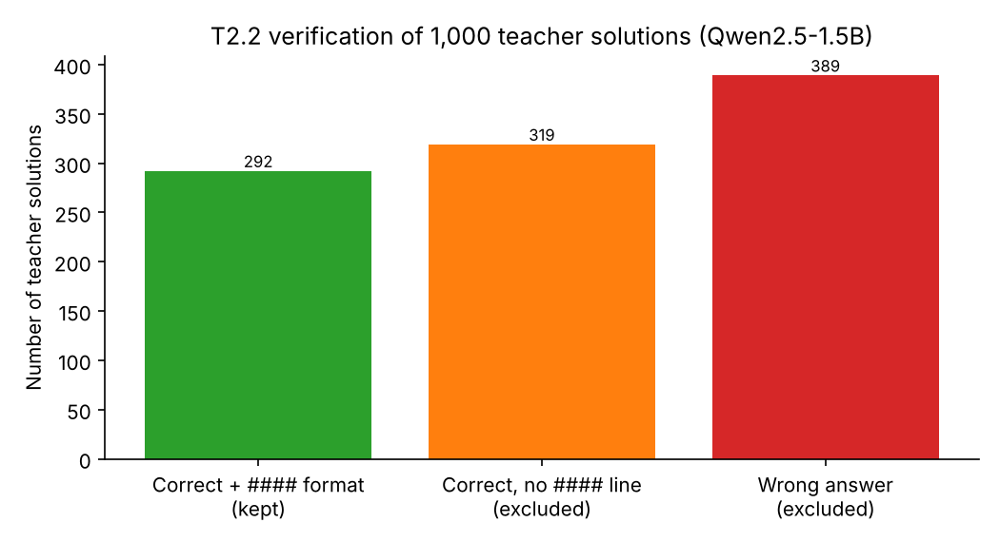

| Teacher outcome (of 1,000) | Count | Used for training? |
|---|---:|---|
| Correct answer **and** ends with `#### <number>` | **292** | Yes (kept) |
| Correct answer but no final `####` line | 319 | No (excluded, strict format rule) |
| Wrong answer | 389 | No (excluded) |

The teacher reached the right number 61.1% of the time, but only solutions that were both correct and in the required format were kept, so the student never trains on wrong reasoning or the wrong answer format. *Limitation:* the 319 correct-but-unformatted solutions could have been corrected (by appending `#### <reference>`) instead of excluded, which would have given about twice as much training data.

**LoRA fine-tuning settings**

| Setting | Value |
|---|---|
| Training examples | **292** |
| LoRA rank r / scaling α | 8 / 16 (scale α/r = 2), dropout 0.05 |
| Target modules | `q_proj`, `k_proj`, `v_proj`, `o_proj` (all 24 layers) |
| Loss | next-token cross-entropy on the **solution tokens only** (question tokens masked with −100) |
| Optimizer / LR | AdamW, 2e-4, cosine schedule with 5% warm-up |
| Batch | effective 8 (micro-batch 1 × 8 gradient-accumulation steps; needed to avoid MPS out-of-memory) |
| Max length / epochs / updates | 384 tokens / 2 epochs / **72 optimizer updates** |

| Training examples | Trainable parameters | Trainable (%) | Training time |
|---:|---:|---:|---:|
| 292 | **1,081,344** of 495,114,112 | **0.22%** | **4.6 min** [measured] |

Trainable count check [analytical]: per layer 8·(896+896) + 8·(896+128) + 8·(896+128) + 8·(896+896) = 45,056; × 24 layers = 1,081,344, which matches the measured count.

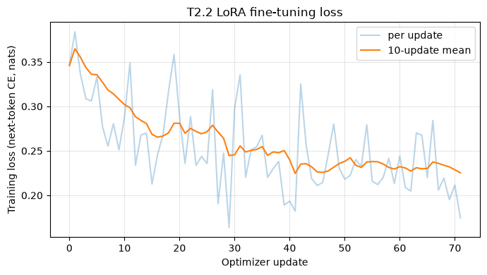

The training loss falls from ≈0.35 to ≈0.23 nats over 72 updates.

**How the student learns from teacher reasoning traces:** the base model is frozen and only small low-rank matrices (W + (α/r)·B·A) are trained. For each example the student reads the question and is trained to predict the teacher's solution **token by token**, so it is rewarded for reproducing the teacher's intermediate steps, not just the final number. This is sequence-level distillation: the student copies the teacher's *process* (break the problem into steps, show calculations, finish with `#### answer`), rather than the teacher's logits as in Task 1.

## T2.3: Evaluate Reasoning

Greedy decoding, max 320 new tokens, same system prompt for both models; exact match on the extracted final number.

| Model | GSM8K accuracy (%) [measured] | Synthetic accuracy (%) [measured] |
|---|---:|---:|
| Original student | 37.0 (74/200) | **63.0** (63/100) |
| Fine-tuned student | **38.5** (77/200) | 54.0 (54/100) |

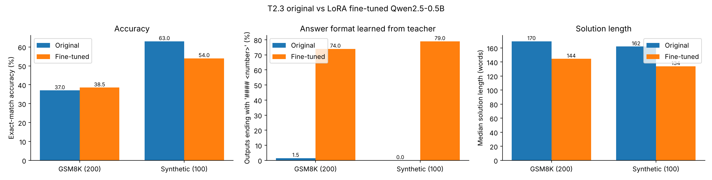

**Manual inspection of 20 solutions** (the same 5 questions per set for both models; `task2_outputs/t2_3_inspect.csv`):

| Model (10 each) | Correct | Arithmetic errors | Reasoning errors | Right answer, wrong reasoning | Cut off (no `####`) |
|---|---:|---:|---:|---:|---:|
| Original | 4 | 1 | 5 | 0 | 4 |
| Fine-tuned | 4 | 0 | 6 | 1 | 1 |

**Examples**
- *Correct (fine-tuned, synthetic):* "Rafael plants 6 rows of 14 plants, 9 tomatoes each, birds eat 1/3": 84 plants → 756 tomatoes → 252 eaten → **#### 504**. The original model got this wrong by taking 1/3 of the *plants* (756 − 28 = 728).
- *Reasoning error (fine-tuned, GSM8K):* "Gunther's bananas": the model *added* the stolen bananas back (48 + 24 = 72) and answered 66 instead of 43.
- *Hallucinated data (fine-tuned, synthetic):* "Zoe's lemonade": it invented costs of $12 each for lemons, sugar and cups and answered 0 instead of 24.
- *Arithmetic error (original, GSM8K):* wrote "stolen = 49 − 12 = 37", then invented a third theft.
- *Cut off (original):* long LaTeX-style solutions hit the 320-token limit before the final answer (4 of 10 inspected).

**Did a model reach the correct answer through incorrect reasoning?** Yes. On the bagel question (reference $1), the fine-tuned model computed 10/9 ≈ 1.11, then 1.11 × 0.9 = 0.999, and rounded to "$1.00". The answer is right but the method is approximate; the exact reasoning is $36 / 36 bagels = $1. Also, one original solution was counted correct although it was cut off before its `####` line (the evaluator fell back to the last number in the text).

**How well did distillation transfer?**
- **The format transferred very strongly:** the share of outputs ending with `#### <number>` rose from **1.5% → 74%** on GSM8K and **0% → 79%** on the synthetic set, and solutions became shorter (median 170 → 144 words). The student clearly learned the teacher's answer style.
- **Reasoning accuracy did not clearly improve:** GSM8K +1.5 pp (3 questions; noise ≈ ±3.4 pp), synthetic **−9 pp** (≈1.8 standard errors). Distillation did **not** transfer well to the synthetic set.
- **Likely reasons:** a weak teacher (1.5B, only 61% correct) and few training examples (292), so the student learned the format without better reasoning. It also became shorter and more confident, which caused errors such as hallucinated numbers on the easy synthetic questions. A stronger teacher and keeping the 319 correct-but-unformatted solutions would probably help.

---

# Task 3: Differentiable Architecture Search (DARTS)

**Setup.** CIFAR-10, **fixed stratified subset of 5,000 train and 1,000 val** (500 + 100 per class, disjoint) from the official training split, no augmentation, seed 42.
Network: 3×3 stem (16 ch) → 2 searchable cells (separate op weights, **shared α**) → global average pooling → 10-class linear head.

## T3.1: Differentiable Cell

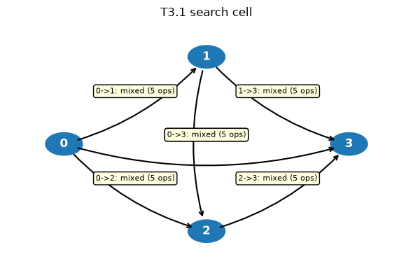

Cell graph: nodes 0 → 1 → 2 → 3 with edges (0,1), (0,2), (1,2), (0,3), (1,3), (2,3). Each edge mixes O = {none, skip, conv1x1, conv3x3, avgpool3x3} (convs are ReLU-Conv-BN; all ops keep 16 × 32 × 32). x_j = Σ_{i<j} ō_(i,j)(x_i); cell output = x_3.

| Verification | Result [measured] |
|---|---|
| Input → stem → cell → logits | (8, 3, 32, 32) → (8, 16, 32, 32) → (8, 16, 32, 32) → (8, 10) (verified) |
| Architecture parameters α | **(6, 5)** = 30 values, shared by both cells |
| Network weights w | 31,354 parameters |
| Forward + backward | Passed: loss 2.606, α gradient norm 5.99e-2, 29/29 weight tensors received gradients |
| Probabilities sum to 1 per edge | [1, 1, 1, 1, 1, 1] (verified) |
| Change α, keep weights fixed | edge (0→1) output changed by 0.371, logits by 0.069; **op weights unchanged: True** |

**Why α can be optimized with gradients:** the discrete choice "pick one op per edge" is relaxed into a **softmax-weighted sum** of all ops, p_o = exp(α_o) / Σ exp(α_o′). The network output is then a smooth, differentiable function of α (softmax and weighted sums are differentiable), so ∂L/∂α exists and is computed by ordinary back-propagation. α can therefore be updated with a normal optimizer (Adam) just like the weights. The check above confirms this: α received a non-zero gradient, and changing α alone changed the output.

## T3.2: First-Order Search

| Setting | Value |
|---|---|
| Weights w | SGD (lr 0.025, momentum 0.9, wd 3e-4, cosine), updated on **training** batches |
| Architecture α | Adam (lr 3e-3, betas (0.5, 0.999), wd 1e-3), updated on **validation** batches, w fixed (gradient taken only w.r.t. α) |
| Budget | 3 epochs, batch 64 → **234 weight updates + 234 α updates**; search time 0.3 min |

**Parameter-update verification (first step) [measured]**

| Step | α changed? | Weight tensors changed |
|---|---|---|
| α step (validation batch) | **True** | **0 / 29** |
| w step (training batch) | **False** | **29 / 29** |

**Training history [measured]**

| Epoch | Train loss | Train acc (%) | Val loss | Val acc (%) |
|---:|---:|---:|---:|---:|
| 1 | 2.069 | 22.5 | 1.967 | 25.1 |
| 2 | 1.859 | 30.1 | 1.832 | 32.0 |
| 3 | 1.766 | 33.8 | 1.779 | 32.5 |

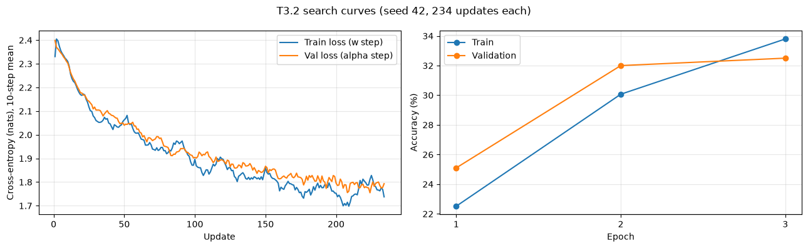
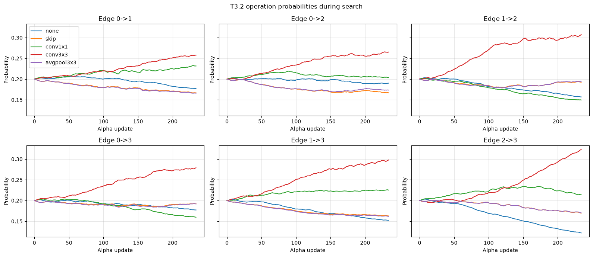

**Final probabilities (change from start in brackets)**

| Edge | none | skip | conv1x1 | conv3x3 | avgpool3x3 |
|---|---:|---:|---:|---:|---:|
| 0→1 | 0.178 (−0.022) | 0.167 (−0.033) | 0.232 (+0.032) | **0.258 (+0.058)** | 0.166 (−0.034) |
| 0→2 | 0.190 (−0.010) | 0.167 (−0.033) | 0.204 (+0.004) | **0.265 (+0.065)** | 0.174 (−0.027) |
| 1→2 | 0.157 (−0.043) | 0.192 (−0.008) | 0.150 (−0.050) | **0.307 (+0.107)** | 0.194 (−0.006) |
| 0→3 | 0.177 (−0.022) | 0.192 (−0.008) | 0.160 (−0.040) | **0.279 (+0.079)** | 0.192 (−0.008) |
| 1→3 | 0.152 (−0.048) | 0.163 (−0.037) | 0.225 (+0.025) | **0.298 (+0.098)** | 0.162 (−0.038) |
| 2→3 | 0.122 (−0.078) | 0.170 (−0.030) | 0.215 (+0.015) | **0.323 (+0.123)** | 0.170 (−0.030) |

**Which operations became more likely?** **conv3x3 grew on all six edges** (+0.06 to +0.12), most strongly on the edges into node 3 and on 1→2. conv1x1 grew slightly on 0→1, 1→3 and 2→3. **none** lost the most (down to 0.12 on 2→3), and skip and avgpool decreased everywhere. With only 16 channels and a short search, the parametric 3×3 conv is the most useful op for reducing validation loss.

## T3.3: Extract and Evaluate a Discrete Architecture

**Extraction rule:** for each node keep its 2 strongest incoming edges (all edges if fewer than 2), ranked by the highest non-`none` probability, and use that op. Node 1 keeps 1 edge, nodes 2 and 3 keep 2 → **5 edges**.

**Architecture encoding (from, to, op):**
`[(0,1,'conv3x3'), (0,2,'conv3x3'), (1,2,'conv3x3'), (1,3,'conv3x3'), (2,3,'conv3x3')]`. Edge 0→3 was dropped.

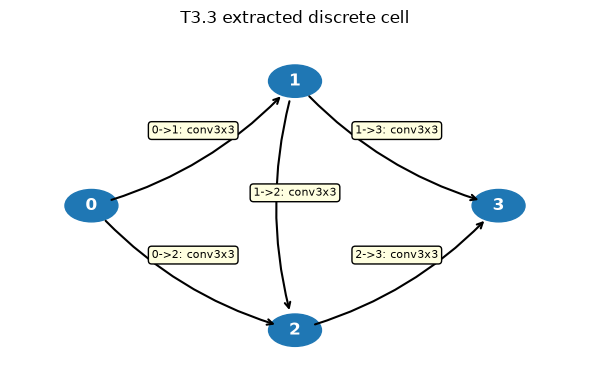

The supernet checkpoint is saved as `task3_outputs/supernet.pt`. Both the continuous supernet and the inherited-weight discrete model were evaluated from this same checkpoint, with **no fine-tuning** in between. The independent model is a newly initialized copy of the discrete architecture trained for 5 epochs (390 updates, same SGD settings).

| Model | Validation accuracy (%) [measured] | Parameters [analytical] | MACs (M) [analytical] | Model size FP32 (KB) [analytical] | Latency (ms) [measured] |
|---|---:|---:|---:|---:|---:|
| Continuous supernet | 32.5 | 31,384 | 31.90 | 122.6 | 3.84 |
| Discrete: inherited weights | **12.1** | 23,674 | 24.04 | 92.5 | 1.34 |
| Discrete: trained from scratch | **46.9** | 23,674 | 24.04 | 92.5 | 1.27 |

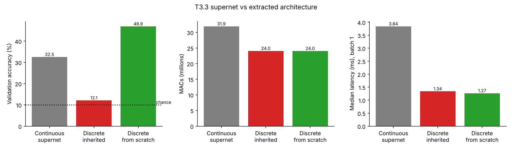
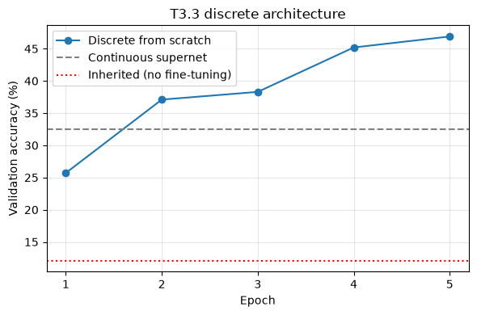

**How much did performance change?**
- **After discretization: −20.4 pp** (32.5% → 12.1%, almost chance at 10%; the validation loss jumped from 1.78 to 69.1). In the supernet every op's output is scaled by its probability (≈0.2–0.3) and mixed with four others. Replacing the mix with single ops at full strength changes the activation scales and BatchNorm statistics that later layers were trained on, so the inherited weights do not work on their own.
- **After independent training: +34.8 pp over the inherited model and +14.4 pp over the supernet** (46.9% after 5 epochs). The discovered architecture is good; it just needs its own training. (It also received more updates: 390 vs 234.)
- **Efficiency:** the discrete model has 24.6% fewer parameters and MACs and is ≈3× faster (1.27 vs 3.84 ms), because it runs one op on 5 edges instead of 5 ops on 6 edges.

---

# Task 4: ENAS-Inspired Weight-Sharing NAS

**Setup.** CIFAR-10, same fixed 5,000 / 1,000 stratified subset, seed 42. Network: 3×3 stem (16 ch) → 4 searchable blocks → GAP → 10-class head. Each block chooses one op from {conv3x3, conv5x5, dwsep3x3, identity}; all ops keep 16 × 32 × 32 and use **GroupNorm(4 groups)** instead of BatchNorm. Search space |S| = 4⁴ = **256**. Optimizer AdamW (lr 2e-3, wd 1e-4, cosine), batch 64.

## T4.1: Supernet and Path Sampling

A path is encoded as **4 op indices** (0 = conv3x3, 1 = conv5x5, 2 = dwsep3x3, 3 = identity). Paths are sampled uniformly (each block independently picks one of 4 ops). `SubNet(supernet, path)` extracts a standalone network by copying the stem, the 4 chosen ops and the head.

| Path | Encoding | Active ops (block 0–3) | Output shape | Extracted subnet == supernet path | Params |
|---|---|---|---|---|---:|
| A | (0, 0, 2, 1) | conv3x3 → conv3x3 → dwsep3x3 → conv5x5 | (4, 10) | **True** | 12,170 |
| B | (3, 0, 0, 0) | identity → conv3x3 → conv3x3 → conv3x3 | (4, 10) | **True** | 7,642 |

**Parameter mapping** (supernet parameter group used by each path)

| Block | Path A op | Path B op | A params | B params | Shared weights? |
|---:|---|---|---:|---:|---|
| 0 | conv3x3 (`blocks.0.0`) | identity (`blocks.0.3`) | 2,336 | 0 | No |
| 1 | conv3x3 (`blocks.1.0`) | conv3x3 (`blocks.1.0`) | 2,336 | 2,336 | **Yes** |
| 2 | dwsep3x3 (`blocks.2.2`) | conv3x3 (`blocks.2.0`) | 432 | 2,336 | No |
| 3 | conv5x5 (`blocks.3.1`) | conv3x3 (`blocks.3.0`) | 6,432 | 2,336 | No |
| — | stem + head | stem + head | 634 | 634 | **Yes** (all 256 paths) |

- Shared between A and B: **8 parameter tensors, 2,970 parameters** (stem, head and block 1's conv3x3).
- Parameters per op [analytical]: conv3x3 2,336 · conv5x5 6,432 · dwsep3x3 432 · **identity 0** (no Conv2d inside, verified). Total supernet: 37,434 parameters.

**How weight sharing reduces search cost:** without sharing, ranking 256 architectures would mean training 256 networks separately. Here **one** supernet (37 K params) is trained once; each of the 256 architectures is a path through it and **inherits** its weights, so evaluating an architecture costs one validation pass instead of a full training run. Training cost is paid once and amortized over all paths: each op is trained by every path that uses it.

## T4.2: Train the Supernet

Each minibatch: (i) sample one path uniformly, (ii) run only its ops, (iii) cross-entropy, (iv) AdamW step. Gradients are cleared with `set_to_none=True`, so inactive ops have `grad = None` and the optimizer skips them. 5 epochs = **390 updates**, training time **0.1 min (≈6 s)** [measured].

**Parameter-update check (step 6, path conv3x3-conv5x5-identity-dwsep3x3) [measured]:** active tensors **15/15 changed** · inactive tensors **0/30 changed** (verified)

**Sampling counts (out of 390 per block)**

| Block | conv3x3 | conv5x5 | dwsep3x3 | identity |
|---|---:|---:|---:|---:|
| 0 | 90 | 94 | 102 | 104 |
| 1 | 93 | 96 | 103 | 98 |
| 2 | 105 | 95 | 90 | 100 |
| 3 | 100 | 86 | 106 | 98 |

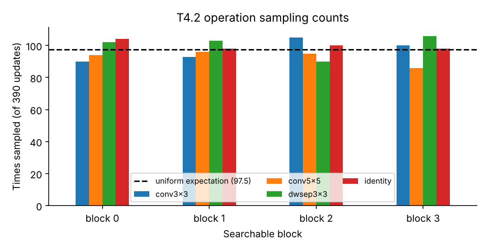
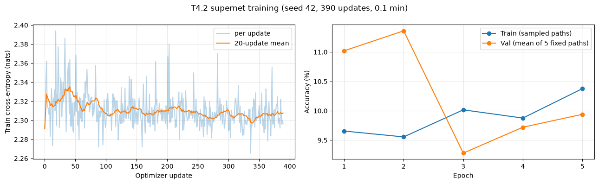

All counts are close to the uniform expectation of 97.5 (range 86–106), as expected from uniform sampling.

**Training result (honest note):** the supernet **did not learn within 5 epochs**. The training loss stayed at ≈2.30 (= ln 10, chance level), train accuracy ≈10%, and validation accuracy on 5 fixed paths ≈10%. This happened with both SGD (lr 0.05) and AdamW (lr 2e-3). Likely cause: the blocks have no skip connections and every step uses a different path, so the shared head sees features whose channel meaning changes from batch to batch (identity vs conv5x5 vs depthwise). The weights receive conflicting updates and do not converge in this very short budget. Each op is trained on only ≈98 of the 390 batches.

**Advantages of evaluating with inherited weights:** very cheap (one forward pass per architecture instead of a training run), all 256 architectures can be scored, and the cost is independent of the search-space size.
**Limitations:** inherited weights are a compromise shared across many paths, so they are not the weights a path would learn alone. The ranking can be biased (e.g. towards paths whose ops were sampled more or interfere less) and may correlate poorly with stand-alone performance. If the supernet is undertrained, as it is here, inherited accuracy is near chance and the ranking is mostly noise.

## T4.3: Subnetwork Adaptation

12 distinct paths were sampled (seed 43). Each was extracted from the **same** `task4_outputs/supernet.pt`, then fine-tuned independently (fresh copy, fresh AdamW lr 5e-4, same minibatch sequence for every subnet) and evaluated after 0, 10 and 30 updates (the 30-step run continues from step 10).

| # | Path (ops) | Params | 0 steps (%) | 10 steps (%) | 30 steps (%) | Rank 0 | Rank 10 | Rank 30 |
|---:|---|---:|---:|---:|---:|---:|---:|---:|
| 0 | conv3x3-dwsep3x3-conv5x5-identity | 9,834 | **14.0** | 12.5 | **18.9** | 1 | 5 | 1 |
| 1 | dwsep3x3-conv3x3-identity-identity | 3,402 | 10.2 | 13.4 | 14.3 | 8 | 3 | 10 |
| 2 | conv3x3-identity-dwsep3x3-identity | 3,402 | 10.3 | 12.0 | 9.8 | 7 | 6 | 12 |
| 3 | identity-conv5x5-conv3x3-conv3x3 | 11,738 | 9.0 | 10.0 | 17.3 | 12 | 10 | 3 |
| 4 | conv3x3-identity-conv5x5-conv3x3 | 11,738 | 10.7 | **14.0** | 18.4 | 5 | 1 | 2 |
| 5 | conv5x5-identity-conv5x5-identity | 13,498 | 10.0 | 10.3 | 16.6 | 9 | 8 | 6 |
| 6 | dwsep3x3-conv5x5-identity-conv3x3 | 9,834 | 13.6 | 13.0 | 15.4 | 2 | 4 | 9 |
| 7 | conv3x3-conv3x3-conv5x5-conv3x3 | 14,074 | 12.1 | 11.9 | 17.3 | 3 | 7 | 3 |
| 8 | conv5x5-dwsep3x3-dwsep3x3-conv3x3 | 10,266 | 9.9 | 9.8 | 16.4 | 10 | 12 | 7 |
| 9 | conv3x3-conv3x3-conv3x3-identity | 7,642 | 10.8 | 10.0 | 16.1 | 4 | 10 | 8 |
| 10 | dwsep3x3-dwsep3x3-identity-conv5x5 | 7,930 | 10.6 | 13.7 | 16.7 | 6 | 2 | 5 |
| 11 | conv5x5-conv3x3-dwsep3x3-conv3x3 | 12,170 | 9.8 | 10.3 | 14.2 | 11 | 8 | 11 |

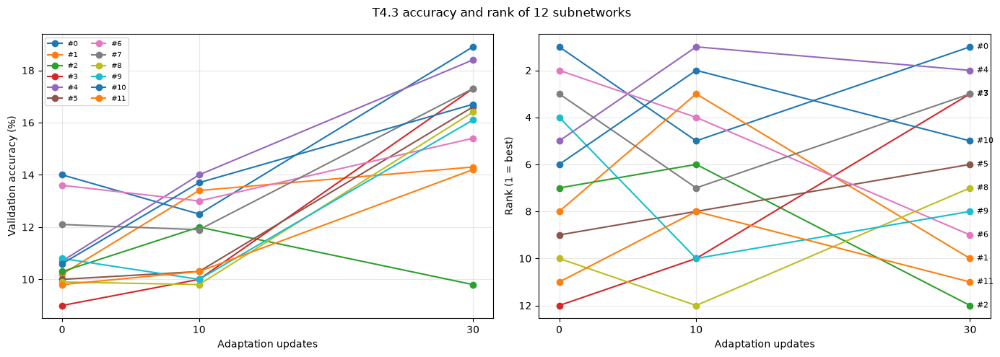
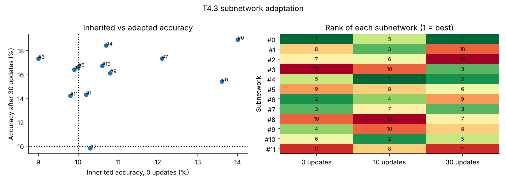

**Kendall's rank correlation (τ-b) [measured]**

| Rankings compared | τ |
|---|---:|
| Inherited (0) vs 10 updates | 0.369 |
| Inherited (0) vs 30 updates | 0.229 |
| 10 vs 30 updates | 0.109 |

**Answer.**
- **Which subnetworks changed rank?** 9 of 12 changed between 0 and 30 updates; only #0 (1st), #7 (3rd) and #11 (11th) kept their rank. The biggest moves: **#3 rose 12th → 3rd**, **#6 fell 2nd → 9th**, #2 fell 7th → 12th, #1 fell 8th → 10th (after rising to 3rd at 10 steps), and #4 rose 5th → 1st at 10 steps and ended 2nd.
- **Was the best inherited architecture still the best?** **Yes.** #0 (conv3x3-dwsep3x3-conv5x5-identity) was 1st at 0 steps and 1st again at 30 steps, although it dropped to 5th at 10 steps.
- **Rank correlation is low** (τ = 0.23 between inherited and 30-step rankings), because the inherited accuracies are close to chance (9–14%) and differ by only a few images. The ranking only became more spread out after adaptation (9.8–18.9%).
- **Additional training required:** 30 updates × 64 images = 1,920 images per subnet (≈0.38 epoch of the 5,000-image subset). For all 12 subnets that is 360 updates, ≈92% of the supernet's own training budget (390 updates). Adaptation is therefore not free, but it is still far cheaper than training each subnet from scratch (390 updates each).

## T4.4: Compare With Training From Scratch

Two architectures, each **initialized from scratch** and trained for 5 epochs (390 updates) with identical settings (AdamW lr 2e-3, cosine, same seed and batch order):

| Path | Inherited accuracy (%) | Adapted, 10 steps (%) | Adapted, 30 steps (%) | From-scratch accuracy (%) |
|---|---:|---:|---:|---:|
| Best adapted (#0): conv3x3-dwsep3x3-conv5x5-identity, 9,834 params | **14.0** | **12.5** | **18.9** | 26.7 |
| Random comparison (#7): conv3x3-conv3x3-conv5x5-conv3x3, 14,074 params | 12.1 | 11.9 | 17.3 | **27.0** |

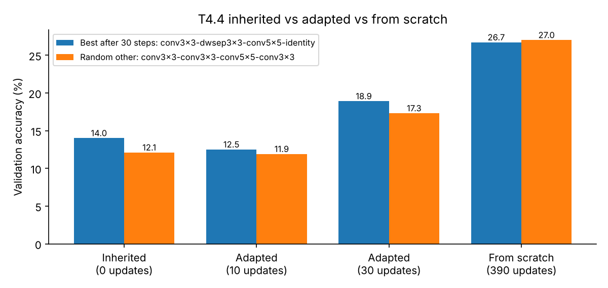
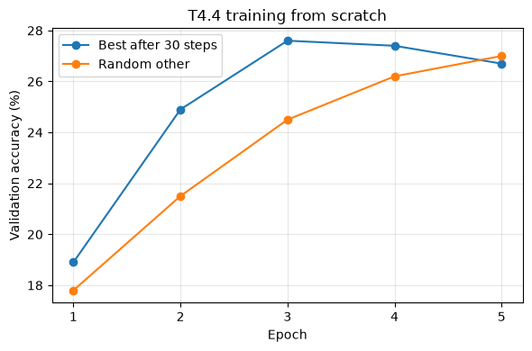

| Ranking by | Order |
|---|---|
| Inherited weights | #0 > #7 |
| Adapted (30 steps) | #0 > #7 |
| From scratch (5 epochs) | #7 > #0 (by 0.3 pp) |

**Did adaptation give a better indication than inherited weights alone?** **No, not in this experiment.** Both inherited and adapted accuracy ranked #0 above #7, while training from scratch ranked #7 marginally higher. The from-scratch difference is only 0.3 pp (3 of 1,000 images, well within noise ≈ ±1.4 pp), and #0 actually peaked higher (27.6% at epoch 3), so the two architectures are effectively **tied**. Adaptation did not change the predicted order; it only narrowed the gap slightly (1.9 pp inherited → 1.6 pp after 30 steps). With an undertrained supernet and two architectures this close, neither proxy can reliably predict the final ranking. A longer supernet training, more adaptation steps or more compared architectures would be needed.

---

# Task 5: Random Search and Aging Evolution

**Setup.** NATS-Bench topology search space (`NATS-tss-v1_0-3ffb9-simple`, fast mode). Every evaluation is a **[benchmark] lookup** of `cifar10-valid` validation accuracy at `hp='200'` (`is_random=False`, averaged result); no network is trained. Budget = 100 evaluations per run, seeds 0, 1, 2.

## T5.1: Random Search

- **Search-space size:** 6 edges × 5 ops each → **5⁶ = 15,625** architectures.
- **Encoding:** a tuple of 6 op indices for edges (0→1, 0→2, 1→2, 0→3, 1→3, 2→3), with ops 0 = none, 1 = skip_connect, 2 = nor_conv_1x1, 3 = nor_conv_3x3, 4 = avg_pool_3x3. It is converted to the NATS string `|o01~0|+|o02~0|o12~1|+|o03~0|o13~1|o23~2|`.
- **Uniform sampling:** each edge independently picks one of the 5 ops.
- **Example architecture:** `(3, 3, 0, 2, 4, 3)` = `|nor_conv_3x3~0|+|nor_conv_3x3~0|none~1|+|nor_conv_1x1~0|avg_pool_3x3~1|nor_conv_3x3~2|` → **89.85%** validation accuracy [benchmark].

| Seed | Best val acc after 100 evals (%) | Best architecture found |
|---:|---:|---|
| 0 | 90.83 | `\|nor_conv_3x3~0\|+\|nor_conv_3x3~0\|avg_pool_3x3~1\|+\|skip_connect~0\|nor_conv_3x3~1\|none~2\|` |
| 1 | **91.32** | `\|nor_conv_3x3~0\|+\|nor_conv_3x3~0\|nor_conv_3x3~1\|+\|skip_connect~0\|none~1\|nor_conv_3x3~2\|` |
| 2 | 91.30 | `\|nor_conv_3x3~0\|+\|nor_conv_3x3~0\|avg_pool_3x3~1\|+\|skip_connect~0\|nor_conv_3x3~1\|nor_conv_1x1~2\|` |

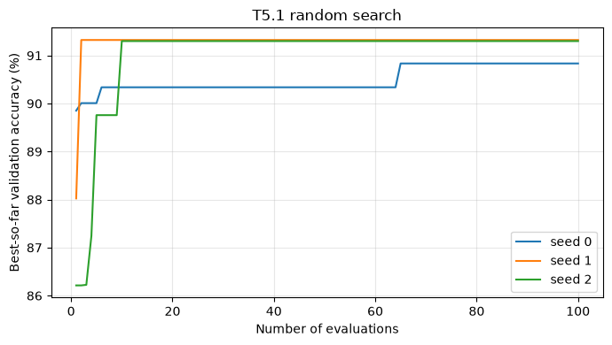

## T5.2: Aging Evolution

**Pseudocode** (population P = 10, sample S = 3, budget 100 *including* initialization):
```text
population = empty queue                     # left end = oldest
repeat 10 times:                             # initialization: 10 evaluations
    a = random architecture; population.append((a, evaluate(a)))
while evaluations < 100:                     # 90 more evaluations
    candidates = 3 random members of population
    parent     = candidate with highest validation accuracy
    child      = parent with ONE edge changed to a DIFFERENT op
    population.append((child, evaluate(child)))
    population.pop_oldest()                  # aging: remove the oldest, not the worst
    assert len(population) == 10             # population-size check
```

**Execution trace (seed 0, first evaluations; full trace in `task5_outputs/t5_2_trace_seed0.csv`)**

| Eval | Step | Accuracy (%) | Pop. size | Pop. best (%) | Best ever (%) |
|---:|---|---:|---:|---:|---:|
| 1 | init | 89.85 | 1 | 89.85 | 89.85 |
| 2 | init | 90.01 | 2 | 90.01 | 90.01 |
| 3 | init | 81.49 | 3 | 90.01 | 90.01 |
| 6 | init | 90.34 | 6 | 90.34 | 90.34 |
| 10 | init | 88.40 | 10 | 90.34 | 90.34 |
| 11 | mutate | 89.72 | 10 | 90.34 | 90.34 |
| 12 | mutate | **91.32** | 10 | 91.32 | 91.32 |
| 15 | mutate | 71.81 | 10 | 91.32 | 91.32 |

**Population-size checks [measured]:** after initialization the population size was **always exactly 10** for all three seeds (assertion passed on every iteration), and every run used exactly **100 evaluations**.

| Seed | Best ever (%) | Population best ever decreased? |
|---:|---:|---|
| 0 | 91.33 | **Yes** |
| 1 | 91.55 | **Yes** |
| 2 | 91.53 | **Yes** |

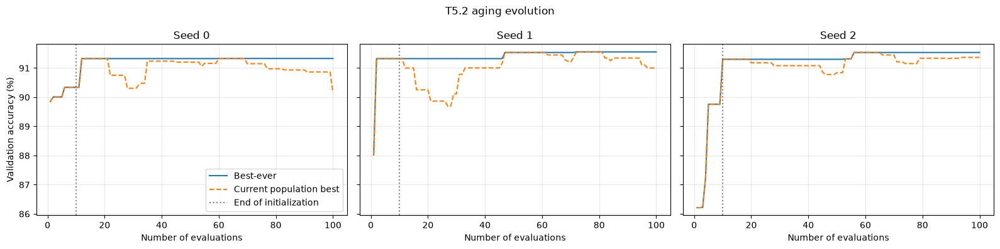

**Can the best architecture currently in the population become worse over time?** **Yes**, and it happened in all three seeds. Aging evolution removes the **oldest** member, **not the worst**. Once the best architecture becomes the oldest, it is removed even if no child is as good, so the population best (dashed curve) drops. This is intentional: it stops one lucky architecture from dominating forever and keeps the search exploring. The **best-ever** value (solid curve) is stored separately, so it can never decrease.

## T5.3: Compare the Search Methods

| Method | Best validation accuracy (%) | Mean (%) | Std. dev. (%) | Seed 0 | Seed 1 | Seed 2 | Evaluations |
|---|---:|---:|---:|---:|---:|---:|---:|
| Random search | 91.32 | 91.15 | 0.23 | 90.83 | 91.32 | 91.30 | 100 |
| **Aging evolution** | **91.55** | **91.47** | **0.10** | **91.33** | **91.55** | **91.53** | 100 |

(Std. dev. is the population standard deviation over the 3 seeds; all values are [benchmark] lookups.)

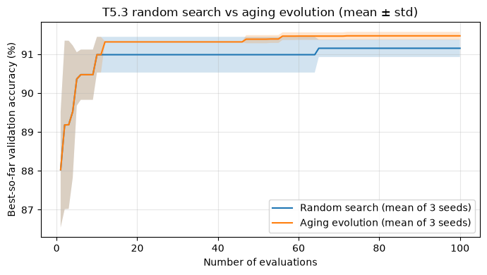
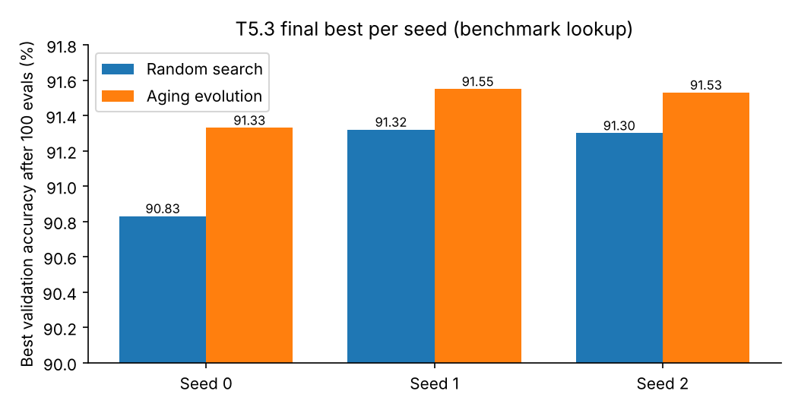

**Which method performed better?** **Aging evolution**, under the same 100-evaluation budget. It beat random search on **every** seed (+0.50, +0.23, +0.23 pp), with a higher mean (+0.32 pp) and half the spread (std 0.10 vs 0.23).
- The two curves are identical for the first 10 evaluations, because both use the same seed and aging evolution's 10 random initial members are exactly random search's first 10 samples. This makes the comparison fair.
- After that, the mean random-search curve plateaus (only one further improvement, near evaluation 65), while aging evolution keeps improving, because mutating good architectures searches **near** good solutions instead of guessing blindly.
- Both methods find top-tier architectures (> 91%) after evaluating only 100 of the 15,625 architectures (0.6%).

---

# AI Tool Use

**Tools used:** Claude (Anthropic), via the claude.ai chat interface.

**How they were used:**
- **Explanations:** to explain the assignment tasks and concepts (knowledge distillation, LoRA, DARTS, weight-sharing NAS, aging evolution).
- **Code:** to draft and debug the notebook code for all five tasks (e.g. fixing MPS out-of-memory and GPU time-out errors in Task 2, and switching Task 4 to AdamW). I ran all code myself on my own machine; every number in this report comes from those runs.
- **T2.1 dataset:** Claude generated the 120 synthetic GSM8K-style questions (prompt shown above). They were then checked automatically in code; 100 were kept.
- **T2.3 inspection:** Claude helped draft the error annotations for the 20 inspected solutions; I reviewed and confirmed each note against the model outputs.
- **Report:** Claude helped draft the text of this report and the summary figures from my result files. I reviewed the answers against my results.

**Reused / referenced code:** PyTorch Knowledge Distillation tutorial, torchvision models and weights, Hugging Face PEFT/LoRA, the DARTS paper and repository (as a reference for the mixed operation and first-order update), ENAS/Once-for-All (path sampling idea), and the NATS-Bench API (`nats_bench`). All components (KD loss, hint and adapter training, LoRA training loop, DARTS cell and search, weight-sharing supernet, random search and aging evolution) were implemented in the notebook rather than taken from a library that performs the whole task.
