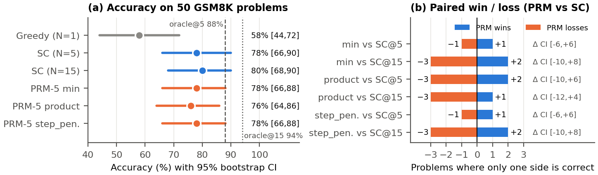
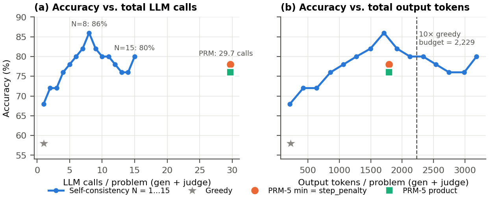
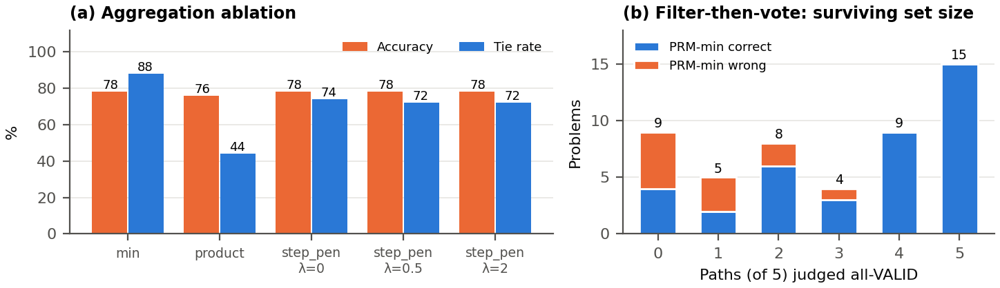
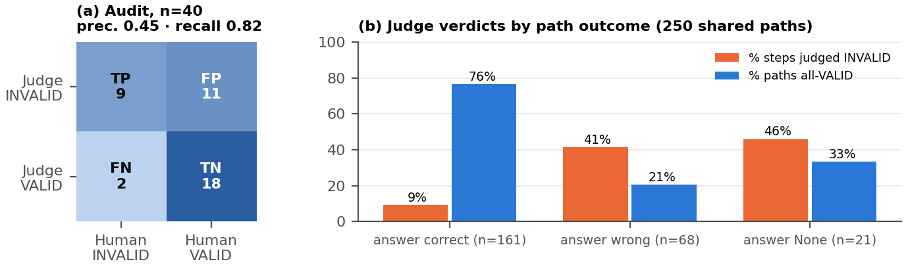
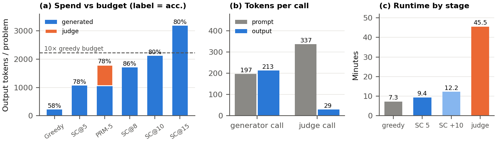

# CS 5326 PA3: Search over Reasoning and Step-Level PRMs

**Muhammad Ahmad · 25280065 · November 2026** — Generator Qwen2.5-1.5B-Instruct (fp16, cuda:0), judge Qwen2.5-7B-Instruct (4-bit NF4, cuda:1), Kaggle T4x2, 50 GSM8K problems. All numbers come from `outputs/`; the figures are built by `report_figures/make_figures.py`.

## 1. Benchmark Results and Scaling Curves

| Method | Acc. % | 95% CI | Gen calls | Judge calls | Total calls | Gen tok/prob | Judge tok/prob | Time (s) |
|---|---|---|---|---|---|---|---|---|
| Greedy (N=1) | 58.0 | [44, 72] | 50 | 0 | 50 | 222.9 | 0 | 438.1 |
| Self-Consistency (N=5) | 78.0 | [66, 90] | 250 | 0 | 250 | 1,066.4 | 0 | 562.5 |
| Compute-Matched SC (N=15) | **80.0** | [68, 90] | 750 | 0 | 750 | 3,185.7 | 0 | 1,297.4 |
| PRM Best-of-5 (min) | 78.0 | [66, 88] | 250 | 1,235 | 1,485 | 1,066.4 | 722.5 | 3,289.6 |
| PRM Best-of-5 (product) | 76.0 | [64, 86] | 250 | 1,235 | 1,485 | 1,066.4 | 722.5 | 3,289.6 |
| PRM Best-of-5 (step_penalty, λ=2) | 78.0 | [66, 88] | 250 | 1,235 | 1,485 | 1,066.4 | 722.5 | 3,289.6 |

K̄ = 1,235 / 250 = 4.94 steps per path, so PRM uses 29.7 calls per problem. The three PRM rows share one candidate pool and one set of judge scores. Their time is sampling (562.5 s) + judging (2,727.1 s) + selection (< 0.01 s).

*Fig. 1. (a) Accuracy with 95% bootstrap CIs (1,000 resamples over problems, seed 5326). Oracle@k = at least one of the first k samples is correct. (b) Paired wins and losses on the same problems, with the bootstrap CI of the accuracy difference in percentage points.*

*Fig. 2. SC majority vote over the first N samples (N = 5 and N = 15 equal the SC rows), with PRM and greedy overlaid. (a) Accuracy vs. LLM calls. (b) Accuracy vs. output tokens (generated + judge).*

**Discussion.**
- **SC curve:** it climbs from 68% (N=1) to 86% (N=8), then settles at 76–80%. One problem is worth 2 pp, so the N=8 peak is within noise (CI half-width ≈ ±11 pp).
- **Paired win/loss:**

  | PRM variant | vs SC@5 (W/L) | vs SC@15 (W/L) |
  |---|---|---|
  | min | 1/1 | 2/3 |
  | product | 2/3 | 1/3 |
  | step_penalty | 1/1 | 2/3 |

- **PRM vs. sampling:** every PRM-vs-SC difference CI contains 0, so **no difference between PRM search and sampling exceeds statistical noise**.
- **vs. greedy:** all five sampling and search methods beat greedy significantly. Paired Δ CIs are [+8, +32] for SC@5, [+10, +34] for SC@15 and [+4, +32] for PRM-product.
- **Selection gap:** oracle@5 is 88%, so better selection over the same 5 paths could gain at most 10 pp. The PRM recovers none of it.

## 2. Path Score Aggregation Ablation

*Fig. 3. (a) Accuracy and tie rate (share of problems whose top-scoring eligible set has more than one path) from `aggregation_ablation.json`. Values: min 78/88; product 76/44; step_penalty λ = 0: 78/74, λ = 0.5: 78/72, λ = 2: 78/72. (b) Problems by how many of the 5 shared paths pass min-pooling (all steps VALID).*

**Dynamics with binary scores** (a path with T steps, k of them INVALID):
- **min:** the score is only ±1, so paths tie whenever they fall in the same class (88% tie rate).
- **product** = 0.99^(T−k)·0.01^k. It ranks by fewest errors, then by **fewest steps**, so ties are rare (44%). This length tie-breaker replaces the vote:
  - In `gsm8k_test_27`, product picks a 2-step all-VALID path answering **3** over four all-VALID paths answering 243 (correct).
  - In `gsm8k_test_45` the same bias helps.
  - Overall, product disagrees with min on 8 problems: 1 win, 2 losses, 5 both wrong. That is the −2 pp.
- **step_penalty** = (1 − 2k/T) − λk. Every all-VALID path scores exactly 1.0, so sound paths tie as under min.
  - With λ = 0, flawed paths are ranked by their error *fraction*, and different paths can tie (e.g. k/T = 1/4 = 2/8), giving 74% ties.
  - With λ = 2, one extra error costs at least the full range of the mean term. The ranking becomes fewest errors first, then **longer** paths, the opposite length bias to product.
  - λ = 0.5 already gives the same rankings on this pool, so λ = 0.5 and λ = 2 are identical.
- **Bonus:** the optional logprob variant was not implemented.

**Filter-then-vote with min** (Fig. 3b).
- **No effect on 24 problems.** When all 5 paths pass (15 problems) or none pass (9), the eligible set ties and PRM-min reduces exactly to the SC@5 vote.
- **The filter only matters for the 26 problems where 1–4 paths pass**, and even there it changes the voted answer on only 3:
  - `test_06`, **win:** five different answers. The vote fell back to the first (115), and the single all-VALID path answered 64 (correct).
  - `test_39`, **loss:** the vote's fallback was correct (10), but the only all-VALID path answered 6.
  - `test_45`: both wrong.
- So min-pooling helps only when the vote is fragmented. When sound paths agree, the vote decides, which is why min and SC@5 have the same accuracy.

## 3. Failure Mode and Judge Error Analysis

**Judge false positive (flawed step marked VALID): `test_22`, candidate 3, step 1.** *"Raymond was born 6 years before Samantha… Samantha is 31."* The step computes "Raymond's age is 31 − 6 = 25", but he is older (37). The judge returned VALID: *"The calculation and deduction are correct."* It checked the subtraction, not whether subtraction was the right operation.

A related gap is `test_01`, candidate 1: all 6 steps are number-free formulas, and the unsupported `Final Answer: 48` (truth 18) is not a step, so it is never judged. Overall, **21 of 250 paths are all-VALID but end wrong or unparseable.**

**Judge false negative (valid step marked INVALID): `test_03`, candidate 0, step 2.** The step "Increase = 1.5 × 80,000 = $120,000" is correct, and the path's answer (70,000) is right. The judge said INVALID: *"should be calculated based on the total cost, not just the purchase price."* It is also inconsistent: in candidate 4 it rejects the same reasoning while its own rationale endorses it. Product then chose a shorter wrong path (65,000). Overall, **38 of 161 correct-answer paths contain at least one INVALID verdict.**

**Shared flawed premise: `test_13`.** No full mode collapse occurred (all 5 answers identical and wrong); this is the closest case. Three of 5 paths compute 90 / 7.5 = 12 years, and **every step of all three is judged VALID**. The arithmetic is right, but he only *starts earning* in year 13. SC@5, SC@15 and all PRM variants answer 12: a local judge cannot catch a misreading that the majority shares.

**Format failures.** Greedy produced no parseable `Final Answer:` line in 6 of 50 problems, and 53 of 750 sampled paths (7.1%) returned `None`. These paths are excluded from PRM selection whenever any path has a real answer.

*Fig. 4. (a) 40 hand-labelled steps (20 judged INVALID and 20 judged VALID, sampled with seed 5326; labels in notebook cell 19). Positive class = INVALID. (b) Verdicts over all 1,235 judged steps, by final-answer outcome.*

**Judge audit.**
- **Results:** TP = 9, FP = 11, FN = 2, TN = 18. **Precision (INVALID) = 0.45, recall = 0.82.**
- **Convention:** in this table, the assignment's "judge false positive" is the FN cell and its "judge false negative" is the FP cell.
- **Over-flagging:** the judge flags too much. Its 11 wrong INVALID verdicts were correct arithmetic built on an earlier error, restated facts, or simple correct operations.
- **Population recall:** the sample is stratified 20/20, while only 21.9% of steps are judged INVALID. Reweighting to the population gives a recall of about **0.56**.
- **There is still signal:** 76% of correct-answer paths pass as all-VALID versus 21% of wrong ones, and P(correct | all-VALID) = 85% against a 64% base rate. Majority voting already captures most of this signal.

**7B judge vs. 1.5B self-verification.**
- **What the larger judge catches:** errors that are wrong *on the page*, such as negative "profit per lemon" (`test_13` candidates 3–4), invented quantities and bad multipliers. 41% of steps on wrong paths are flagged, against 9% on correct ones.
- **What it misses:** steps that are plausible but wrong in context (Case 1) and shared misreadings (Case 3).
- **With 1.5B self-verification, expect:**
  - Its own misreadings accepted, since the same model produced them.
  - A stronger bias toward calling its own fluent text VALID.
  - More breaks in the `Verdict:` format, each parsed as INVALID by default.
  - Verdicts correlated with generator errors, which makes the min filter nearly useless.

## 4. Test-Time Compute Efficiency

*Fig. 5. (a) Output tokens per problem against the 10× greedy budget (labels = accuracy). (b) Prompt and output tokens per call (notebook cell 20). (c) Wall-clock time per stage.*

**Budget.** 10 × 222.9 = **2,229 output tokens per problem** (111,450 for the run).
- **PRM:** spends 1,066.4 generated + 722.5 judge = **1,788.9 tokens (80% of the budget) for 78%**.
- **SC at equal spend:** SC@8 uses 1,711 tokens and scores **86%**.
- **SC at full budget:** the largest SC inside the budget, SC@10 (2,125 tokens), scores 80%.

**Asymmetry.**
- **Per call:** a generator call reads 197 tokens and writes 213. A judge call reads 337 and writes 29, an 11.6 : 1 prompt-to-output ratio.
- **Calls vs. tokens:** judge calls are 83% of PRM's calls but only 40% of its output tokens.
- **Prefill:** the judge reads about 8,300 prompt tokens per problem (24.7 × 337), against about 1,000 for the generator.
- **Runtime:** counting output tokens alone therefore understates judge cost. Judging took **45.5 min: 61% of the run and 4.8× the time to sample the shared 5 paths.**

**Recommendation: pure sampling.**
- At equal output tokens, SC@8 beats PRM by 8 pp, and SC@10 fits the budget at 80%.
- SC@5 matches PRM-min using the same 5 paths at 60% of the tokens and about one-sixth of the wall-clock time.
- The scaling curve still rises up to N ≈ 8, while the 0.45-precision judge only swaps answers on 2–5 problems.
- Extra samples are a better use of compute than noisy step verification.

## 5. Reproducibility and Limitations

**Setup.**
- **Hardware:** Kaggle T4x2. Generator on cuda:0, judge on cuda:1 (no `device_map="auto"`).
- **Software:** Python 3.13.16, torch 2.11.0+cu130, transformers 5.20.2, bitsandbytes 0.50.2.
- **Runtime:** 74.4 min total (greedy 7.3, SC@5 sampling 9.4, extra SC samples 12.2, judging 45.5).

**Protocol.**
- **Seeds:** `transformers.set_seed(5326 + problem_index)` before every problem.
- **Greedy and judge:** `do_sample=False`, with temperature/top_p/top_k = None.
- **Sampling:** T = 0.7, top_p = 1.0, top_k = 0, repetition_penalty = 1.0.
- **Token limits:** `max_new_tokens` 512 for generation and 96 for the judge.
- **Shared pool:** paths 0–4 feed SC@5 and all PRM variants, and paths 5–14 complete SC@15.
- **Token counts:** taken from output IDs.
- **Checkpointing:** `per_problem.jsonl` is written after each problem.
- **Tests:** all 20 public smoke tests pass.

**Limitations of a prompted stand-in verifier.**
- **Not a trained PRM.** A PRM trained on human step labels (PRM800K; Lightman et al., 2023) outputs a calibrated probability learned from real error distributions. Ours outputs an uncalibrated binary verdict that depends on the prompt and can contradict itself (Case 2).
- **No sense of progress.** It checks local validity only, so unlike a value function it cannot estimate whether a step leads to the right answer. That is why Cases 1 and 3 and unsupported final lines pass.
- **Correlated blind spots.** It comes from the same model family as the generator, so their errors overlap.
- **Cost.** It needs one long-prompt generation per step.
- **Benchmark size.** With n = 50, every comparison here is limited to about ±10 pp resolution.

**References.**
1. Cobbe et al., 2021, arXiv:2110.14168.
2. Lightman et al., 2023, arXiv:2305.20050.
3. Wang et al., 2023, arXiv:2203.11171.
4. Snell et al., 2024, arXiv:2408.03314.
5. Brown et al., 2024, arXiv:2407.21787.
6. Qwen Team, 2024, arXiv:2412.15115.
