# Question 1 — River Forecasting Proposal: Three-way Decomposed River-Graph Forecaster

**Summary.** Every 10 minutes we turn the last 24 h of levels, rainfall and releases, plus the release schedule announced for the next hour, into one tensor on a 7-node directed river graph (Figure 2). A shared GRU encodes each node's history. Directed lag attention learns flow-dependent travel delays between neighbouring nodes. Three gated heads then split each station's 1-hour change into **base flow**, **observed-rain** and **hidden-rain** parts (Figure 6). The output is the 10/50/90 % quantiles of the level at S1–S4 at t + 60 min.

---

## 1. Architecture diagram

The full pipeline is in **Figure 1**, and **Figure 2** shows the graph it runs on.

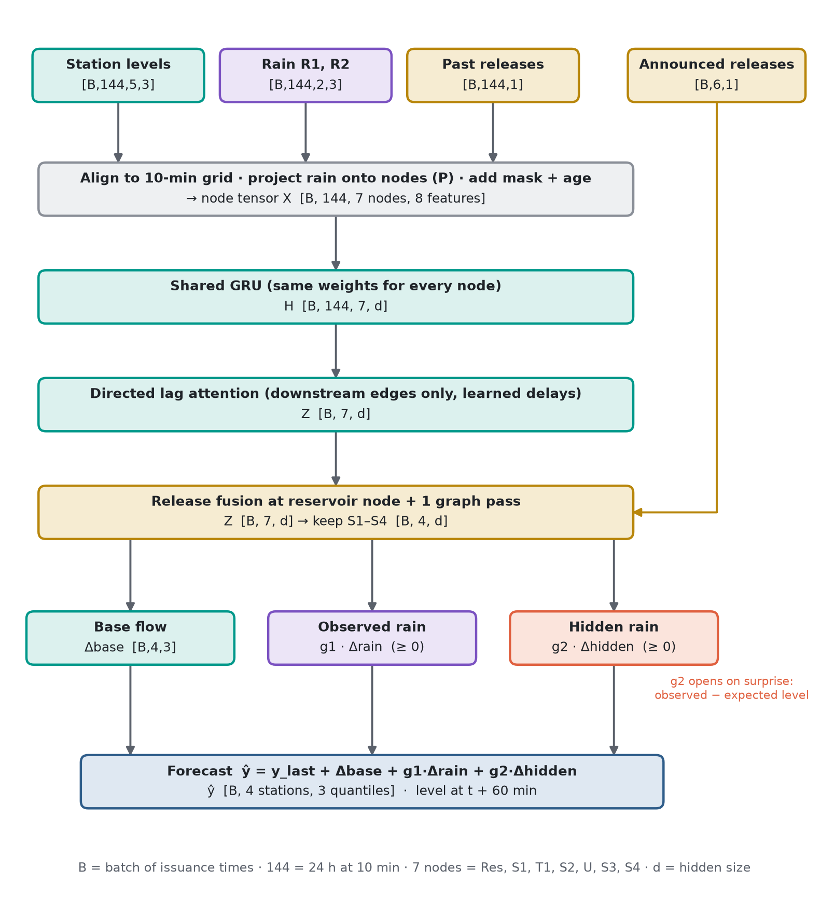

*Figure 1: Architecture. Four input groups are aligned to one 10-min grid and projected onto the 7 graph nodes (node tensor X [B,144,7,8]). A shared GRU and directed lag attention give node states Z [B,7,d]; announced releases are fused at the reservoir node. Three heads (base flow, observed rain, hidden rain) are added to the last valid level, giving ŷ [B,4,3]. Each box shows its output shape. Colours: teal = base flow/backbone, purple = observed rain, coral = hidden rain, gray = fixed/alignment, ochre = reservoir release, navy = forecast.*

- **Data sources (top row of Figure 1):** station levels X_lev, rain gauges X_rain, past releases X_rel, announced releases X_fut (enter at release fusion). Static graph data (A, D, P, time of day) is used in the alignment and attention blocks.
- **Alignment, projection and reshaping:**
  - Everything is snapped or summed onto one 10-min grid.
  - Rain goes from gauges to nodes with $\tilde r = P^\top r$, i.e. [B,144,2] → [B,144,7].
  - Stations and the release are placed into the 7 node slots.
  - The result is concatenated into **X [B,144,7,8]**.
  - For the shared GRU, X is reshaped to [B·7,144,8] and back.
  - S1–S4 rows are gathered, [B,7,d] → [B,4,d], before the heads.
- **Main blocks:** rain projection → shared temporal GRU → directed lag attention (2 layers) → release fusion → three heads with gates → combine.
- **Source combination:**
  - Sources meet first in X (per-node features).
  - Upstream information arrives through graph attention along downstream edges.
  - Future releases are added at node Res.
  - Rain and surprise enter through the gated heads.
- **Output:** **ŷ [B,4,3]**, the S1–S4 levels at t + 60 min at quantiles {0.1, 0.5, 0.9}.

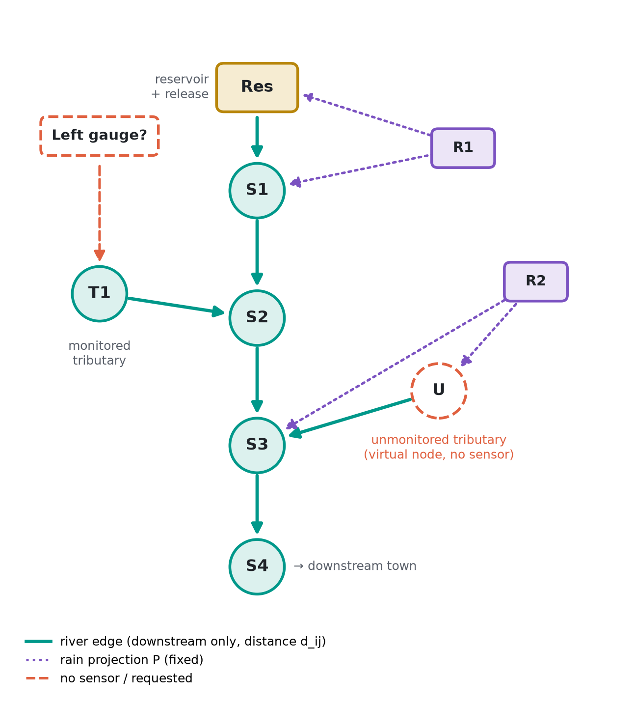

*Figure 2: The 7-node directed river graph (Res, S1, T1, S2, U, S3, S4). Teal edges point downstream only and carry river distance d_ij. Dotted purple arrows are the fixed rain projection P (the small R1 → T1 weight in A6 is left out for clarity). U is a virtual node for the unmonitored tributary: no sensor (mask ≡ 0), receives R2 rain. The dashed coral box is a requested left-side rain gauge that does not exist yet.*

---

## 2. Assumptions

**Supplied facts (from the handout, not assumptions):**

| ID | Fact |
|---|---|
| F1 | Historical water levels at S1–S4 and T1, every 10 min. |
| F2 | Historical rainfall at R1 and R2, with timestamps and gauge locations. |
| F3 | Recorded reservoir releases, and future release schedules announced before each forecast, with announcement and effective times. |
| F4 | Station locations, river connectivity, distances along the river. |
| F5 | Topology: Reservoir → S1 → S2 → S3 → S4 → town. The monitored tributary (T1) joins between S1 and S2; an unmonitored tributary joins between S2 and S3. Stations are unevenly spaced and travel times change with conditions. |
| F6 | Not supplied: precise travel times, unmonitored-tributary inflow. Not available at issuance: future rainfall, future levels. |
| F7 | R1 and R2 are on the right-side hillsides; the T1 (left) side has no rain gauge (handout illustration). |
| F8 | Service: every 10 min, forecast the level 1 h ahead at S1–S4. |

**Assumptions (our choices where the handout is silent):**

| ID | Assumption | Why reasonable | Effect on design |
|---|---|---|---|
| A1 | The record holds ≥ 3 years of 10-min data from all sources, covering several wet seasons. | Typical length for an authority's telemetry archive. | Chronological train/validation/test split (e.g. last year = test). Extreme floods stay rare (L5). |
| A2 | All sources use one clock (UTC). Level timestamps fall within ±5 min of the 10-min tick. | Loggers are normally clock-synchronised and report on schedule. | Snap each level to the nearest tick within ±5 min; otherwise mask = 0 (Figure 4). |
| A3 | Reporting delay is usually 0–20 min, occasionally hours, and each record's arrival time is logged. | Typical for GSM/satellite telemetry. | Data-age feature; training replays the delays from the arrival logs; the system never waits (§5 ii). |
| A4 | Levels carry about 1–2 cm noise, with occasional spikes, flat-lines and gaps (a few % of steps). | Common for pressure and radar level sensors. | Rule-based QC sets mask = 0; random sensor dropout during training. |
| A5 | Rain reports are accumulations (mm) at irregular times, with no double counting. | Tipping-bucket / event-reporting gauges. | Rain is *summed* per 10-min bin, not interpolated. |
| A6 | R1 represents the right-side hillsides above Res/S1, and weakly the upper T1 area through shared storms. R2 represents the U catchment and the local area above S3. | This follows the gauge positions relative to the sub-catchments. | Fixed P weights from catchment areas: R1 → Res, S1 (large), T1 (small); R2 → U, S3. |
| A7 | Releases are recorded as discharge (m³/s) at ≥ 10-min resolution. Schedules are piecewise constant and usually announced ≥ 1 h ahead. The actual release may differ in timing or size. | Normal dam operating practice. | X_fut comes from the latest schedule known at t; a mismatch flag is raised (§5 iv). |
| A8 | No significant backwater, and no other controlled structures or large abstractions between Res and S4. | A steep hillside river (as in the handout illustration). | Directed edges point downstream only, so the graph has no upstream influence. |
| A9 | Travel time per reach is typically ≤ 1.5 h (rarely up to 2 h). Res → S4 (4 reaches) takes ≤ about 6 h at low flow and less at high flow. | Plausible for a short mountain river where wave speed rises with stage. | K = 12 lags (0–120 min) per edge. Queries depend on the current state, so learned delays can shrink at high flow (Figure 5). |
| A10 | Within 60 min, a station is affected only by conditions at most two reaches upstream. Anything farther away already shows in the intermediate stations' current levels. | This follows from A9: three reaches take longer than 1 h except in extreme floods. | Two attention layers (two hops) plus one release pass. Add a layer if validation shows a need. |
| A11 | Hillside rain reaches the river within ~1–6 h, recession lasts up to ~12–18 h, and soil wetness has a memory of about one day. | Typical for small, steep catchments. | History L = 144 (24 h), plus a rolling 24-h rain sum as a soil-wetness proxy. |
| A12 | Over a 1-h horizon, rain only adds water, and contributions from different areas add up. | Mass balance: rainfall cannot lower a river within the hour. | Rain heads are softplus ≥ 0 and are combined additively. |
| A13 | Unmonitored-tributary inflow is base flow plus a response to rain near R2, entering just above S3. | Adjacent catchments share storms. | Virtual node U receives R2 rain; any remaining inflow is caught by S3's surprise. |
| A14 | Channel shape, sensor datums and the stage–discharge relation change slowly, apart from known resets. | No major works are reported. | One model with per-station normalisation; retrain yearly and after known changes. |

**Why L = 144 (24 h):**
- The longest routing path, Res → S4, takes at most about 6 h (A9).
- The longest rain response including recession is about 18 h (A11).
- 24 h covers both with margin and also captures one full daily cycle.

---

## 3. Forecasting task and data specification

- **Issuance time t:** every 10 min, on the clock tick (144 issuances per day).
- **History window:** L = 144 steps, τ = t − 143 … t, covering (t − 24 h, t].
- **Horizon:** a single target 6 steps ahead, the level at **t + 60 min**.
- **Outputs:** S1–S4 × quantiles {0.1, 0.5, 0.9}. The model predicts the change Δ from the last valid level y_last and adds y_last back.
- **Batch axis B:** different issuance times (during training, random t from the training years; in operation B = 1).

| Name | Shape | Axes | Time coverage | Available at t? |
|---|---|---|---|---|
| X_lev (levels) | [B,144,5,3] | b = issuance time; τ = history step; station ∈ {S1,S2,S3,S4,T1}; channel ∈ {value (m, normalised), mask, data-age (min)} | τ = t−143 … t (10-min grid) | Yes, except readings still in transit (mask 0) |
| Raw rain reports | variable-length list (time, gauge, mm) | one record per report | t − 48 h … t (48 h are needed for the 24-h rolling sum) | Reports received by t |
| X_rain (rain) | [B,144,2,3] | b; τ; gauge ∈ {R1,R2}; {mm in (τ−10, τ], mask, age} | t−143 … t | Yes, except in-transit bins (mask 0) |
| X_rel (past releases) | [B,144,1] | b; τ; mean recorded release in the bin (m³/s) | t−143 … t | Yes (the latest bin may be pending) |
| X_fut (announced releases) | [B,6,1] | b; future step h = 1…6; scheduled release effective at t + 10h min | t+10 … t+60 | Yes, but only schedules with announcement time ≤ t |
| X_tod (time of day) | [B,144,2] | b; τ; {sin, cos} | t−143 … t | Yes (clock) |
| A (adjacency) | [7,7] | A_ji = 1 if there is an edge j → i (downstream) | static | Yes |
| D (distances) | [7,7] | river distance d_ji (km) on edges, 0 elsewhere | static | Yes |
| P (rain projection) | [2,7] | gauge g × node i weight | static | Yes |
| X (node tensor, derived) | [B,144,7,8] | b; τ; node ∈ {Res,S1,T1,S2,U,S3,S4}; F = 8: level, mask, age, rain_recent, rain_24h, release, sin(tod), cos(tod) | t−143 … t | Built at t |
| y_last | [B,4] | b; station S1–S4; last level with mask = 1 | ≤ t | Yes |
| **ŷ (output)** | **[B,4,3]** | b; station S1–S4; quantile ∈ {0.1, 0.5, 0.9} | valid at t + 60 | Issued at t |
| y_target, m_target | [B,4], [B,4] | b; station; true level at t + 60 and its mask | t + 60 | **No**: training label only |

**Alignment across sampling times (Figure 4):**
- **Levels** are snapped to the nearest 10-min tick within ±5 min (A2), otherwise mask = 0.
  - Interior gaps are linearly interpolated (both ends lie in the past, so there is no leakage).
  - Trailing gaps are forward-filled.
- **Rain** is summed over (τ − 10, τ], because reports are accumulations (A5). A rolling 24-h sum is added as rain_24h.
- **Releases** are averaged over each bin. **X_fut** takes, for each future step, the value from the newest schedule announced at or before t (A7).

**Alignment across locations:**
- Each source maps to a fixed node slot: S1–S4 and T1 to their own nodes, the release to Res, and rain to nodes through P (Figure 2).
- Res and U have level = 0 and mask = 0 at all times, so the model never confuses "no sensor" with "level 0".

**Available at issuance (Figure 3):** history up to t (minus in-transit data) and announced releases up to t + 60. Future rain and future levels are *not* available; future levels appear only as training labels.

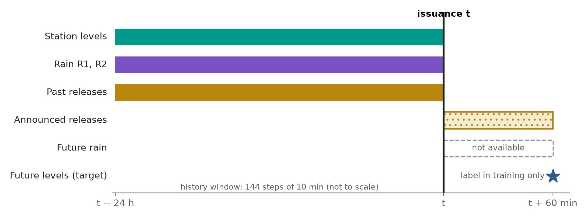

*Figure 3: What is available at issuance t. Levels, rain and past releases cover the 24-h history window; announced releases are the only known future input; future rain is not available; the star marks the target y(t+60), used only as a training label. The axis is schematic, not to scale.*

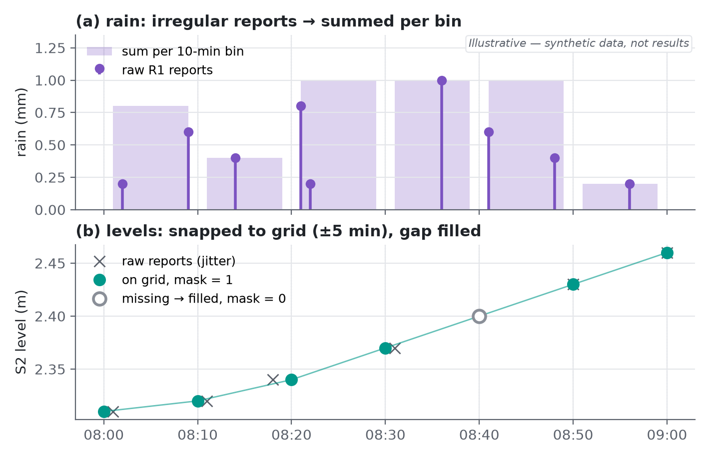

*Figure 4: Alignment onto one 10-min grid. (a) Irregular rain reports are summed per bin (τ−10, τ]. (b) Level reports with timing jitter are snapped to the nearest tick (±5 min); the missing 08:40 value is interpolated and gets mask = 0. Illustrative — synthetic data, not results.*

---

## 4. Model computations and design justification

**Notation**

| Symbol | Meaning |
|---|---|
| t, τ | issuance time; history step τ ∈ {t−143, …, t} |
| V, S | nodes {Res, S1, T1, S2, U, S3, S4} (N = 7); output stations S = {S1, S2, S3, S4} |
| N(i), Up(i) | direct upstream neighbours {j : A_ji = 1}; all upstream ancestors of i |
| x_i(τ) ∈ ℝ⁸ | node features (one row of X) |
| y_i(τ), m_i(τ) | observed level and its mask (1 = valid) |
| r(τ) ∈ ℝ², r̃_i(τ), c_i(τ) | gauge rain per bin; projected rain at node i; rolling 24-h sum |
| r̃_i^6h | projected rain at node i summed over the last 6 h (36 steps) |
| u ∈ ℝ⁶ | announced future releases (X_fut) |
| h_i(τ), z_i ∈ ℝ^d | GRU state; final node state (d = 64) |
| K = 12, Q = {0.1, 0.5, 0.9} | maximum lag (120 min); quantile levels |
| sp, σ, cs | softplus; sigmoid; ordered cumulative softplus (defined below) |

**(1) Rain projection** (fixed P, A6). Weights are renormalised over the gauges that are currently valid:

$$\tilde r_i(\tau) = \frac{\sum_g P_{gi}\, m_g(\tau)\, r_g(\tau)}{\sum_g P_{gi}\, m_g(\tau) + \epsilon}, \qquad c_i(\tau) = \sum_{s=0}^{143} \tilde r_i(\tau - s)$$

**(2) Shared temporal encoder.** One GRU with the same weights θ is applied to all 7 nodes:

$$h_i(\tau) = \mathrm{GRU}_\theta\big(x_i(\tau),\, h_i(\tau-1)\big), \qquad H \in \mathbb{R}^{B\times144\times7\times d}$$

**(3) Directed lag attention (2 layers).** Layer 2 is evaluated at τ = t−6…t, because the nowcast in (5) needs z_i(τ−1) for τ = t−5…t. Layer 1 is evaluated at τ = t−6−K…t so that layer 2 can attend to lagged outputs. For node i at time t (same form at each τ):

$$\alpha_{ijk} = \operatorname*{softmax}_{j\in N(i),\,k\in[0,K]}\left(\frac{q_i(t)^\top k_j(t-k)}{\sqrt d} + \phi(d_{ij}, k)\right), \qquad m_i = \sum_{j}\sum_k \alpha_{ijk}\, W v_j(t-k)$$

$$z_i = \mathrm{LayerNorm}\big(h_i(t) + m_i\big), \qquad q_i = W_Q h_i,\; k_j = W_K h_j,\; v_j = W_V h_j$$

- φ is a small MLP of the distance and the lag; it gives the attention a prior over plausible delays.
- Res, T1 and U have no upstream neighbours, so m_i = 0 for them.

**(4) Release fusion.**

$$e = \mathrm{MLP}(u) \in \mathbb{R}^d, \quad z_{\mathrm{Res}} \leftarrow z_{\mathrm{Res}} + e, \quad z_i \leftarrow \mathrm{LayerNorm}\Big(z_i + \sum_{j\in N(i)} \beta_{ij} W_f z_j\Big)$$

**(5) Three heads** for i ∈ S. The ordering function is $\mathrm{cs}(a) = [a_1,\ a_1{+}\mathrm{sp}(a_2),\ a_1{+}\mathrm{sp}(a_2){+}\mathrm{sp}(a_3)]$, and $\mathrm{cs}^+$ uses $\mathrm{sp}(a_1)$ as its first term, which makes every entry ≥ 0.

$$\Delta^{\text{base}}_i = \mathrm{cs}\big(f_b(z_i^{\text{dry}})\big) \quad (z^{\text{dry}}:\ \text{same backbone, rain channels set to } 0)$$

$$\Delta^{\text{rain}}_i = \mathrm{cs}^+\big(f_r(z_i)\big) \ge 0, \qquad g^{(1)}_i = \sigma\Big(w_1^\top\big[\tilde r_i^{\text{6h}},\, c_i,\, \textstyle\sum_{j\in Up(i)} \tilde r_j^{\text{6h}},\, \sum_{j\in Up(i)} c_j\big] + b_1\Big)$$

The surprise uses a nowcast built only from data up to τ − 1, with stop-gradient (sg), so there is no leakage:

$$\hat y^{\text{now}}_i(\tau) = y^{\text{last}}_i(\tau{-}1) + f_n\big(z_i(\tau{-}1)\big), \qquad s_i(\tau) = m_i(\tau)\,\big(y_i(\tau) - \mathrm{sg}[\hat y^{\text{now}}_i(\tau)]\big),\ \ \tau = t{-}5\ldots t$$

$$\Delta^{\text{hid}}_i = \mathrm{cs}^+\big(f_h([z_i, s_i, \textstyle\sum_{j\in N(i)} s_j])\big) \ge 0, \qquad g^{(2)}_i = \sigma\big(w_2^\top[s_i,\ \textstyle\sum_{j\in N(i)} s_j] + b_2\big)$$

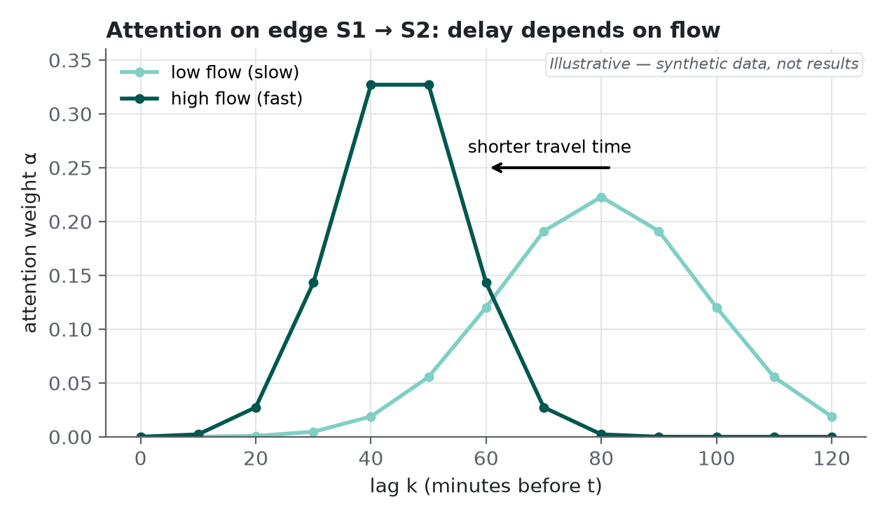

*Figure 5: Attention weight α on edge S1 → S2 against lag. Because queries depend on the current state, the learned delay can move to shorter lags at high flow (A9). Illustrative — synthetic data, not results.*

**(6) Forecast mapping.**

$$\hat y_{i,q} = y^{\text{last}}_i + \Delta^{\text{base}}_{i,q} + g^{(1)}_i\,\Delta^{\text{rain}}_{i,q} + g^{(2)}_i\,\Delta^{\text{hid}}_{i,q}, \qquad i \in S,\ q \in Q$$

Every term is non-decreasing in q and the gates are ≥ 0, so the quantiles can never cross.

**(7) Training objective.** Here ρ_q(e) = max(q·e, (q − 1)·e) is the pinball loss, Ω is the set of targets with m_target = 1, and "dry" means the projected rain over the past 6 h of i's catchment is below a small threshold:

$$\mathcal L = \frac{1}{|\Omega|}\sum_{(b,i)\in\Omega}\sum_{q\in Q} \rho_q\big(y_i(t{+}6) - \hat y_{i,q}\big) + \lambda_1\, \overline{g^{(1)}}_{\text{dry}} + \lambda_2\, \overline{g^{(2)}} + \lambda_3\,\frac{\sum m_i(\tau)\big(y_i(\tau) - \hat y^{\text{now}}_i(\tau)\big)^2}{\sum m_i(\tau)}$$

- Levels are normalised per station, so all four stations carry equal weight.
- The optimiser is Adam with early stopping on the validation year.
- Inputs are rebuilt "as available at t", with sensor dropout and simulated delays (§5).

**Design justification**

| Choice | Why |
|---|---|
| Directed graph instead of a flat multivariate model | Topology is known (F4, F5). It rules out impossible paths (e.g. S3 → S1) and lets all nodes share weights on a limited record (A1). |
| One GRU shared across nodes | Rise, recession and daily cycle look alike at every node, so 7× more sequences train each weight. |
| Lag attention, not fixed lags | Travel times are unknown and change with flow (F5, F6). State-dependent queries adapt the delay (Figure 5); distance is only a prior φ. |
| Predict Δ from y_last | Persistence is strong at 1 h, and Δ is well-scaled across stations. |
| Three-way decomposition | Separates what the inputs explain (base flow, gauged rain) from what they cannot (hidden rain); interpretable, and the band widens when the hidden term is active (Figures 6, 7). |
| Quantile outputs | Flood preparedness needs a band, not a point forecast. |

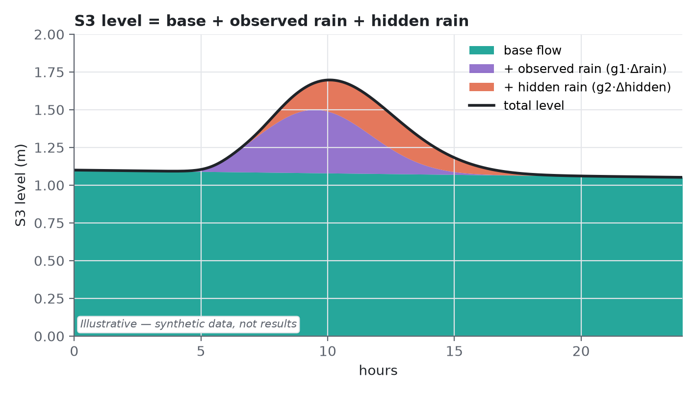

*Figure 6: Three-way decomposition of the S3 level in a storm: base flow + observed-rain contribution + hidden-rain contribution = total. The hidden part represents the unmonitored tributary, which is visible only as surprise at S3. Illustrative — synthetic data, not results.*

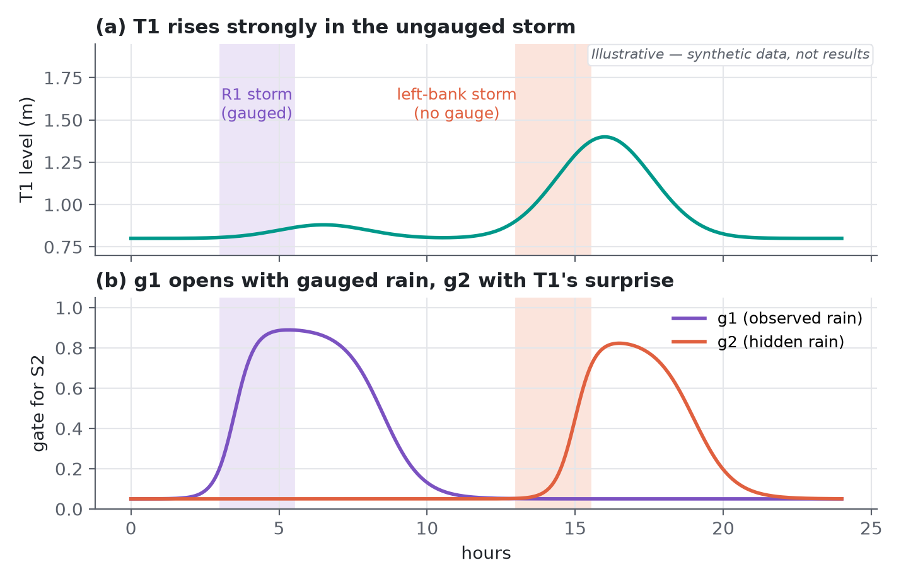

*Figure 7: Gates during two storms. g1 opens with gauged R1 rain. Later, T1 rises with no gauged rain (a left-side storm); the resulting surprise opens g2 for S2. Illustrative — synthetic data, not results.*

**Physics vs learned**

| Element | Fixed (physical assumption) | Learned mapping |
|---|---|---|
| Graph direction, connectivity | ✔ A, downstream only (F4, A8) | — |
| River distances | ✔ D as an input feature | how distance affects delay (φ) |
| Rain-to-catchment map | ✔ P from geography (A6) | how much rain reaches each station, and when |
| Rain sign and combination | ✔ softplus ≥ 0, additive (A12) | size and duration of the rain response |
| Persistence | ✔ forecast = y_last + Δ | Δ itself |
| Travel delays | — | ✔ lag attention α (A9) |
| Release response | — | ✔ fusion MLP, graph pass |
| Hidden inflow (U, left-side rain) | ✔ only its sign (≥ 0) and where it enters (A13) | ✔ size, from surprise |
| Uncertainty width | ✔ quantile ordering | ✔ width, from the pinball loss |

**How each factor reaches each station** (qualitative map in Figure 8):
- **Reservoir release:** enters through the release feature on Res, then Res → S1 attention (past releases) and the fusion pass (X_fut). It is strongest at S1. Farther down it is mostly already reflected in upstream levels.
- **Upstream conditions:** S1's state reaches S2 over edge S1 → S2 at a learned lag, and S2 reaches S3 the same way. Two hops cover any ≤ 1-h influence (A10).
- **Monitored tributary T1:** reaches S2 over edge T1 → S2. T1's surprise also feeds S2's g2.
- **Rainfall:** R1 enters at Res, S1 and (weakly) T1; R2 enters at U and S3. Both act through the observed-rain head, gated by g1 using rain over the station's whole upstream catchment.
- **Unmonitored tributary and left-side rain:** no direct input. They reach the forecast through S3's surprise (U) and T1/S1's surprise (left side) via the hidden-rain head (A13).

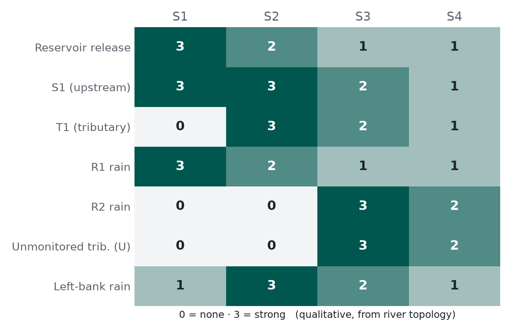

*Figure 8: Qualitative influence (0–3) of each factor on each station's 1-hour forecast, read from the river topology. These are not learned weights or measured sensitivities.*

---

## 5. Operation and exceptional conditions

### (i) Missing observations
- QC sets **mask = 0**. Interior gaps are interpolated and trailing gaps forward-filled (Figure 9). The data-age counter grows while the sensor is offline.
- **Training:** random sensor dropout (whole sensors for hours, plus single steps), so the model learns to rely on graph neighbours. For example, with T1 offline, S2 leans on S1 and on rain over T1's catchment.
- **Loss:** targets with a missing true value are skipped (masked pinball loss).
- **Surprise** is computed only where mask = 1, so a missing sensor never fakes hidden rain.
- **Output:** the band widens, because the model saw such cases in training (Figure 12), and a "sensor offline" flag is published with the forecast.

### (ii) Delayed observations
- The system **never waits**: each forecast is issued on the tick with whatever has arrived.
- Data not yet arrived gets mask 0 and is forward-filled, and the age feature shows how stale each value is (Figure 9).
- **Training replays history "as it was available at t"**, using the logged arrival delays (A3). Deployment inputs therefore look like training inputs, and there is no leakage.
- A late reading is stored under its true timestamp and used from the **next cycle**. Optionally, the forecast is re-issued if the late data changes ŷ a lot.

### (iii) Announced future releases
- X_fut [B,6,1] holds the scheduled release at t + 10 … t + 60. It is built **only from schedules with announcement time ≤ t**; for each future step the newest such schedule applies (A7).
- If no schedule covers a step, the last recorded release is held constant.
- X_fut is fused at node Res (block 4) and then passed one hop downstream, mainly affecting S1 within the hour.

### (iv) Scheduled vs actual releases
- **Training uses schedules as they were announced, not the actual releases**, so the model learns the typical schedule–actual gap that it will also face in deployment.
- Once an actual release is recorded, it becomes past input (X_rel) in the next cycle and overrides the schedule for that time.
- When |actual − scheduled| exceeds a threshold, the system **flags it** and widens the band for the affected stations until the two agree again (Figure 10).

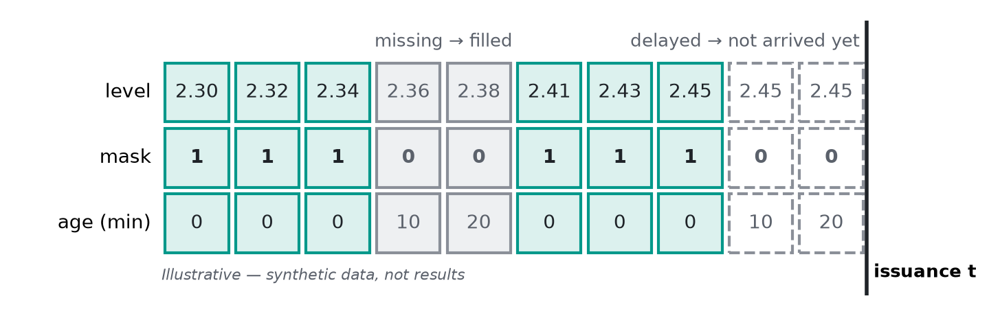

*Figure 9: One sensor at issuance t: received readings (mask 1), a two-step outage that is filled (mask 0), and the last two readings still delayed (forward-filled, mask 0). The age row counts minutes since the last real value. Illustrative — synthetic data, not results.*

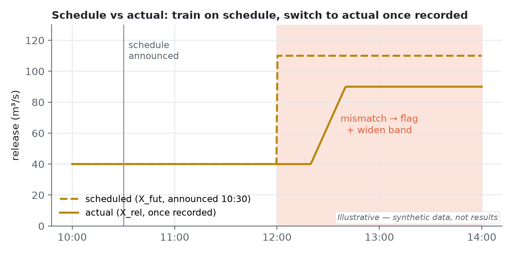

*Figure 10: The gate opens later and lower than scheduled. The model is trained on the schedule as announced (dashed, X_fut); once recorded, the actual release (solid) becomes past input X_rel. While the two differ by more than a threshold, a flag is raised and the band widens. Illustrative — synthetic data, not results.*

### Feasibility of running every 10 minutes

Design estimates, not benchmarks:

| Item | Estimate |
|---|---|
| Parameters (d = 64) | GRU ≈ 14 k, attention + fusion ≈ 50 k, heads ≈ 15 k, about 80 k in total |
| Compute per forecast | 2 passes (normal + dry) × 7 nodes × 144 GRU steps ≈ 0.1 GFLOP, milliseconds on a CPU (≪ 1 s) |
| Data per cycle | 5 levels + 2 gauges + 1 release, a few hundred numbers |
| Load | 144 issuances/day; a full 24-h recompute every cycle (needed anyway when late data revises the past) fits easily in the 10-min budget (Figure 11) |

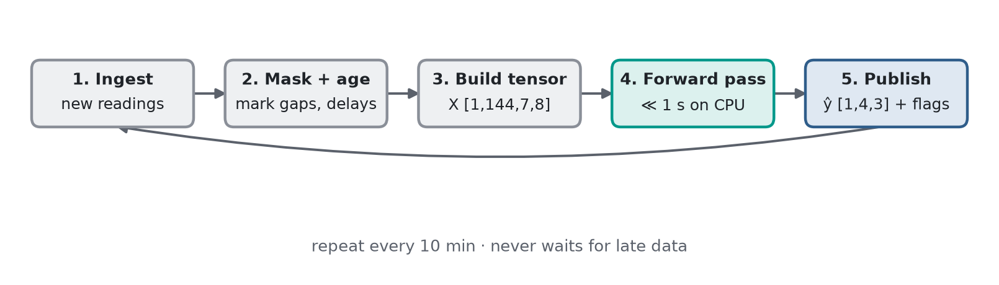

*Figure 11: The 10-minute operating loop: ingest → mask/age → build tensor → forward pass → publish quantiles and flags, then repeat. Late data is used in the next cycle.*

---

## 6. Uncertainty, limitations, and additional information

**How physics and uncertainty are handled.**
- **Physics:** we do **not** use a separate physical simulator. Physical knowledge enters as structure: the directed graph, distances, the fixed P, non-negative additive rain, and persistence (table in §4).
- **Uncertainty:** quantile regression with the pinball loss, inputs that represent data problems (mask, age, gates), and operational flags.
- **Calibration:** the coverage of the 10–90 % band is monitored on a rolling window. If coverage drifts, the band is rescaled and the model retrained.

| Limitation / uncertainty | Forecast impact | Response | Unresolved |
|---|---|---|---|
| **Unmonitored tributary** | S3/S4 forecasts miss its inflow until S3 itself rises. | Virtual node U with R2 rain; the S3 surprise feeds g2 and the hidden-rain head; the band widens. | The first ~10–20 min of a U-driven rise is seen late, and its size can only be inferred. |
| **Changing travel times** | Fixed lags would give mistimed peaks, early at low flow and late at high flow. | State-dependent lag attention (Figure 5) with a distance prior; 120-min lag range. | Rare very-high-flow speeds may lie outside the training data. |
| **No rain gauge on the left side (T1 catchment)** | Warning comes only once T1 rises, so **S2 has the shortest lead time**. | T1/S1 surprise → g2 for S2; small R1 → T1 weight for shared storms. | The rain that falls before T1 responds stays invisible. |
| **No future rainfall** | Rain starting within the next hour is not anticipated; forecasts lag the onset. | Rain-response memory covers rain that has already fallen; the band widens when a storm is under way. | Fully unresolved without a nowcast (request I3). |
| **Rare extreme floods** | Few training examples, so quantiles may be too narrow and the median biased low. | Δ formulation and non-negative rain terms limit nonsense; inputs outside the training range raise a flag. | Calibration in the extreme tail cannot be verified with A1 data. |
| **Sensor drift or faults** | Biased inputs and false surprise, which can open g2. | QC rules, comparison with neighbouring stations, masks; surprise is used only where mask = 1. | Slow drift is hard to separate from a real trend. |
| **Base/rain split not observable** | The decomposition (Figure 6) is a model interpretation, not a measurement. | Gate penalties keep the split parsimonious; the dry pass makes the base head rain-free. | Only the total is validated; the split is not used to make decisions. |
| **Schedule–actual mismatch** | S1 (and later S2) errors right after a release change. | Train on announced schedules; actual releases override once recorded; flag and widen. | The size of the mismatch is unknown until recorded. |
| **Reporting delays** | Stale inputs, especially just after a fast rise. | Age feature, delay-aware training, never waiting. | Long outages reduce the system to upstream and rain information. |
| **Channel or datum changes (A14)** | Level offsets break the learned Δ. | Per-station normalisation, scheduled retraining. | Sudden changes need manual notice from the authority. |

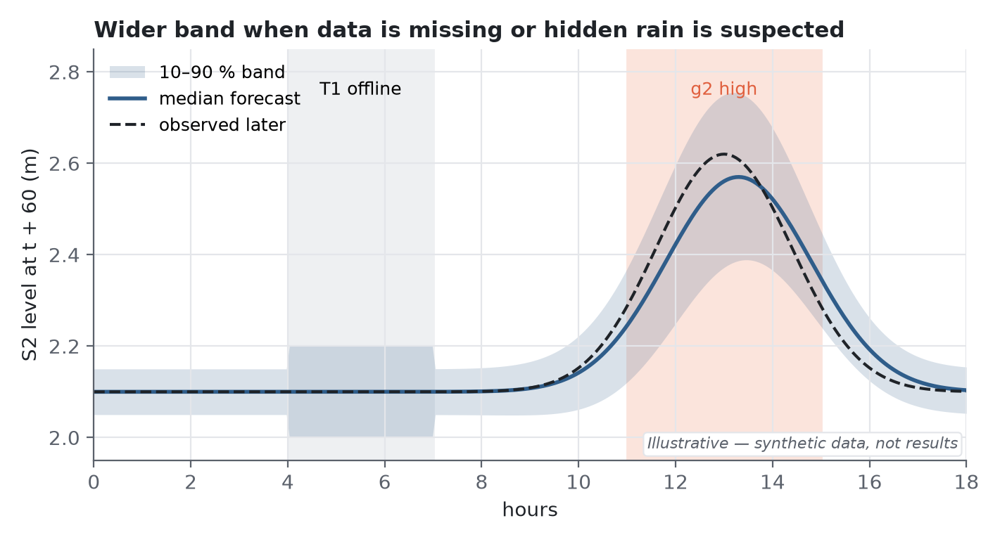

*Figure 12: The S2 forecast's 10–90 % band widens while T1 is offline and while g2 is high (suspected hidden rain). Illustrative — synthetic data, not results.*

**Additional information requests** (none are guaranteed; the system works without every one of them):

| ID | Request | How it helps | Usable without? |
|---|---|---|---|
| I1 | Rain gauge on the left side (T1 catchment) | Earlier warning for T1/S2; less reliance on surprise. | Yes (surprise-based hidden-rain head) |
| I2 | Level/flow gauge on the unmonitored tributary | Turns U into a real sensor node and removes the main S3 blind spot. | Yes (virtual node U) |
| I3 | Rainfall nowcast or radar (0–2 h) | Anticipates rain within the horizon (future rain becomes a known input). | Yes (no future rain, wider band) |
| I4 | Rating curves (level ↔ discharge) at S1–S4, T1 | Allows mass-balance checks and a discharge-space Δ; improves extrapolation. | Yes (works in level space) |
| I5 | Reservoir gate logs (gate openings, operator actions) | Detects schedule deviations sooner; improves X_rel quality. | Yes (recorded releases only) |
| I6 | Sensor delay and outage statistics | More realistic delay simulation in training (A3); better data-age handling. | Yes (assumed delay distribution) |
| I7 | Survey of river cross-sections | Better travel-time prior φ and better high-flow extrapolation. | Yes (distance-only prior) |

---

## Compliance checklist

| Requirement in the question | Where answered |
|---|---|
| Architecture drawn first: sources, blocks, combination, S1–S4 forecasts | §1, Figure 1, Figure 2 |
| Tensor dimensions, alignment, projection, reshaping labelled | Figure 1 (shape in each box), §1 bullets, Figure 4 |
| Assumptions A1, A2, … listed separately, why reasonable, effect on design | §2 assumption table (A1–A14) |
| Assumptions distinguished from supplied facts | §2 facts table (F1–F8) |
| Unspecified data conditions (record length, delays, quality) | A1, A2, A3, A4, A5, A7 |
| River dynamics assumed | A8–A13 |
| Issuance time, history window, one-hour horizon, outputs | §3 bullets, Figure 3 |
| One table of inputs and outputs: dimensions, axes (incl. batch), time coverage | §3 table |
| Alignment across locations and sampling times | §3 alignment bullets, Figure 4 |
| Information available at issuance | §3 table "Available at t?", Figure 3 |
| Notation and core equations of main blocks | §4 notation table, equations (1)–(5) |
| Forecast mapping and training objective | §4 equations (6), (7) |
| Justification of major choices | §4 "Design justification" |
| Influence of upstream conditions, tributaries, rainfall, releases | §4 "How each factor reaches each station", Figure 8 |
| Physical assumptions vs learned mappings | §4 "Physics vs learned" table |
| Reference to diagram and assumptions | §4 cites Figures 1, 5, 6, 7, 8 and A6–A13 |
| (i) missing, (ii) delayed observations | §5 (i), (ii), Figure 9 |
| (iii) announced releases, (iv) scheduled vs actual | §5 (iii), (iv), Figure 10 |
| Feasibility of running every 10 min | §5 feasibility, Figure 11 |
| Uncertainties and limitations incl. unmonitored tributary and changing travel times | §6 limitations table |
| Impact and response, or what remains unresolved | §6 table columns |
| Additional information requests, benefit, usable without | §6 requests table (I1–I7) |
| Treatment of physical relationships and uncertainty (no simulator) | §6 opening bullets, §4 physics table, Figure 12 |

**Reproducing the figures:** from `Question1/`, run `python figures/src/run_all.py` (matplotlib only); each `figures/src/figNN_*.py` also runs on its own. All plots built from synthetic data say so in their caption and inside the plot.

---

## AI usage disclosure

I used Claude for Questions. It explained the question to me, helped develop my design ideas into the final design
