# AI651 Assignment 2 — Report

| | |
|---|---|
| **Student** | Muhammad Ahmad Gill (25280065) |
| **Course** | AI651 – Deep Learning for Space, Time and Graphs, Fall 2026 |
| **Code (GitHub, public)** | <https://github.com/Ahmad-Gill/LUMS-Academics/tree/main/Third%20Semester/Deep%20Learning%20For%20Time%20Space%20Grsph/Assignments/Assignment%202> |
| **Notebook** | `Question2/25280065_Question_2.ipynb` |
| **Hardware** | Apple M2 Pro, PyTorch 2.14.1, MPS backend |

**Contents**

1. Question 1 — River Forecasting Proposal
2. Question 2 — Motion or Memory?
   1. Setup (Table 1, Figure 1, Q2.1–Q2.2)
   2. Baseline: ConvLSTM (Table 2, Figure 2, Q2.3–Q2.5)
   3. Testing the Baseline (Tables 3–4, Figures 3–5, Q2.6–Q2.10)
   4. What Can Data Fix? (Table 5, Q2.11–Q2.14)
   5. The Final Model (Table 6, Figure 6, Q2.15–Q2.17)
   6. Summary of findings
3. Reproducibility
4. Use of generative AI

Tables and figures follow the handout's numbering (Table 1–6, Figure 1–6). Extra material that the
handout does not number is labelled **Diagram D1–D11** (architecture and concept diagrams) and
**Plot P1–P5** (supplementary charts) so it never collides with the handout's numbers.
Errors are given to three significant figures, and values below 10⁻³ in scientific notation.
Learned-model entries are **mean (seed 0, seed 1)**.

\newpage

# Question 1 — River Forecasting Proposal

<!-- TODO (Q1): write this section later. Keep the six headings below, in this order (required by the handout). -->

## 1. Architecture diagram

<!-- TODO: insert hand-drawn architecture diagram, e.g.  -->
*To be added.*

## 2. Assumptions

*To be added (A1, A2, …; separate assumptions from supplied facts).*

## 3. Forecasting task and data specification

*To be added (issuance time, history window, one-hour horizon, input/output table with dimensions and time coverage).*

## 4. Model computations and design justification

*To be added (notation, core equations, training objective, how upstream conditions, tributaries, rainfall and releases enter).*

## 5. Operation and exceptional conditions

*To be added ((i) missing observations, (ii) delayed observations, (iii) announced releases, (iv) scheduled vs actual releases; feasibility every 10 minutes).*

## 6. Uncertainty, limitations, and additional information

*To be added.*

\newpage

# Question 2 — Motion or Memory?

A forecaster with a good test score has not necessarily learned *how things move*; it may only have
learned *what the training videos look like*. This question trains a ConvLSTM on Moving MNIST,
stress-tests it with transformations that should not matter to a true motion rule (mirror, rotation,
faster playback), diagnoses each failure, and builds a final model that holds up.

<!-- REDRAW: Question2/figures/diagrams/D1_q2_roadmap.png -->
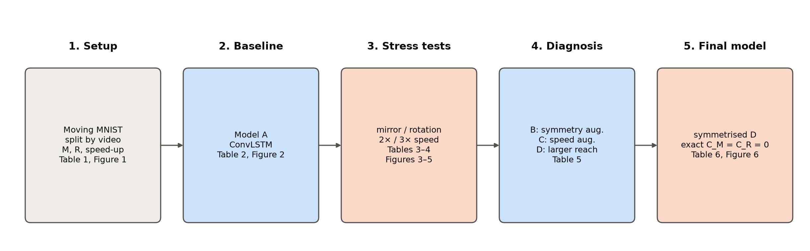

**Diagram D1:** Roadmap of Question 2 and where each table and figure comes from.

## 1. Setup

### Data

Moving MNIST is loaded with `torchvision.datasets.MovingMNIST(root="data", split=None, download=True)`,
giving all 10,000 videos of 20 frames (1×64×64). Videos are split **by index**: 0–7,999 train,
8,000–8,999 validation, 9,000–9,999 test. Frames are kept as `uint8` in memory and converted to
`float32 / 255` per batch on the device. Frames are numbered 1–20 (tensor index = frame − 1).

### Transformations and the symmetry group

* **Mirror** M: `x.flip(-1)`, i.e. (Mx)[i, j] = x[i, 63 − j].
* **Rotation** R: `torch.rot90(x, k=1, dims=(-2, -1))`, 90° anticlockwise.
* **Speed-up** k×: keep every k-th frame.

Mirror and rotation generate the 8 symmetries of the square, G = {Rᵃ, MRᵃ : a = 0..3}, with
MRᵃ = M(Rᵃ(x)) (rotate first, then mirror). Rᵃ is undone by R⁻ᵃ and each MRᵃ is its own inverse;
both properties are asserted in the notebook for all 8 elements.

<!-- REDRAW (optional, data figure): Question2/figures/diagrams/D2_symmetry_group.png -->
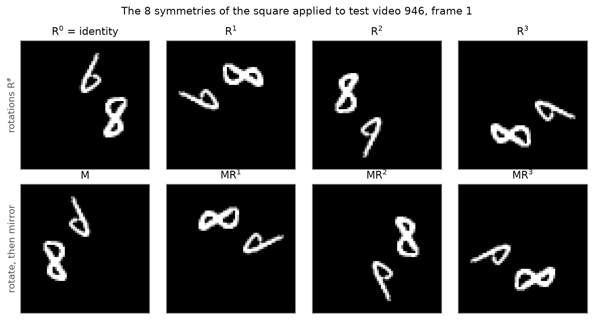

**Diagram D2:** The 8 elements of G applied to one real test frame. The digit "6" makes it easy to see that
mirroring changes the digit's appearance even though the motion rule is unchanged.

### Windows at different speeds

A window starting at frame t at speed k uses X = (x_t, x_{t+k}, …, x_{t+4k}) and
Y = (x_{t+5k}, …, x_{t+9k}), keeping only target frames ≤ 20. Allowed starts are t ∈ {1..11} for
normal training (models A, B), and t ∈ {1..14} at 1×, {1..8} at 2×, {1, 2} at 3× for speed-augmented
training (models C, D): all five inputs and at least two targets must exist.

<!-- REDRAW: Question2/figures/diagrams/D3_windows_speeds.png -->


**Diagram D3:** Frames used with t = 1 at 1×, 2× and 3×, and the allowed start frames for each speed.

### Checking the code

**Table 1:** Checks of the transformation and window functions (computed with the same functions the experiments use).

| | Check | Expected | Ours |
|---|---|---|---|
| (a) | max \|M(M(x)) − x\| | 0 | 0 (`torch.equal` = True) |
| (b) | max \|R⁴(x) − x\| | 0 | 0 (`torch.equal` = True) |
| (c) | max \|MRM(x) − R⁻¹(x)\| | 0 | 0 (`torch.equal` = True) |
| (d) | bright pixel of M(p) (frame, row, column) | (7, 10, 43) | (7, 10, 43) |
| (e) | bright pixel of R(p) (frame, row, column) | (7, 43, 10) | (7, 43, 10) |
| (f) | 1× input / target frames | 1–5 / 6–10 | 1–5 / 6–10 |
| (g) | 2× input / target frames | 1, 3, 5, 7, 9 / 11, 13, 15, 17, 19 | 1, 3, 5, 7, 9 / 11, 13, 15, 17, 19 |
| (h) | 3× input / target frames | 1, 4, 7, 10, 13 / 16, 19 | 1, 4, 7, 10, 13 / 16, 19 |

All rows match.

### Is the training data already symmetric?

Dense optical flow (OpenCV Farneback, `0.5, 3, 15, 3, 5, 1.2, 0`, on `uint8` frames) was computed on the
first 50 training videos, all 19 consecutive pairs (950 pairs). Pixels were kept if they are brighter than
0.2 at the same location in both frames and move more than 0.5 px.


**Figure 1:** Optical flow on the first 50 training videos (950 frame pairs), pooled over **103,050** kept pixels.
(a) Flow direction θ = atan2(−dy, dx), 18 bins of 20°; red line = uniform level 1/18. (b) Flow speed;
**median = 3.32 px/frame**. Both are fractions of kept pixels.

### Q2.1

**Direction.** Yes, mirrored and rotated trajectories are already familiar. Every 20° bin in Figure 1(a)
is non-empty, holding between 0.0263 and 0.0820 of the kept pixels (uniform = 0.0556). A mirror maps
θ → 180° − θ, which reflects the histogram about the 90°/270° axis. A 90° rotation maps θ → θ + 90°, which
shifts it by 4.5 bins. Neither creates a direction that is missing from training, so the transformed motion
stays within what training already covers. Only the digits' appearance is new.

**Speed.** The median speed is **3.32 px/frame**. 72.2 % of kept pixels are between 3 and 4.5 px/frame,
and only 0.465 % are above 5 px/frame. So 2× ≈ **6.64 px/frame** and 3× ≈ **9.95 px/frame** are speeds the
model has essentially never seen in training.

**Overlap bias.** Where digits overlap, flow tends to underestimate speed and adds scattered directions.
The small bump near 1 px/frame in Figure 1(b) is likely this effect. It can only add low speeds and
spread directions out. It cannot create speeds of 6.6–10 px/frame or remove whole directions, so it
cannot change either conclusion.

### Q2.2

| Transformation | Changes motion statistics? | Changes appearance? |
|---|---|---|
| Mirror | No | Yes |
| Rotation | No | Yes (more) |
| Speed-up | Yes | No |

Mirror and rotation do change each digit's velocity (e.g. dx → −dx), but the **distribution** of directions and
speeds stays within what training covers (Q2.1). Each transformation changes **only one thing** and keeps the
physics the same, so if the model fails we know the cause: appearance (mirror or rotation) or motion (speed-up).

\newpage

## 2. Baseline: ConvLSTM (model A)

### Architecture

Model A follows Shi et al. (2015) without peepholes: each frame is folded with `pixel_unshuffle(·, 4)`,
passed through two ConvLSTM layers (64 hidden channels, 3×3 kernels, stride 1, zero padding 1), then a
1×1 convolution (64 → 16), `pixel_shuffle(·, 4)` and a sigmoid. One convolution computes all four gates:

[i, f, o, g] = Conv₃ₓ₃([u_τ, h_{τ−1}]),  c_τ = σ(f) ⊙ c_{τ−1} + σ(i) ⊙ tanh(g),  h_τ = σ(o) ⊙ tanh(c_τ).

<!-- REDRAW: Question2/figures/diagrams/D4_convlstm_cell.png -->
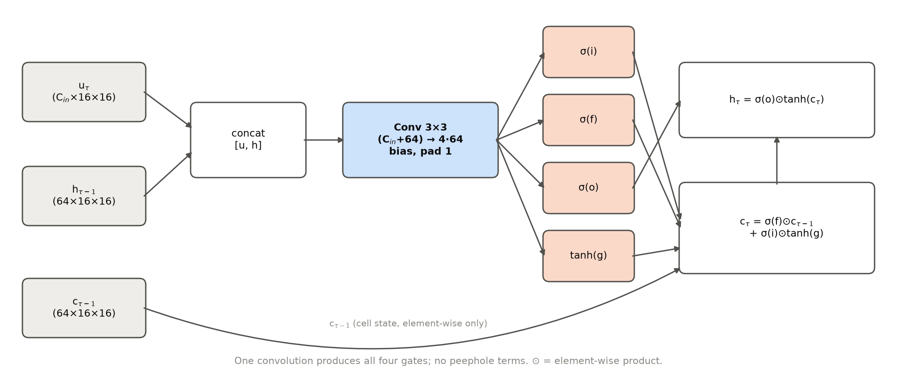

**Diagram D4:** One ConvLSTM cell. A single 3×3 convolution over [u, h] produces the four gates.

<!-- REDRAW: Question2/figures/diagrams/D5_model_A.png -->
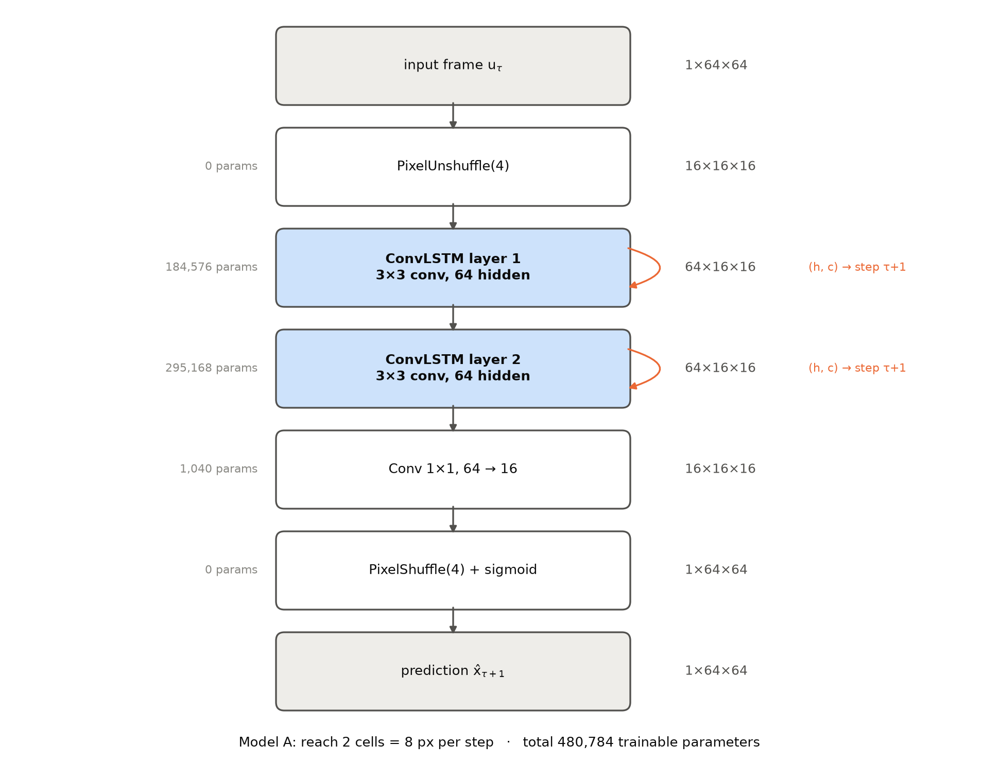

**Diagram D5:** Model A with tensor shapes and parameter counts per layer (total **480,784**, matching the handout).

The network runs for 9 steps: steps 1–5 take the true input frames, steps 6–9 take the network's own
previous prediction (no teacher forcing; gradients flow through the fed-back predictions). The outputs of
steps 5–9 form Ŷ.

<!-- REDRAW: Question2/figures/diagrams/D6_rollout.png -->
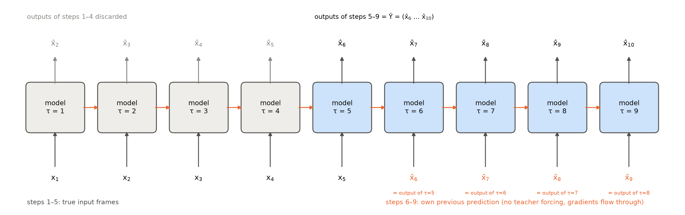

**Diagram D6:** The 9-step rollout used in both training and evaluation.

### Training and evaluation protocol

| Setting | Value |
|---|---|
| Optimiser | Adam, learning rate 10⁻³, no schedule |
| Batch / epochs | 32 / 30, final-epoch weights kept |
| Epoch | one pass over the 8,000 training videos in shuffled order, one random window per video |
| Loss | squared error averaged over pixels and *available* target frames per video, then over the batch |
| Seeds | 0 and 1 (control initialisation, shuffling, window and augmentation sampling) |
| Hardware | Apple M2 Pro, MPS backend, PyTorch 2.14.1 |
| Training time (A) | 19.9 s/epoch (seed 0), 19.8 s/epoch (seed 1) |


**Plot P1:** Training loss and validation E(5) (1×, t = 1) for models A–D over 30 epochs (mean of the two seeds;
band = range across seeds). Validation error is still falling at epoch 30, so all models are somewhat
under-trained under the fixed protocol. C and D train on harder (faster) windows, so their training loss is higher.

### Results

**Table 2:** Test-set error (1×, t = 1) per forecast horizon and E(5). Model A entries are mean (seed 0, seed 1).

| Model | MSE₁ | MSE₂ | MSE₃ | MSE₄ | MSE₅ | E(5) | Params |
|---|---|---|---|---|---|---|---|
| A | 0.0171 (0.0177, 0.0165) | 0.0205 (0.0213, 0.0197) | 0.0228 (0.0237, 0.0219) | 0.0247 (0.0256, 0.0237) | 0.0265 (0.0275, 0.0255) | **0.0223** (0.0232, 0.0214) | 480,784 |
| Blank | 0.0426 | 0.0426 | 0.0426 | 0.0425 | 0.0425 | 0.0426 | 0 |
| Copy-last | 0.0492 | 0.0604 | 0.0669 | 0.0708 | 0.0732 | 0.0641 | 0 |

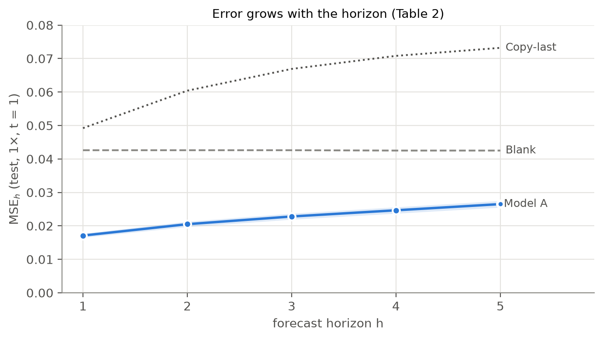

**Plot P2:** Table 2 as a chart: model A's error per horizon (band = seed range) against the two reference predictors.

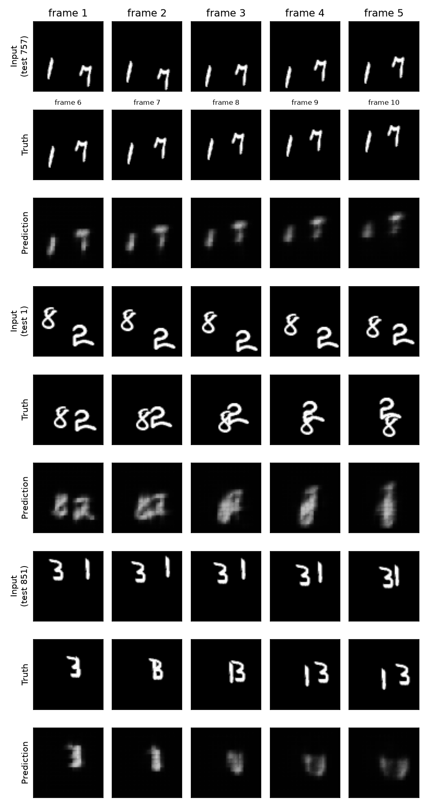

**Figure 2:** Seed-0 model A on test videos 757, 1 and 851 (dataset indices 9757, 9001, 9851). Rows: input
frames 1–5, true future frames 6–10, prediction. Video 757 has no overlap; in videos 1 and 851 the digits
overlap in the future frames.

### Q2.3

<!-- REDRAW: Question2/figures/diagrams/D8_reach_A_vs_D.png -->
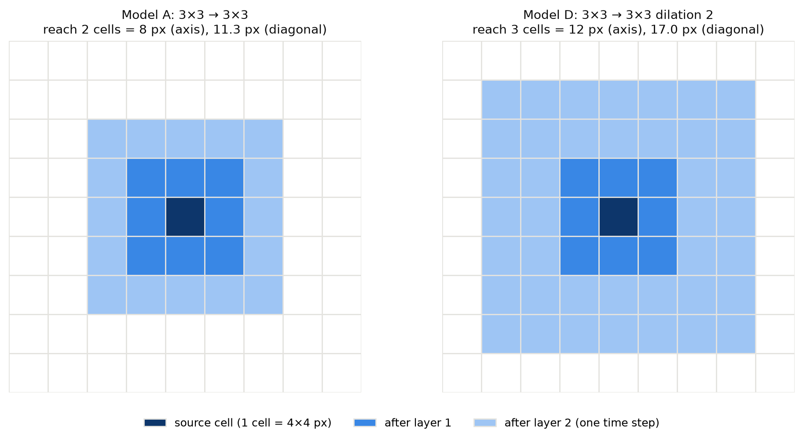

**Diagram D8:** Cells (4×4 px each) that one source cell can influence within a single time step. Left: model A
(two 3×3 convolutions). Right: model D (3×3, then 3×3 with dilation 2), used later in Q2.12.

**Reach of model A ≈ 8 px per step (horizontal/vertical), 11.3 px diagonally.**

- `pixel_unshuffle(4)` turns each 4×4 patch into one cell, so **1 cell = 4 pixels**. Folding, unfolding and the 1×1 conv move nothing.
- Each 3×3 conv moves information at most 1 cell, including diagonally.
- Paths within one step: u_τ → conv 1 → conv 2 = **2 convs**; h⁽¹⁾_{τ−1} → conv 1 → conv 2 = **2 convs**;
  h⁽²⁾_{τ−1} → conv 2 = 1 conv. The cell states c are updated element-wise and move nothing.
- So the longest path is 2 convs: **2 cells = 8 px along rows or columns**, and **2√2 cells ≈ 11.3 px diagonally**.

So reach depends on direction: 8 px for horizontal/vertical motion, up to 11.3 px diagonally.
1× (3.32 px/frame) and 2× (6.64 px/frame) are within reach. 3× (9.95 px/frame) exceeds the reach for
horizontal/vertical motion and is close to the diagonal limit, so most 3× motion is at or beyond reach
(revisited with experimental evidence in Q2.13).

### Q2.4

Model A beats both references: E(5) = 0.0223, about half of Blank (0.0426) and a third of Copy-last (0.0641).
Copy-last is worse than Blank because a moved digit is penalised twice: once where it was copied and once where it should be.
A's error grows from 0.0171 (h = 1) to 0.0265 (h = 5), about +55 %, because it feeds back its own blurry predictions.
Figure 2 shows predictions blurring and fading with each frame, with a visible 4×4 block pattern from pixel_shuffle.
When digits overlap, A merges them into one blob and cannot separate them: in video 851 the 3 and 1 overlap at
frame 6 and the 1 never reappears, even though they separate in the truth. In video 1 the 8 and 2 merge into one
vertical blob. Validation E(5) was still falling at epoch 30, so A is somewhat undertrained, which may explain the seed gap
(0.0232 vs 0.0214).

### Q2.5 (written before running Testing the Baseline)

*Reproduced unedited. Committed in `fc4408f` (2026-10-28 18:02) before any Section 3 experiment was run.*

- **Mirror: passes, mostly.** The motion is familiar (Fig. 1a) and only the digit shapes are new, so E_M is a little above 0.0223 and C_M is small.
- **Rotation: fails partly.** The motion is familiar, but the digits look even less familiar, so E_R > E_M and C_R > C_M.
- **Speed:** 2× (6.64 px) is within reach but outside the training speeds, so I expect clear degradation.
  At 3× (9.95 px), horizontal/vertical motion exceeds the 8 px reach, so I expect it to break down: digits stall, blur or vanish.

\newpage

## 3. Testing the Baseline

### Mirror and rotation

If a forecaster f has learned a rule that carries over to the transformed scene, predicting from T(X)
should equal transforming the prediction f(X). The **consistency gap** C_T measures that; the
**transformed error** E_T measures correctness.

<!-- REDRAW: Question2/figures/diagrams/D10_commutative_square.png -->
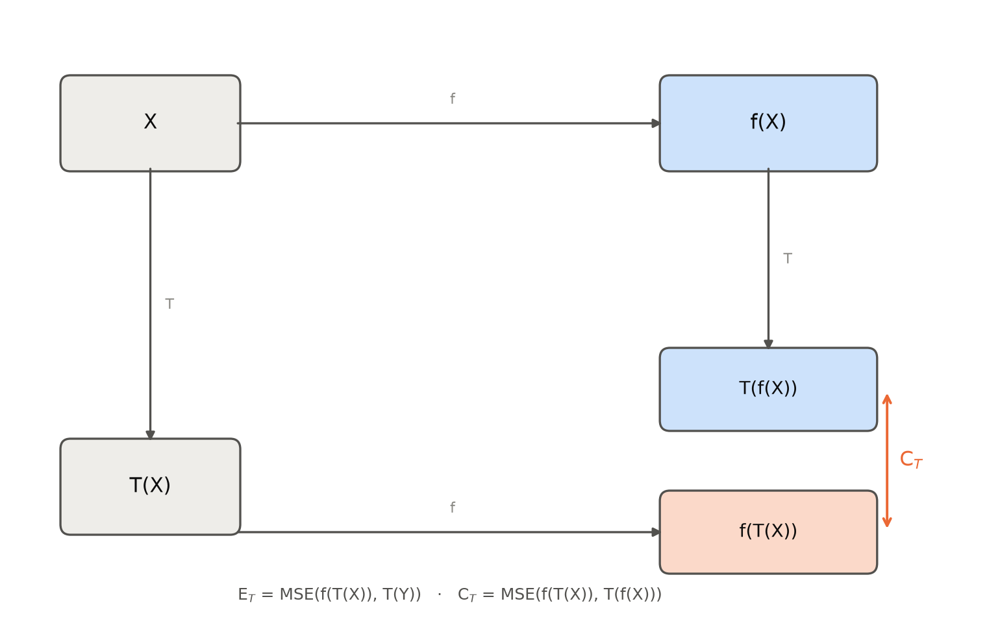

**Diagram D10:** The two paths that should agree. C_T compares the two bottom-right boxes; E_T compares f(T(X)) with the transformed truth T(Y).

**Table 3:** Test-set E(5), consistency gaps C_M, C_R and transformed errors E_M, E_R (1×, t = 1). Model A: mean (seed 0, seed 1).

| Model | E(5) | C_M | E_M | C_R | E_R |
|---|---|---|---|---|---|
| A | 0.0223 (0.0232, 0.0214) | 0.00185 (0.00155, 0.00216) | 0.0230 (0.0236, 0.0223) | 0.00326 (0.00297, 0.00356) | 0.0241 (0.0248, 0.0234) |
| Blank | 0.0426 | 0 | 0.0426 | 0 | 0.0426 |
| Copy-last | 0.0641 | 0 | 0.0641 | 0 | 0.0641 |

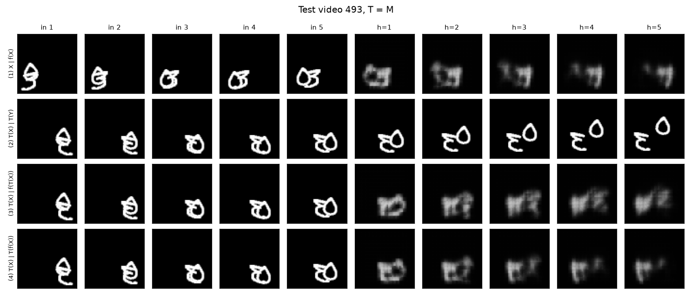


**Figure 3:** Seed-0 model A on the two test videos with the largest C_M (493, 547) and the largest C_R (36, 928).
Rows: (1) X | f(X), (2) T(X) | T(Y), (3) T(X) | f(T(X)), (4) T(X) | T(f(X)); columns 1–5 inputs, 6–10 future.
Animated versions: `Question2/figures/gifs/fig3_M_493.gif`, `fig3_M_547.gif`, `fig3_R_36.gif`, `fig3_R_928.gif`.

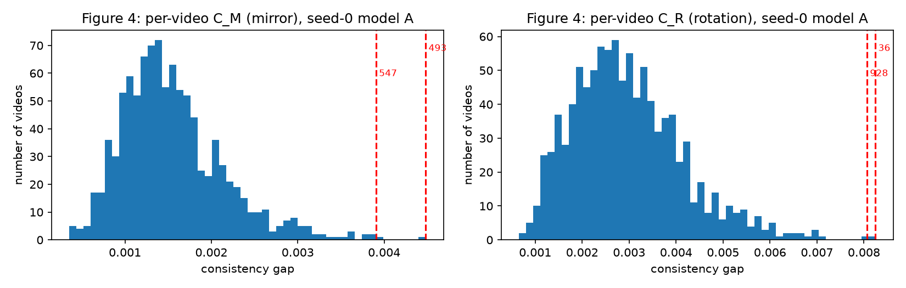

**Figure 4:** Per-video C_M and C_R of seed-0 model A over the 1,000 test videos; red lines mark the Figure 3 videos.

### Faster motion

**Table 4:** Model A at different speeds (t = 1), with Blank and Copy-last for comparison. Model A: mean (seed 0, seed 1).

| Model | E(2) 1× | E(2) 2× | E(2) 3× | E(5) 1× | E(5) 2× |
|---|---|---|---|---|---|
| A | 0.0188 (0.0195, 0.0181) | 0.0432 (0.0433, 0.0431) | 0.0478 (0.0492, 0.0464) | 0.0223 (0.0232, 0.0214) | 0.0471 (0.0473, 0.0470) |
| Blank | 0.0426 | 0.0425 | 0.0426 | 0.0426 | 0.0425 |
| Copy-last | 0.0548 | 0.0661 | 0.0703 | 0.0641 | 0.0719 |


**Figure 5:** Test video 946 (digits do not overlap in any displayed true frame) at 1×, 2× and 3×: five input
frames, first two true future frames, first two predictions (seed-0 model A).

### Q2.6

Blank and Copy-last have C_M = C_R = 0 but the worst errors (E = 0.0426 and 0.0641). A trivial model can be perfectly
consistent while being useless, so a small C_T alone does not mean the model learned motion. E_T must be reported next
to it to show the consistent predictions are also correct.

### Q2.7 (seed-0 model A, test video 493, mirror, 1×, t = 1)

In the truth (row 2) the two overlapping digits separate: the "O" moves up and to the right, and the other digit moves left.
Predicting on the mirrored input (row 3) gives one wide blob that stays low and never separates; the "O" never moves up.
Mirroring the normal prediction (row 4) gives two faint clumps drifting apart, although the "O" does not move up there
either. So on the mirrored clip the model merges both digits into a single smear, while on the original clip it at least
keeps two separate clumps. The video starts with the digits overlapping (frames 1–5), the same situation that broke
model A in Q2.4.

### Q2.8

Yes, for model A at 1× (t = 1). C_R = 0.00326 is about 1.8× C_M = 0.00185, and E_R = 0.0241 > E_M = 0.0230. This holds
for both seeds (C_R / C_M = 1.92 for seed 0 and 1.65 for seed 1), and Figure 4 shows the whole C_R distribution shifted
right. The motion is equally familiar under both (Q2.1: every direction occurs in training), so the difference comes
from appearance: rotated digits look less like the training digits than mirrored ones (Q2.2).

### Q2.9

Model A falls apart at 2×, not 3×: E(2) rises from 0.0188 (1×) to 0.0432 (2×), slightly worse than Blank at the same
speed (Table 4), and to 0.0478 at 3×. This disagrees with Q2.3, because 2× (6.64 px/frame) is within both the 8 px
(horizontal/vertical) and the 11.3 px (diagonal) reach. The estimate missed that reach is only an
upper limit: the network must also have learned to use it, and it was trained only on speeds around 3.3 px/frame.
In Figure 5 (video 946), at 1× the 6 and the 8 are blurry but in roughly the right places. At 2× and 3× they stay two
separate blobs, but both stall near their last input positions: at 2× the 6 and the 8 should keep moving down, and at 3×
the 6 should bounce back up and the 8 should move to the bottom right. Their shapes also dissolve into blobs. A digit
that stalls suggests the model moves digits by at most its familiar training speed. The blurred blobs suggest it is
unsure where the digit went and averages over possible positions instead of tracking it.

### Q2.10

No. Fast motion was never in training and 3× is also beyond the reach, so both explanations predict failure. (The failure
at 2×, which is within reach, does hint that unfamiliarity matters.) Experiment: train the same architecture on 1×, 2× and
3× clips (model C). If C fixes 2× and 3×, the cause is unfamiliar motion. If C fixes 2× but still fails at 3×, while a
larger-reach model trained the same way (model D) succeeds, the 3× failure is architectural reach.

\newpage

## 4. What Can Data Fix?

| Model | Architecture | Training speeds | Symmetry augmentation |
|---|---|---|---|
| A | baseline | 1× | none |
| B | baseline | 1× | g drawn uniformly from G |
| C | baseline | k drawn uniformly from {1, 2, 3} | none |
| D | larger reach (dilated layer 2) | k drawn uniformly from {1, 2, 3} | none |

<!-- REDRAW: Question2/figures/diagrams/D9_training_pipelines.png -->
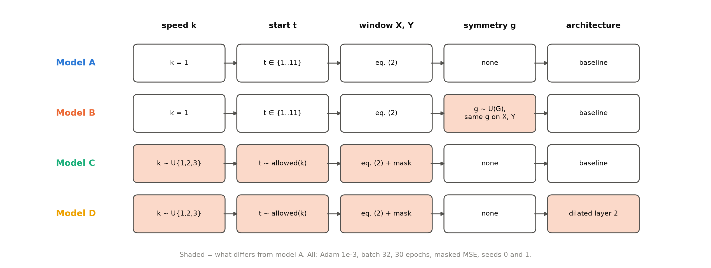

**Diagram D9:** How one training window is built for each model. Shaded boxes are the single thing each model
changes relative to A (B: symmetry; C: speed; D: speed + architecture, so D differs from C only in architecture).

### Q2.11 (written before training B–D)

*Reproduced unedited. Committed in `4d38afc` (2026-10-28 20:15), before training of B–D started (~20:18).*

B (symmetry augmentation) will shrink C_M, C_R and E_M, E_R, because the mirror/rotation failures come from appearance.

C (speed augmentation) will fix 2× because that failure is unfamiliar motion, but will stay poor at 3×.

D (larger reach + speed augmentation) will also fix 3×, because 3× motion is beyond model A's 8 px reach.

### Model D

<!-- REDRAW: Question2/figures/diagrams/D7_model_D.png -->
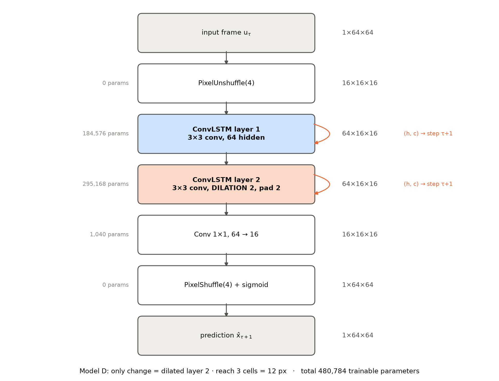

**Diagram D7:** Model D. Identical to model A except that ConvLSTM layer 2 uses a 3×3 convolution with
dilation 2 (padding 2). Same 480,784 parameters (limit 721,176), same shapes, rollout and training protocol as C.

### Results

**Table 5:** Models A–D on the test set (t = 1). E(5) and C/E at 1×; E(2) at 1×, 2×, 3×. Inference = time to predict all
1,000 test videos at batch 32 (MPS, Apple M2 Pro). Entries are mean (seed 0, seed 1).

| Model | E(5) 1× | C_M | E_M | C_R | E_R |
|---|---|---|---|---|---|
| A | 0.0223 (0.0232, 0.0214) | 0.00185 (0.00155, 0.00216) | 0.0230 (0.0236, 0.0223) | 0.00326 (0.00297, 0.00356) | 0.0241 (0.0248, 0.0234) |
| B | 0.0221 (0.0225, 0.0217) | 0.00117 (0.00114, 0.00120) | 0.0221 (0.0225, 0.0217) | 0.00142 (0.00130, 0.00154) | 0.0221 (0.0224, 0.0217) |
| C | 0.0276 (0.0283, 0.0269) | 0.00111 (9.02e-04, 0.00131) | 0.0278 (0.0285, 0.0271) | 0.00238 (0.00193, 0.00283) | 0.0287 (0.0293, 0.0281) |
| D | 0.0271 (0.0271, 0.0270) | 7.27e-04 (6.31e-04, 8.24e-04) | 0.0273 (0.0273, 0.0273) | 0.00159 (0.00157, 0.00161) | 0.0281 (0.0282, 0.0280) |

| Model | E(2) 1× | E(2) 2× | E(2) 3× | Params | Train s/epoch | Inference (s) |
|---|---|---|---|---|---|---|
| A | 0.0188 (0.0195, 0.0181) | 0.0432 (0.0433, 0.0431) | 0.0478 (0.0492, 0.0464) | 480,784 | 19.9 (19.9, 19.8) | 0.554 (0.590, 0.518) |
| B | 0.0185 (0.0187, 0.0183) | 0.0432 (0.0422, 0.0441) | 0.0480 (0.0455, 0.0504) | 480,784 | 21.0 (21.7, 20.4) | 0.538 (0.551, 0.524) |
| C | 0.0236 (0.0240, 0.0232) | 0.0291 (0.0295, 0.0288) | 0.0334 (0.0335, 0.0332) | 480,784 | 20.4 (20.5, 20.2) | 0.520 (0.519, 0.520) |
| D | 0.0240 (0.0241, 0.0239) | 0.0287 (0.0287, 0.0287) | 0.0323 (0.0325, 0.0321) | 480,784 | 23.1 (23.1, 23.0) | 0.703 (0.704, 0.703) |

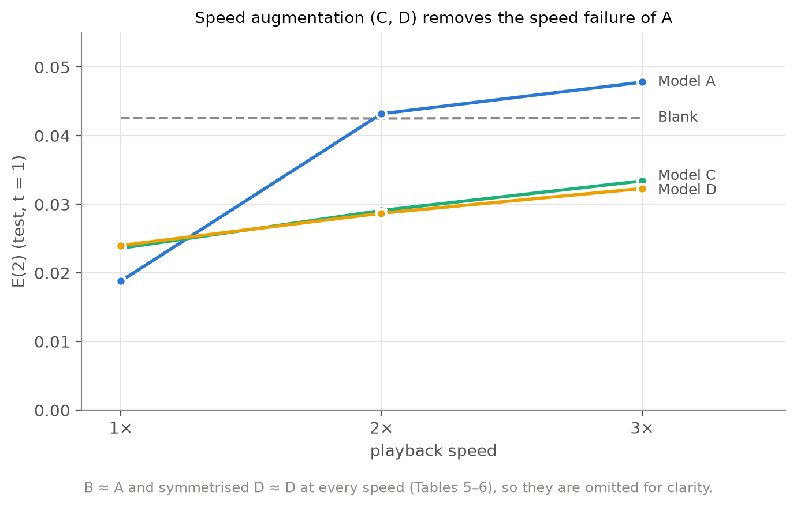

**Plot P3:** E(2) against playback speed (Tables 4–6). Model A collapses to the Blank level at 2×; speed
augmentation (C, D) keeps the error well below Blank at every speed, and D is slightly better than C at 3×.

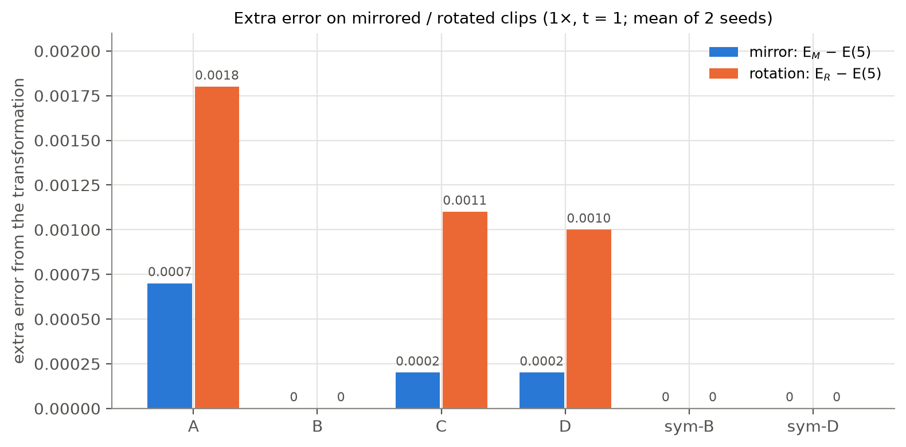

**Plot P4:** Extra error caused by mirroring or rotating the clip, E_T − E(5) (from Tables 5 and 6). Symmetry
augmentation (B) and symmetrisation remove it; speed augmentation only shrinks it.

### Q2.12

Model D is model A with one change: ConvLSTM layer 2 uses a 3×3 convolution with dilation 2 (padding 2).
Parameters are unchanged at 480,784 (≤ 721,176), and it is trained exactly like C (k drawn from {1, 2, 3}).
**Reach:** 1 cell = 4 px as before. Layer 1's 3×3 conv moves information {−1, 0, +1} cells; layer 2's dilated conv
moves {−2, 0, +2} cells. The longest path within one step (u_τ or h⁽¹⁾_{τ−1} → layer 1 → layer 2) reaches every offset
from −3 to +3 cells with no gaps (Diagram D8, right), so the reach is **3 cells = 12 px** along rows or columns
(3√2 cells ≈ 17.0 px diagonally), compared with 8 px (11.3 px) for model A. Every speed up to 3× (9.95 px/frame)
is now within reach.

### Q2.13

- **Mirror/rotation → appearance.** Measured by the extra error a transformation causes (E_T − E(5), Plot P4):

  | | E_M − E(5) | E_R − E(5) |
  |---|---|---|
  | A | +0.0007 | +0.0018 |
  | B | 0.0000 | 0.0000 |
  | C | +0.0002 | +0.0011 |
  | D | +0.0002 | +0.0010 |

  B removes the penalty completely (E_M = E_R = E(5) = 0.0221); C and D only shrink it. Their smaller C_T partly reflects
  blurrier predictions, not a learned symmetry (Q2.6). So the cause is appearance, and symmetry augmentation fixes it.
- **2× → unfamiliar motion.** C (same reach as A) cuts E(2) at 2× from 0.0432 to 0.0291, so reach was not the problem.
- **3× → mostly unfamiliar motion, small reach effect.** C cuts E(2) at 3× from 0.0478 to 0.0334. D improves it by only
  0.0011 more (0.0323), but consistently across both seeds.
- **"C bad at 3×, D good"** would show that reach is the bottleneck. That is not what we see: C already handles 3× fairly well
  (0.0334 vs Blank 0.0426). This fits Q2.3: 3× (9.95 px) is beyond A's 8 px horizontal/vertical reach but within its 11.3 px
  diagonal reach, so 3× was only partly out of reach. (This also went against my Q2.11 prediction.)
- **Why data can't beat reach:** in one step, information can only travel as far as the network's connections allow.
  If a digit jumps further, there is no path for training to use, so only an architecture change (D) helps.

### Q2.14

- **B:** no cost (E(5) at 1×: 0.0221 vs 0.0223, within seed spread). Worth it.
- **C, D:** yes, E(5) at 1× rises to 0.0276 and 0.0271 (about +22–24 %), because only a third of their training is at 1×.
  Still worth it: 2× and 3× errors drop by about 0.014, so they work at all speeds. D is also slower
  (0.703 s vs 0.554 s inference, 23.1 vs 19.9 s/epoch).

\newpage

## 5. The Final Model

Symmetrised forecaster: f̄(X) = (1/8) Σ_{g∈G} g⁻¹( f( g(X) ) ).

<!-- REDRAW: Question2/figures/diagrams/D11_symmetrised_forecaster.png -->
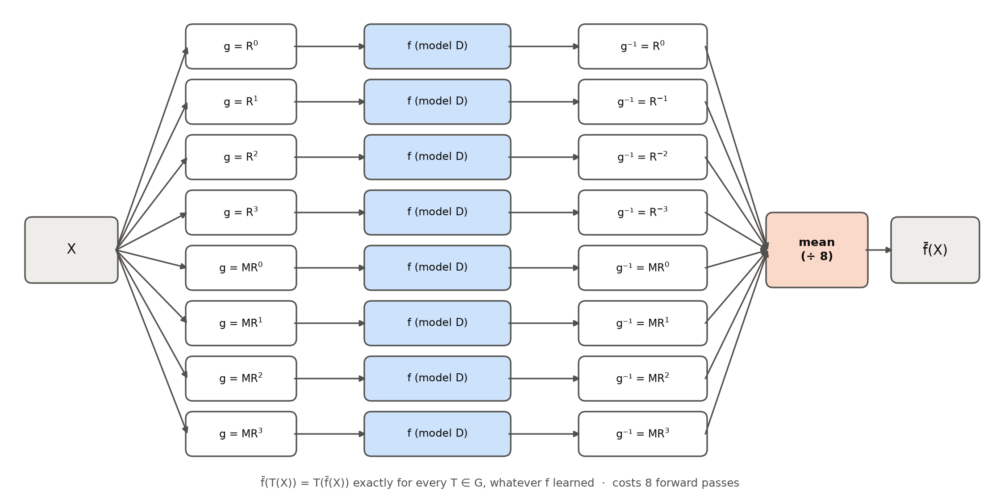

**Diagram D11:** The symmetrised forecaster: transform the input by each of the 8 symmetries, predict with the
same trained model, undo the transformation and average. No retraining is needed.

**Final model: symmetrised D.** The main benefit of symmetry augmentation (model B) is consistency, and symmetrisation
already makes that exact (Table 6: C_M, C_R ≈ 5e-17, E_M = E_R = E(5)). B's gain at 1× was within seed spread
(0.0221 vs 0.0223), so D+B would add little beyond symmetrised D, and we wrap D.

### Why f̄ has C_M = C_R = 0

Take any T ∈ G. Then f̄(T(X)) = (1/8) Σ_g g⁻¹ f(gT(X)). Let h = gT. As g runs over all 8 elements of G, so does h
(G is a group), and g⁻¹ = T h⁻¹. So f̄(T(X)) = (1/8) Σ_h T h⁻¹ f(h(X)) = T(f̄(X)), since T just rearranges pixels and can be
taken outside the average. Therefore f̄(T(X)) = T(f̄(X)) exactly, so C_T = 0 for every T ∈ G, including M and R, for any f.
Numerically we get floating-point error only, because the 8 terms are summed in a different order.

### Results

**Table 6:** Symmetrised B and symmetrised D (final model), same columns as Table 5; mean (seed 0, seed 1).
Training time is that of the underlying model (symmetrisation needs no training). Inference time includes all 8 transformations,
forward passes, inverse transformations and the averaging.

| Model | E(5) 1× | C_M | E_M | C_R | E_R |
|---|---|---|---|---|---|
| sym-B | 0.0215 (0.0219, 0.0211) | 7.81e-17 (7.51e-17, 8.12e-17) | 0.0215 (0.0219, 0.0211) | 7.70e-17 (7.40e-17, 8.00e-17) | 0.0215 (0.0219, 0.0211) |
| **sym-D (final)** | 0.0271 (0.0272, 0.0270) | 5.01e-17 (4.86e-17, 5.16e-17) | 0.0271 (0.0272, 0.0270) | 4.98e-17 (4.83e-17, 5.14e-17) | 0.0271 (0.0272, 0.0270) |

| Model | E(2) 1× | E(2) 2× | E(2) 3× | Params | Train s/epoch | Inference (s) |
|---|---|---|---|---|---|---|
| sym-B | 0.0180 (0.0182, 0.0178) | 0.0423 (0.0414, 0.0432) | 0.0469 (0.0446, 0.0491) | 480,784 | 21.0 (21.7, 20.4) | 4.40 (4.56, 4.25) |
| **sym-D (final)** | 0.0240 (0.0241, 0.0238) | 0.0287 (0.0287, 0.0287) | 0.0322 (0.0324, 0.0320) | 480,784 | 23.1 (23.1, 23.0) | 5.72 (5.71, 5.72) |


**Plot P5:** Consistency gaps of every model on a log scale (Tables 5–6). Learned symmetry (B) lowers the gap;
built-in symmetry drives it to floating-point level (~10⁻¹⁷), about 13 orders of magnitude lower.

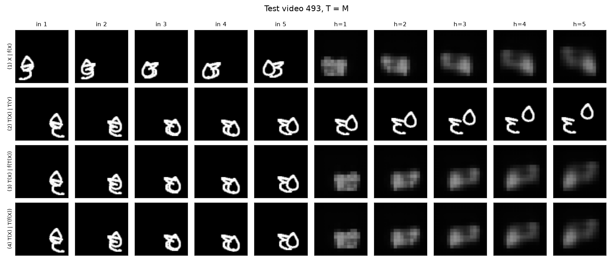


**Figure 6:** Final model (symmetrised D, seed 0). (a) Same videos and layout as Figure 3 (493, 547 mirror; 36, 928 rotation);
GIFs: `Question2/figures/gifs/fig6a_M_493.gif`, `fig6a_M_547.gif`, `fig6a_R_36.gif`, `fig6a_R_928.gif`.
(b) Same video (946) and layout as Figure 5.

### Q2.15

- **Consistency:** built-in symmetry is exact (C_M, C_R ≈ 5e-17 to 8e-17, floating-point error only); learned symmetry is
  approximate (B: C_M = 0.00117, C_R = 0.00142). Built-in is exact by construction: transforming the input only reorders
  the 8 terms of the average (proof above), whatever f has learned. B only learns to be consistent on the training data.
- **Accuracy:** symmetrisation makes transformed clips exactly as easy as originals (E_M = E_R = E(5)) and did not hurt
  accuracy: sym-B improves on B (0.0215 vs 0.0221) and sym-D matches D at 1× (0.0271) while fixing its rotation penalty
  (E_R 0.0281 → 0.0271).
- **Cost:** built-in symmetry is about 8× slower at inference (sym-B 4.40 s vs 0.538 s; sym-D 5.72 s vs 0.703 s); learned symmetry is free.
- **Blur:** averaging 8 different guesses blurs predictions when they disagree. Under MSE, f̄'s error is at most the mean of
  f's errors over the 8 transformed inputs, but it can still be worse than f's original-clip error E(5) when f is much
  worse on transformed inputs (e.g. model A on rotations); that is when symmetrisation hurts. It did not hurt here
  (sym-B 0.0215 vs B 0.0221; sym-D 0.0271 = D), although Figure 6 predictions look smoother and blurrier.

### Q2.16

Partly. In Figure 6(a) rows 3 and 4 are now identical, so the consistency failure is fixed: by symmetrisation, which makes
f(M(X)) = M(f(X)) exactly. But the motion failure is not fixed: the two overlapping digits still come out as one blob that
spreads diagonally and never separates into the "O" moving up-right and the other digit moving left. That part of the failure
comes from overlapping digits, which none of B, C, D or symmetrisation targets.
D's speed augmentation and larger reach play no role here, because 493 is a 1× clip.

### Q2.17

Partly. The final model (symmetrised D) tracks motion at every speed it was trained on: E(2) is 0.0287 at 2× and 0.0322 at 3×,
versus 0.0432 and 0.0478 for model A and 0.0426 for Blank. In Figure 6(b) at 1× and 2×, the 6 and 8 stay as two blobs near
their true positions. Its exact mirror/rotation consistency (C_M, C_R ≈ 5e-17, E_M = E_R = E(5)) is guaranteed by
construction, so on its own it is not evidence of learned motion. Against that, it predicts blurry blobs, is worse than A on
1× clips (0.0271 vs 0.0223), and merges overlapping digits (Figure 6a). A skeptic would want speeds never seen in training
(e.g. 1.5× or 4×), longer rollouts and new shapes. One test it still fails: separating two digits after they overlap.

## 6. Summary of findings

| Failure of model A | Cause | Evidence | What fixed it |
|---|---|---|---|
| Worse on mirrored / rotated clips (rotation worse) | Appearance | Motion statistics already symmetric (Fig. 1); B removes E_T − E(5) (Plot P4) | Symmetry augmentation (B) partly; symmetrisation exactly |
| Collapses at 2× | Unfamiliar motion | 2× is within reach, yet A ≈ Blank; C (same reach) cuts E(2) 0.0432 → 0.0291 | Speed augmentation (C, D) |
| Degrades at 3× | Mostly unfamiliar motion, small reach effect | C cuts 0.0478 → 0.0334; D adds 0.0011 more on both seeds | Speed augmentation + larger reach (D) |
| Overlapping digits merge and never separate | Not addressed by any change | Figures 2, 3, 6(a) | Still open |

\newpage

# Reproducibility

```
Assignment 2/
├── report.md                          ← this report
├── DL4STG_PA2.pdf                     ← handout
└── Question2/
    ├── 25280065_Question_2.ipynb       ← all code, tables and figures (Sections 1–5)
    ├── make_report_figures.py         ← regenerates Diagrams D1–D11 and Plots P1–P5
    ├── figures/                       ← Figures 1–6 (PNG)
    │   ├── gifs/                      ← animated Figure 3 and Figure 6(a) panels
    │   ├── diagrams/                  ← Diagrams D1–D11
    │   └── plots/                     ← Plots P1–P5
    ├── checkpoints/                   ← trained weights (git-ignored)
    └── data/                          ← Moving MNIST (downloaded by torchvision, git-ignored)
```

* Seeds 0 and 1 for every learned model; seed 0 is used for all figures and GIFs.
* Pre-registered answers: Q2.5 committed in `fc4408f` before Section 3; Q2.11 committed in `4d38afc` before training B–D.
* Supplementary diagrams and plots: run `../.venv/bin/python -I make_report_figures.py` from `Question2/`.

\newpage

# Use of generative AI

<!-- TODO: review and complete this section before submitting. The handout requires the prompt, its output, and the edits you made. -->

I used Claude (Anthropic, Claude Code in VS Code) as a reviewer while working on Question 2. All code was written
and run by me; the AI checked it against the handout and suggested corrections.

| # | Prompt (summary) | Output (summary) | Edits I made |
|---|---|---|---|
| 1 | "Strict review of Section 1 line by line against the PDF; PASS/FAIL per item with fixes." | Found: `speed_up` sliced the batch axis; G/G⁻¹ and allowed start frames missing; no guard for t < 1; Q2.1 had 9.96 instead of 9.95, overstated "almost all speeds", and an unsupported overlap argument. | Fixed `speed_up`, added `G`, `G_inv`, `T_NORMAL`, `T_AUG` and asserts; rewrote Q2.1 with numbers computed in the notebook. |
| 2 | "Review Section 2 completely." | Code and Table 2 confirmed (recomputed independently); flagged missing hardware line, wrong Figure 2 caption, missing diagonal reach in Q2.3, Q2.5 not yet committed. | Added hardware; changed Figure 2 to a non-overlapping video (757); added diagonal reach to Q2.3; committed Q2.5 before Section 3. |
| 3 | "Check Section 3." | Tables 3–4 confirmed; Figure 5 video 604 overlapped in the 3× true frames; Figure 4 labels overlapped. | Asked the AI to apply the fixes in the notebook: video 946 for Figure 5, staggered labels, Blank row in Table 4, model/speed labels in Q2.7–Q2.8 and a new Figure 5 description in Q2.9; I re-ran the cells and checked the figures. |
| 4 | "Check Section 4." | Table 5 confirmed; Q2.13 did not answer the "C bad at 3×, D good" question and relied on C_T although C/D are blurrier. | Added the E_T − E(5) table and the missing paragraph to Q2.13; adjusted Q2.14 wording. |
| 5 | "Check Section 5." | Proof and Table 6 confirmed; Q2.17 wrongly called 2×/3× "unfamiliar" and used by-construction consistency as evidence; final-model choice weakly justified. | Rewrote Q2.17 and the final-model justification; clarified the Jensen argument in Q2.15. |
| 6 | "Check the complete notebook end to end." | Flagged an unexecuted cell and out-of-order execution counts; suggested reusing checkpoints so "Run All" is reproducible. | *(describe what you changed)* |
| 7 | "Prepare report.md with all figures and architecture diagrams." | This report skeleton, Diagrams D1–D11 and Plots P1–P5. | *(describe your edits; Diagrams D1, D3–D11 to be redrawn by hand)* |

Q2.5 and Q2.11 were written and committed before the corresponding experiments and were not changed afterwards.

# References

Shi, X., Chen, Z., Wang, H., Yeung, D.-Y., Wong, W.-K., and Woo, W. (2015). Convolutional LSTM Network: A Machine
Learning Approach for Precipitation Nowcasting. *NeurIPS*.

Srivastava, N., Mansimov, E., and Salakhutdinov, R. (2015). Unsupervised Learning of Video Representations using LSTMs. *ICML*.
