# AI651 Assignment 2 — Report

| | |
|---|---|
| **Student** | Muhammad Ahmad Gill (25280065) |
| **Course** | AI651 – Deep Learning for Space, Time and Graphs, Fall 2026 |
| **Code (GitHub, public)** | <https://github.com/Ahmad-Gill/LUMS-Academics/tree/main/Third%20Semester/Deep%20Learning%20For%20Time%20Space%20Grsph/Assignments/Assignment%202> |
| **Notebook** | `Question2/25280065_Question_2.ipynb` |
| **Hardware** | Apple M2 Pro, PyTorch 2.14.1, MPS backend |

**Contents**

1. Question 1 — River Forecasting Proposal (six required sections, Figures Q1.1–Q1.12)
2. Question 2 — Motion or Memory?
   1. Setup (Table 1, Figure 1, Q2.1–Q2.2)
   2. Baseline: ConvLSTM (Table 2, Figure 2, Q2.3–Q2.5)
   3. Testing the Baseline (Tables 3–4, Figures 3–5, Q2.6–Q2.10)
   4. What Can Data Fix? (Table 5, Q2.11–Q2.14)
   5. The Final Model (Table 6, Figure 6, Q2.15–Q2.17)
   6. Summary of findings
3. Reproducibility
4. Use of generative AI

Tables and figures follow the handout's numbering (Table 1–6, Figure 1–6). Extra material that the
handout does not number is labelled **Diagram D1–D11** (architecture and concept diagrams) and
**Plot P1–P5** (supplementary charts) so it never collides with the handout's numbers. Question 1's figures are numbered
**Figure Q1.1–Q1.12** for the same reason.
Errors are given to three significant figures, and values below 10⁻³ in scientific notation.
Learned-model entries are **mean (seed 0, seed 1)**.

\newpage

# Question 1 — River Forecasting Proposal: Three-way Decomposed River-Graph Forecaster

**Summary.** Every 10 minutes we turn the last 24 h of levels, rainfall and releases, plus the release schedule announced for the next hour, into one tensor on a 7-node directed river graph (Figure Q1.2). A shared GRU encodes each node's history. Directed lag attention learns flow-dependent travel delays between neighbouring nodes. Three gated heads then split each station's 1-hour change into **base flow**, **observed-rain** and **hidden-rain** parts (Figure Q1.6). The output is the 10/50/90 % quantiles of the level at S1–S4 at t + 60 min.

---

## 1. Architecture diagram

The full pipeline is in **Figure Q1.1**, and **Figure Q1.2** shows the graph it runs on.

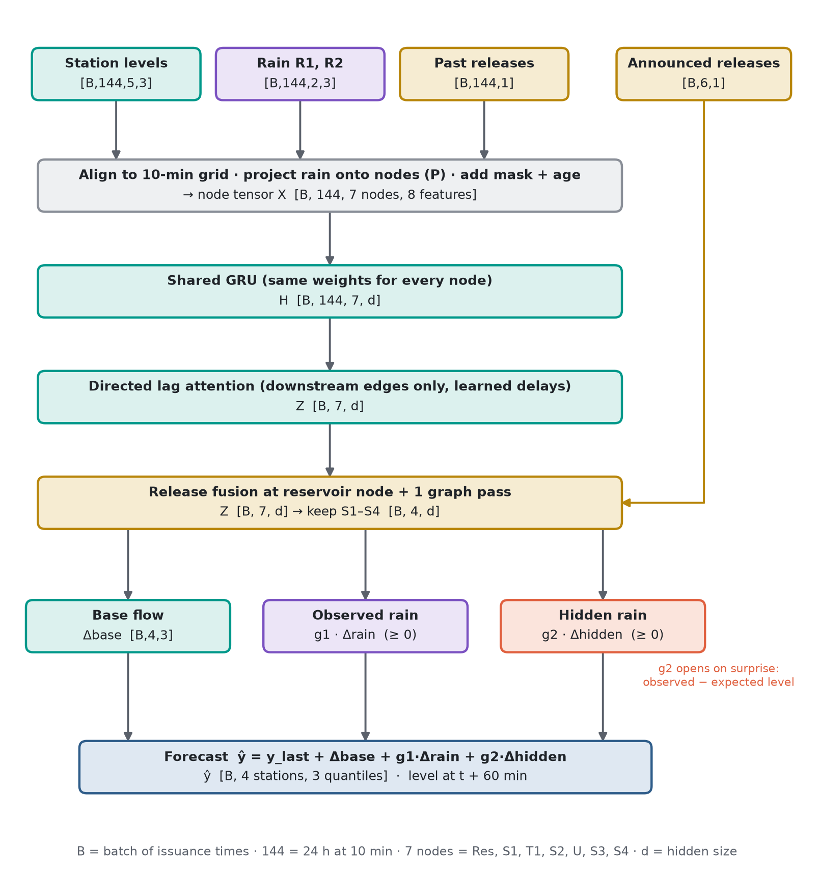

*Figure Q1.1: Architecture. Four input groups are aligned to one 10-min grid and projected onto the 7 graph nodes (node tensor X [B,144,7,8]). A shared GRU and directed lag attention give node states Z [B,7,d]; announced releases are fused at the reservoir node. Three heads (base flow, observed rain, hidden rain) are added to the last valid level, giving ŷ [B,4,3]. Each box shows its output shape. Colours: teal = base flow/backbone, purple = observed rain, coral = hidden rain, gray = fixed/alignment, ochre = reservoir release, navy = forecast.*

- **Data sources (top row of Figure Q1.1):** station levels X_lev, rain gauges X_rain, past releases X_rel, announced releases X_fut (enter at release fusion). Static graph data (A, D, P, time of day) is used in the alignment and attention blocks.
- **Alignment, projection and reshaping:**
  - Everything is snapped or summed onto one 10-min grid.
  - Rain goes from gauges to nodes with $\tilde r = P^\top r$, i.e. [B,144,2] → [B,144,7].
  - Stations and the release are placed into the 7 node slots.
  - The result is concatenated into **X [B,144,7,8]**.
  - For the shared GRU, X is reshaped to [B·7,144,8] and back.
  - S1–S4 rows are gathered, [B,7,d] → [B,4,d], before the heads.
- **Main blocks:** rain projection → shared temporal GRU → directed lag attention (2 layers) → release fusion → three heads with gates → combine.
- **Source combination:**
  - Sources meet first in X (per-node features).
  - Upstream information arrives through graph attention along downstream edges.
  - Future releases are added at node Res.
  - Rain and surprise enter through the gated heads.
- **Output:** **ŷ [B,4,3]**, the S1–S4 levels at t + 60 min at quantiles {0.1, 0.5, 0.9}.

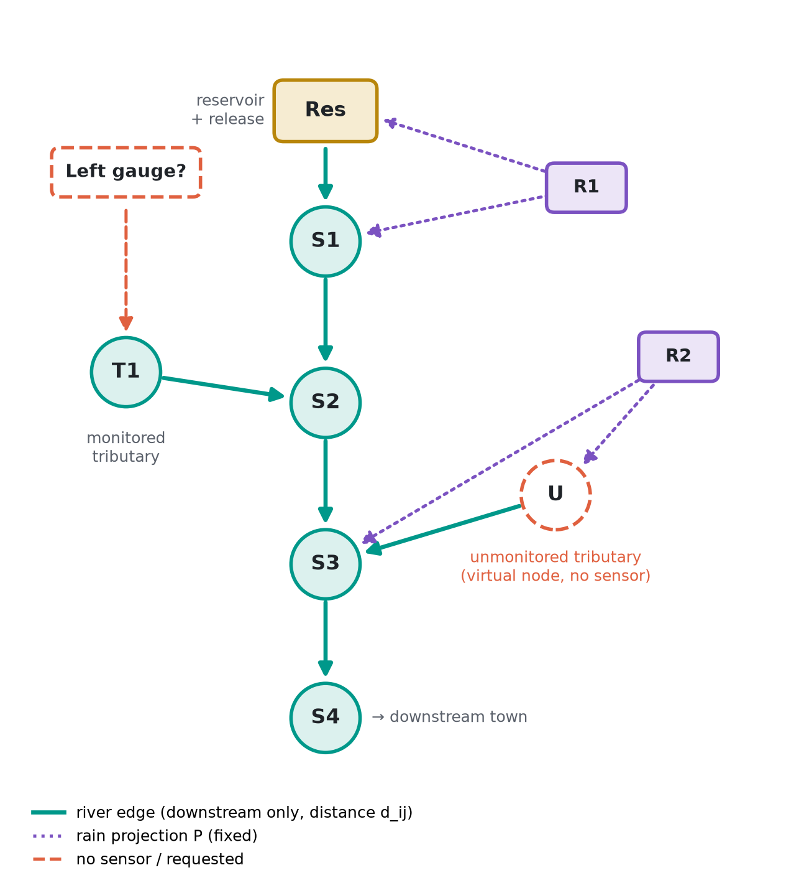

*Figure Q1.2: The 7-node directed river graph (Res, S1, T1, S2, U, S3, S4). Teal edges point downstream only and carry river distance d_ij. Dotted purple arrows are the fixed rain projection P (the small R1 → T1 weight in A6 is left out for clarity). U is a virtual node for the unmonitored tributary: no sensor (mask ≡ 0), receives R2 rain. The dashed coral box is a requested left-side rain gauge that does not exist yet.*

---

## 2. Assumptions

**Supplied facts (from the handout, not assumptions):**

| ID | Fact |
|---|---|
| F1 | Historical water levels at S1–S4 and T1, every 10 min. |
| F2 | Historical rainfall at R1 and R2, with timestamps and gauge locations. |
| F3 | Recorded reservoir releases, and future release schedules announced before each forecast, with announcement and effective times. |
| F4 | Station locations, river connectivity, distances along the river. |
| F5 | Topology: Reservoir → S1 → S2 → S3 → S4 → town. The monitored tributary (T1) joins between S1 and S2; an unmonitored tributary joins between S2 and S3. Stations are unevenly spaced and travel times change with conditions. |
| F6 | Not supplied: precise travel times, unmonitored-tributary inflow. Not available at issuance: future rainfall, future levels. |
| F7 | R1 and R2 are on the right-side hillsides; the T1 (left) side has no rain gauge (handout illustration). |
| F8 | Service: every 10 min, forecast the level 1 h ahead at S1–S4. |

**Assumptions (our choices where the handout is silent):**

| ID | Assumption | Why reasonable | Effect on design |
|---|---|---|---|
| A1 | The record holds ≥ 3 years of 10-min data from all sources, covering several wet seasons. | Typical length for an authority's telemetry archive. | Chronological train/validation/test split (e.g. last year = test). Extreme floods stay rare (L5). |
| A2 | All sources use one clock (UTC). Level timestamps fall within ±5 min of the 10-min tick. | Loggers are normally clock-synchronised and report on schedule. | Snap each level to the nearest tick within ±5 min; otherwise mask = 0 (Figure Q1.4). |
| A3 | Reporting delay is usually 0–20 min, occasionally hours, and each record's arrival time is logged. | Typical for GSM/satellite telemetry. | Data-age feature; training replays the delays from the arrival logs; the system never waits (§5 ii). |
| A4 | Levels carry about 1–2 cm noise, with occasional spikes, flat-lines and gaps (a few % of steps). | Common for pressure and radar level sensors. | Rule-based QC sets mask = 0; random sensor dropout during training. |
| A5 | Rain reports are accumulations (mm) at irregular times, with no double counting. | Tipping-bucket / event-reporting gauges. | Rain is *summed* per 10-min bin, not interpolated. |
| A6 | R1 represents the right-side hillsides above Res/S1, and weakly the upper T1 area through shared storms. R2 represents the U catchment and the local area above S3. | This follows the gauge positions relative to the sub-catchments. | Fixed P weights from catchment areas: R1 → Res, S1 (large), T1 (small); R2 → U, S3. |
| A7 | Releases are recorded as discharge (m³/s) at ≥ 10-min resolution. Schedules are piecewise constant and usually announced ≥ 1 h ahead. The actual release may differ in timing or size. | Normal dam operating practice. | X_fut comes from the latest schedule known at t; a mismatch flag is raised (§5 iv). |
| A8 | No significant backwater, and no other controlled structures or large abstractions between Res and S4. | A steep hillside river (as in the handout illustration). | Directed edges point downstream only, so the graph has no upstream influence. |
| A9 | Travel time per reach is typically ≤ 1.5 h (rarely up to 2 h). Res → S4 (4 reaches) takes ≤ about 6 h at low flow and less at high flow. | Plausible for a short mountain river where wave speed rises with stage. | K = 12 lags (0–120 min) per edge. Queries depend on the current state, so learned delays can shrink at high flow (Figure Q1.5). |
| A10 | Within 60 min, a station is affected only by conditions at most two reaches upstream. Anything farther away already shows in the intermediate stations' current levels. | This follows from A9: three reaches take longer than 1 h except in extreme floods. | Two attention layers (two hops) plus one release pass. Add a layer if validation shows a need. |
| A11 | Hillside rain reaches the river within ~1–6 h, recession lasts up to ~12–18 h, and soil wetness has a memory of about one day. | Typical for small, steep catchments. | History L = 144 (24 h), plus a rolling 24-h rain sum as a soil-wetness proxy. |
| A12 | Over a 1-h horizon, rain only adds water, and contributions from different areas add up. | Mass balance: rainfall cannot lower a river within the hour. | Rain heads are softplus ≥ 0 and are combined additively. |
| A13 | Unmonitored-tributary inflow is base flow plus a response to rain near R2, entering just above S3. | Adjacent catchments share storms. | Virtual node U receives R2 rain; any remaining inflow is caught by S3's surprise. |
| A14 | Channel shape, sensor datums and the stage–discharge relation change slowly, apart from known resets. | No major works are reported. | One model with per-station normalisation; retrain yearly and after known changes. |

**Why L = 144 (24 h):**
- The longest routing path, Res → S4, takes at most about 6 h (A9).
- The longest rain response including recession is about 18 h (A11).
- 24 h covers both with margin and also captures one full daily cycle.

---

## 3. Forecasting task and data specification

- **Issuance time t:** every 10 min, on the clock tick (144 issuances per day).
- **History window:** L = 144 steps, τ = t − 143 … t, covering (t − 24 h, t].
- **Horizon:** a single target 6 steps ahead, the level at **t + 60 min**.
- **Outputs:** S1–S4 × quantiles {0.1, 0.5, 0.9}. The model predicts the change Δ from the last valid level y_last and adds y_last back.
- **Batch axis B:** different issuance times (during training, random t from the training years; in operation B = 1).

| Name | Shape | Axes | Time coverage | Available at t? |
|---|---|---|---|---|
| X_lev (levels) | [B,144,5,3] | b = issuance time; τ = history step; station ∈ {S1,S2,S3,S4,T1}; channel ∈ {value (m, normalised), mask, data-age (min)} | τ = t−143 … t (10-min grid) | Yes, except readings still in transit (mask 0) |
| Raw rain reports | variable-length list (time, gauge, mm) | one record per report | t − 48 h … t (48 h are needed for the 24-h rolling sum) | Reports received by t |
| X_rain (rain) | [B,144,2,3] | b; τ; gauge ∈ {R1,R2}; {mm in (τ−10, τ], mask, age} | t−143 … t | Yes, except in-transit bins (mask 0) |
| X_rel (past releases) | [B,144,1] | b; τ; mean recorded release in the bin (m³/s) | t−143 … t | Yes (the latest bin may be pending) |
| X_fut (announced releases) | [B,6,1] | b; future step h = 1…6; scheduled release effective at t + 10h min | t+10 … t+60 | Yes, but only schedules with announcement time ≤ t |
| X_tod (time of day) | [B,144,2] | b; τ; {sin, cos} | t−143 … t | Yes (clock) |
| A (adjacency) | [7,7] | A_ji = 1 if there is an edge j → i (downstream) | static | Yes |
| D (distances) | [7,7] | river distance d_ji (km) on edges, 0 elsewhere | static | Yes |
| P (rain projection) | [2,7] | gauge g × node i weight | static | Yes |
| X (node tensor, derived) | [B,144,7,8] | b; τ; node ∈ {Res,S1,T1,S2,U,S3,S4}; F = 8: level, mask, age, rain_recent, rain_24h, release, sin(tod), cos(tod) | t−143 … t | Built at t |
| y_last | [B,4] | b; station S1–S4; last level with mask = 1 | ≤ t | Yes |
| **ŷ (output)** | **[B,4,3]** | b; station S1–S4; quantile ∈ {0.1, 0.5, 0.9} | valid at t + 60 | Issued at t |
| y_target, m_target | [B,4], [B,4] | b; station; true level at t + 60 and its mask | t + 60 | **No**: training label only |

**Alignment across sampling times (Figure Q1.4):**
- **Levels** are snapped to the nearest 10-min tick within ±5 min (A2), otherwise mask = 0.
  - Interior gaps are linearly interpolated (both ends lie in the past, so there is no leakage).
  - Trailing gaps are forward-filled.
- **Rain** is summed over (τ − 10, τ], because reports are accumulations (A5). A rolling 24-h sum is added as rain_24h.
- **Releases** are averaged over each bin. **X_fut** takes, for each future step, the value from the newest schedule announced at or before t (A7).

**Alignment across locations:**
- Each source maps to a fixed node slot: S1–S4 and T1 to their own nodes, the release to Res, and rain to nodes through P (Figure Q1.2).
- Res and U have level = 0 and mask = 0 at all times, so the model never confuses "no sensor" with "level 0".

**Available at issuance (Figure Q1.3):** history up to t (minus in-transit data) and announced releases up to t + 60. Future rain and future levels are *not* available; future levels appear only as training labels.

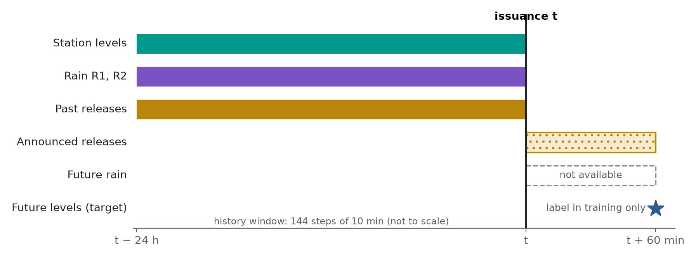

*Figure Q1.3: What is available at issuance t. Levels, rain and past releases cover the 24-h history window; announced releases are the only known future input; future rain is not available; the star marks the target y(t+60), used only as a training label. The axis is schematic, not to scale.*


*Figure Q1.4: Alignment onto one 10-min grid. (a) Irregular rain reports are summed per bin (τ−10, τ]. (b) Level reports with timing jitter are snapped to the nearest tick (±5 min); the missing 08:40 value is interpolated and gets mask = 0. Illustrative — synthetic data, not results.*

---

## 4. Model computations and design justification

**Notation**

| Symbol | Meaning |
|---|---|
| t, τ | issuance time; history step τ ∈ {t−143, …, t} |
| V, S | nodes {Res, S1, T1, S2, U, S3, S4} (N = 7); output stations S = {S1, S2, S3, S4} |
| N(i), Up(i) | direct upstream neighbours {j : A_ji = 1}; all upstream ancestors of i |
| x_i(τ) ∈ ℝ⁸ | node features (one row of X) |
| y_i(τ), m_i(τ) | observed level and its mask (1 = valid) |
| r(τ) ∈ ℝ², r̃_i(τ), c_i(τ) | gauge rain per bin; projected rain at node i; rolling 24-h sum |
| r̃_i^6h | projected rain at node i summed over the last 6 h (36 steps) |
| u ∈ ℝ⁶ | announced future releases (X_fut) |
| h_i(τ), z_i ∈ ℝ^d | GRU state; final node state (d = 64) |
| K = 12, Q = {0.1, 0.5, 0.9} | maximum lag (120 min); quantile levels |
| sp, σ, cs | softplus; sigmoid; ordered cumulative softplus (defined below) |

**(1) Rain projection** (fixed P, A6). Weights are renormalised over the gauges that are currently valid:

$$\tilde r_i(\tau) = \frac{\sum_g P_{gi}\, m_g(\tau)\, r_g(\tau)}{\sum_g P_{gi}\, m_g(\tau) + \epsilon}, \qquad c_i(\tau) = \sum_{s=0}^{143} \tilde r_i(\tau - s)$$

**(2) Shared temporal encoder.** One GRU with the same weights θ is applied to all 7 nodes:

$$h_i(\tau) = \mathrm{GRU}_\theta\big(x_i(\tau),\, h_i(\tau-1)\big), \qquad H \in \mathbb{R}^{B\times144\times7\times d}$$

**(3) Directed lag attention (2 layers).** Layer 2 is evaluated at τ = t−6…t, because the nowcast in (5) needs z_i(τ−1) for τ = t−5…t. Layer 1 is evaluated at τ = t−6−K…t so that layer 2 can attend to lagged outputs. For node i at time t (same form at each τ):

$$\alpha_{ijk} = \operatorname*{softmax}_{j\in N(i),\,k\in[0,K]}\left(\frac{q_i(t)^\top k_j(t-k)}{\sqrt d} + \phi(d_{ij}, k)\right), \qquad m_i = \sum_{j}\sum_k \alpha_{ijk}\, W v_j(t-k)$$

$$z_i = \mathrm{LayerNorm}\big(h_i(t) + m_i\big), \qquad q_i = W_Q h_i,\; k_j = W_K h_j,\; v_j = W_V h_j$$

- φ is a small MLP of the distance and the lag; it gives the attention a prior over plausible delays.
- Res, T1 and U have no upstream neighbours, so m_i = 0 for them.

**(4) Release fusion.**

$$e = \mathrm{MLP}(u) \in \mathbb{R}^d, \quad z_{\mathrm{Res}} \leftarrow z_{\mathrm{Res}} + e, \quad z_i \leftarrow \mathrm{LayerNorm}\Big(z_i + \sum_{j\in N(i)} \beta_{ij} W_f z_j\Big)$$

**(5) Three heads** for i ∈ S. The ordering function is $\mathrm{cs}(a) = [a_1,\ a_1{+}\mathrm{sp}(a_2),\ a_1{+}\mathrm{sp}(a_2){+}\mathrm{sp}(a_3)]$, and $\mathrm{cs}^+$ uses $\mathrm{sp}(a_1)$ as its first term, which makes every entry ≥ 0.

$$\Delta^{\text{base}}_i = \mathrm{cs}\big(f_b(z_i^{\text{dry}})\big) \quad (z^{\text{dry}}:\ \text{same backbone, rain channels set to } 0)$$

$$\Delta^{\text{rain}}_i = \mathrm{cs}^+\big(f_r(z_i)\big) \ge 0, \qquad g^{(1)}_i = \sigma\Big(w_1^\top\big[\tilde r_i^{\text{6h}},\, c_i,\, \textstyle\sum_{j\in Up(i)} \tilde r_j^{\text{6h}},\, \sum_{j\in Up(i)} c_j\big] + b_1\Big)$$

The surprise uses a nowcast built only from data up to τ − 1, with stop-gradient (sg), so there is no leakage:

$$\hat y^{\text{now}}_i(\tau) = y^{\text{last}}_i(\tau{-}1) + f_n\big(z_i(\tau{-}1)\big), \qquad s_i(\tau) = m_i(\tau)\,\big(y_i(\tau) - \mathrm{sg}[\hat y^{\text{now}}_i(\tau)]\big),\ \ \tau = t{-}5\ldots t$$

$$\Delta^{\text{hid}}_i = \mathrm{cs}^+\big(f_h([z_i, s_i, \textstyle\sum_{j\in N(i)} s_j])\big) \ge 0, \qquad g^{(2)}_i = \sigma\big(w_2^\top[s_i,\ \textstyle\sum_{j\in N(i)} s_j] + b_2\big)$$

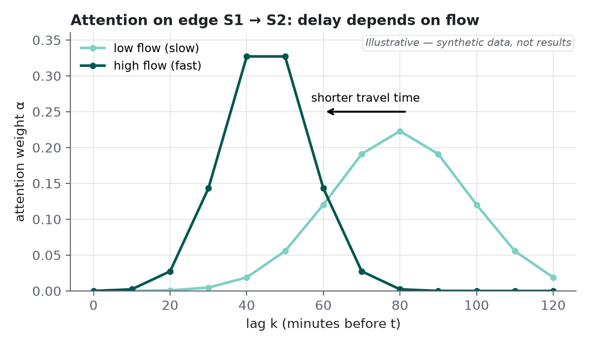

*Figure Q1.5: Attention weight α on edge S1 → S2 against lag. Because queries depend on the current state, the learned delay can move to shorter lags at high flow (A9). Illustrative — synthetic data, not results.*

**(6) Forecast mapping.**

$$\hat y_{i,q} = y^{\text{last}}_i + \Delta^{\text{base}}_{i,q} + g^{(1)}_i\,\Delta^{\text{rain}}_{i,q} + g^{(2)}_i\,\Delta^{\text{hid}}_{i,q}, \qquad i \in S,\ q \in Q$$

Every term is non-decreasing in q and the gates are ≥ 0, so the quantiles can never cross.

**(7) Training objective.** Here ρ_q(e) = max(q·e, (q − 1)·e) is the pinball loss, Ω is the set of targets with m_target = 1, and "dry" means the projected rain over the past 6 h of i's catchment is below a small threshold:

$$\mathcal L = \frac{1}{|\Omega|}\sum_{(b,i)\in\Omega}\sum_{q\in Q} \rho_q\big(y_i(t{+}6) - \hat y_{i,q}\big) + \lambda_1\, \overline{g^{(1)}}_{\text{dry}} + \lambda_2\, \overline{g^{(2)}} + \lambda_3\,\frac{\sum m_i(\tau)\big(y_i(\tau) - \hat y^{\text{now}}_i(\tau)\big)^2}{\sum m_i(\tau)}$$

- Levels are normalised per station, so all four stations carry equal weight.
- The optimiser is Adam with early stopping on the validation year.
- Inputs are rebuilt "as available at t", with sensor dropout and simulated delays (§5).

**Design justification**

| Choice | Why |
|---|---|
| Directed graph instead of a flat multivariate model | Topology is known (F4, F5). It rules out impossible paths (e.g. S3 → S1) and lets all nodes share weights on a limited record (A1). |
| One GRU shared across nodes | Rise, recession and daily cycle look alike at every node, so 7× more sequences train each weight. |
| Lag attention, not fixed lags | Travel times are unknown and change with flow (F5, F6). State-dependent queries adapt the delay (Figure Q1.5); distance is only a prior φ. |
| Predict Δ from y_last | Persistence is strong at 1 h, and Δ is well-scaled across stations. |
| Three-way decomposition | Separates what the inputs explain (base flow, gauged rain) from what they cannot (hidden rain); interpretable, and the band widens when the hidden term is active (Figures Q1.6, Q1.7). |
| Quantile outputs | Flood preparedness needs a band, not a point forecast. |

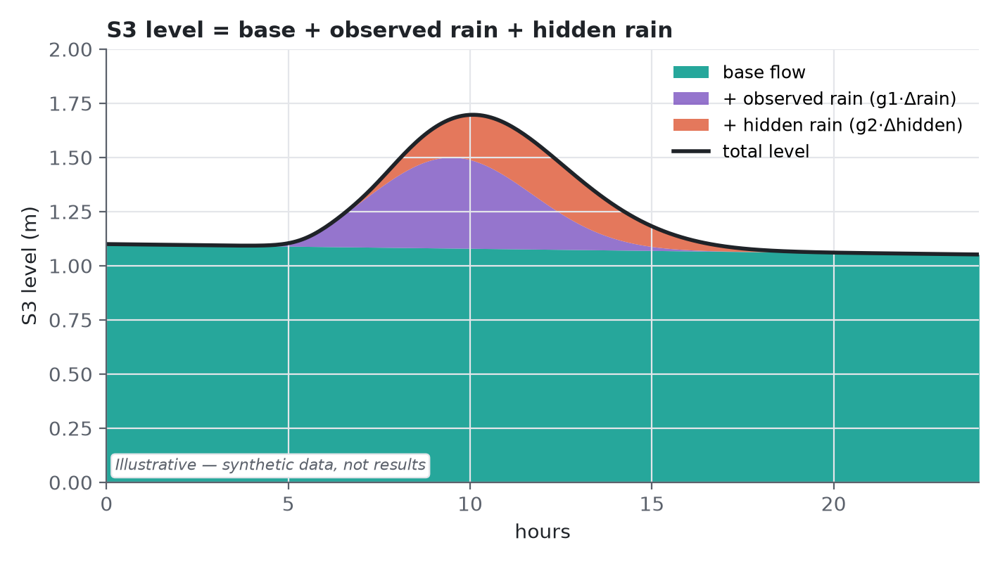

*Figure Q1.6: Three-way decomposition of the S3 level in a storm: base flow + observed-rain contribution + hidden-rain contribution = total. The hidden part represents the unmonitored tributary, which is visible only as surprise at S3. Illustrative — synthetic data, not results.*


*Figure Q1.7: Gates during two storms. g1 opens with gauged R1 rain. Later, T1 rises with no gauged rain (a left-side storm); the resulting surprise opens g2 for S2. Illustrative — synthetic data, not results.*

**Physics vs learned**

| Element | Fixed (physical assumption) | Learned mapping |
|---|---|---|
| Graph direction, connectivity | ✔ A, downstream only (F4, A8) | — |
| River distances | ✔ D as an input feature | how distance affects delay (φ) |
| Rain-to-catchment map | ✔ P from geography (A6) | how much rain reaches each station, and when |
| Rain sign and combination | ✔ softplus ≥ 0, additive (A12) | size and duration of the rain response |
| Persistence | ✔ forecast = y_last + Δ | Δ itself |
| Travel delays | — | ✔ lag attention α (A9) |
| Release response | — | ✔ fusion MLP, graph pass |
| Hidden inflow (U, left-side rain) | ✔ only its sign (≥ 0) and where it enters (A13) | ✔ size, from surprise |
| Uncertainty width | ✔ quantile ordering | ✔ width, from the pinball loss |

**How each factor reaches each station** (qualitative map in Figure Q1.8):
- **Reservoir release:** enters through the release feature on Res, then Res → S1 attention (past releases) and the fusion pass (X_fut). It is strongest at S1. Farther down it is mostly already reflected in upstream levels.
- **Upstream conditions:** S1's state reaches S2 over edge S1 → S2 at a learned lag, and S2 reaches S3 the same way. Two hops cover any ≤ 1-h influence (A10).
- **Monitored tributary T1:** reaches S2 over edge T1 → S2. T1's surprise also feeds S2's g2.
- **Rainfall:** R1 enters at Res, S1 and (weakly) T1; R2 enters at U and S3. Both act through the observed-rain head, gated by g1 using rain over the station's whole upstream catchment.
- **Unmonitored tributary and left-side rain:** no direct input. They reach the forecast through S3's surprise (U) and T1/S1's surprise (left side) via the hidden-rain head (A13).


*Figure Q1.8: Qualitative influence (0–3) of each factor on each station's 1-hour forecast, read from the river topology. These are not learned weights or measured sensitivities.*

---

## 5. Operation and exceptional conditions

### (i) Missing observations
- QC sets **mask = 0**. Interior gaps are interpolated and trailing gaps forward-filled (Figure Q1.9). The data-age counter grows while the sensor is offline.
- **Training:** random sensor dropout (whole sensors for hours, plus single steps), so the model learns to rely on graph neighbours. For example, with T1 offline, S2 leans on S1 and on rain over T1's catchment.
- **Loss:** targets with a missing true value are skipped (masked pinball loss).
- **Surprise** is computed only where mask = 1, so a missing sensor never fakes hidden rain.
- **Output:** the band widens, because the model saw such cases in training (Figure Q1.12), and a "sensor offline" flag is published with the forecast.

### (ii) Delayed observations
- The system **never waits**: each forecast is issued on the tick with whatever has arrived.
- Data not yet arrived gets mask 0 and is forward-filled, and the age feature shows how stale each value is (Figure Q1.9).
- **Training replays history "as it was available at t"**, using the logged arrival delays (A3). Deployment inputs therefore look like training inputs, and there is no leakage.
- A late reading is stored under its true timestamp and used from the **next cycle**. Optionally, the forecast is re-issued if the late data changes ŷ a lot.

### (iii) Announced future releases
- X_fut [B,6,1] holds the scheduled release at t + 10 … t + 60. It is built **only from schedules with announcement time ≤ t**; for each future step the newest such schedule applies (A7).
- If no schedule covers a step, the last recorded release is held constant.
- X_fut is fused at node Res (block 4) and then passed one hop downstream, mainly affecting S1 within the hour.

### (iv) Scheduled vs actual releases
- **Training uses schedules as they were announced, not the actual releases**, so the model learns the typical schedule–actual gap that it will also face in deployment.
- Once an actual release is recorded, it becomes past input (X_rel) in the next cycle and overrides the schedule for that time.
- When |actual − scheduled| exceeds a threshold, the system **flags it** and widens the band for the affected stations until the two agree again (Figure Q1.10).

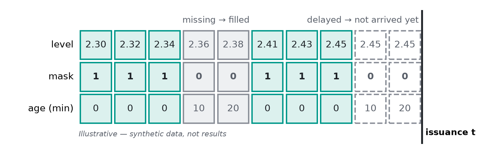

*Figure Q1.9: One sensor at issuance t: received readings (mask 1), a two-step outage that is filled (mask 0), and the last two readings still delayed (forward-filled, mask 0). The age row counts minutes since the last real value. Illustrative — synthetic data, not results.*


*Figure Q1.10: The gate opens later and lower than scheduled. The model is trained on the schedule as announced (dashed, X_fut); once recorded, the actual release (solid) becomes past input X_rel. While the two differ by more than a threshold, a flag is raised and the band widens. Illustrative — synthetic data, not results.*

### Feasibility of running every 10 minutes

Design estimates, not benchmarks:

| Item | Estimate |
|---|---|
| Parameters (d = 64) | GRU ≈ 14 k, attention + fusion ≈ 50 k, heads ≈ 15 k, about 80 k in total |
| Compute per forecast | 2 passes (normal + dry) × 7 nodes × 144 GRU steps ≈ 0.1 GFLOP, milliseconds on a CPU (≪ 1 s) |
| Data per cycle | 5 levels + 2 gauges + 1 release, a few hundred numbers |
| Load | 144 issuances/day; a full 24-h recompute every cycle (needed anyway when late data revises the past) fits easily in the 10-min budget (Figure Q1.11) |


*Figure Q1.11: The 10-minute operating loop: ingest → mask/age → build tensor → forward pass → publish quantiles and flags, then repeat. Late data is used in the next cycle.*

---

## 6. Uncertainty, limitations, and additional information

**How physics and uncertainty are handled.**
- **Physics:** we do **not** use a separate physical simulator. Physical knowledge enters as structure: the directed graph, distances, the fixed P, non-negative additive rain, and persistence (table in §4).
- **Uncertainty:** quantile regression with the pinball loss, inputs that represent data problems (mask, age, gates), and operational flags.
- **Calibration:** the coverage of the 10–90 % band is monitored on a rolling window. If coverage drifts, the band is rescaled and the model retrained.

| Limitation / uncertainty | Forecast impact | Response | Unresolved |
|---|---|---|---|
| **Unmonitored tributary** | S3/S4 forecasts miss its inflow until S3 itself rises. | Virtual node U with R2 rain; the S3 surprise feeds g2 and the hidden-rain head; the band widens. | The first ~10–20 min of a U-driven rise is seen late, and its size can only be inferred. |
| **Changing travel times** | Fixed lags would give mistimed peaks, early at low flow and late at high flow. | State-dependent lag attention (Figure Q1.5) with a distance prior; 120-min lag range. | Rare very-high-flow speeds may lie outside the training data. |
| **No rain gauge on the left side (T1 catchment)** | Warning comes only once T1 rises, so **S2 has the shortest lead time**. | T1/S1 surprise → g2 for S2; small R1 → T1 weight for shared storms. | The rain that falls before T1 responds stays invisible. |
| **No future rainfall** | Rain starting within the next hour is not anticipated; forecasts lag the onset. | Rain-response memory covers rain that has already fallen; the band widens when a storm is under way. | Fully unresolved without a nowcast (request I3). |
| **Rare extreme floods** | Few training examples, so quantiles may be too narrow and the median biased low. | Δ formulation and non-negative rain terms limit nonsense; inputs outside the training range raise a flag. | Calibration in the extreme tail cannot be verified with A1 data. |
| **Sensor drift or faults** | Biased inputs and false surprise, which can open g2. | QC rules, comparison with neighbouring stations, masks; surprise is used only where mask = 1. | Slow drift is hard to separate from a real trend. |
| **Base/rain split not observable** | The decomposition (Figure Q1.6) is a model interpretation, not a measurement. | Gate penalties keep the split parsimonious; the dry pass makes the base head rain-free. | Only the total is validated; the split is not used to make decisions. |
| **Schedule–actual mismatch** | S1 (and later S2) errors right after a release change. | Train on announced schedules; actual releases override once recorded; flag and widen. | The size of the mismatch is unknown until recorded. |
| **Reporting delays** | Stale inputs, especially just after a fast rise. | Age feature, delay-aware training, never waiting. | Long outages reduce the system to upstream and rain information. |
| **Channel or datum changes (A14)** | Level offsets break the learned Δ. | Per-station normalisation, scheduled retraining. | Sudden changes need manual notice from the authority. |

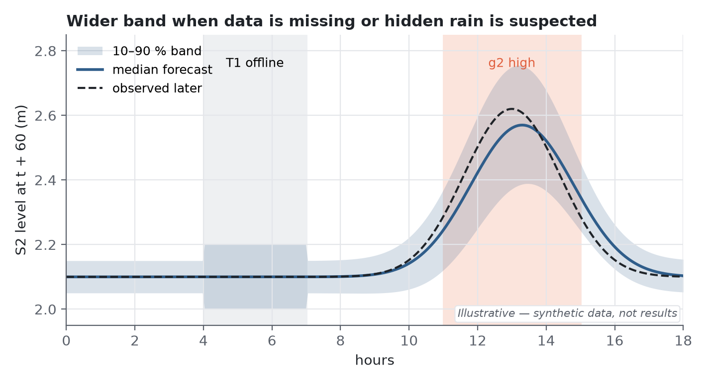

*Figure Q1.12: The S2 forecast's 10–90 % band widens while T1 is offline and while g2 is high (suspected hidden rain). Illustrative — synthetic data, not results.*

**Additional information requests** (none are guaranteed; the system works without every one of them):

| ID | Request | How it helps | Usable without? |
|---|---|---|---|
| I1 | Rain gauge on the left side (T1 catchment) | Earlier warning for T1/S2; less reliance on surprise. | Yes (surprise-based hidden-rain head) |
| I2 | Level/flow gauge on the unmonitored tributary | Turns U into a real sensor node and removes the main S3 blind spot. | Yes (virtual node U) |
| I3 | Rainfall nowcast or radar (0–2 h) | Anticipates rain within the horizon (future rain becomes a known input). | Yes (no future rain, wider band) |
| I4 | Rating curves (level ↔ discharge) at S1–S4, T1 | Allows mass-balance checks and a discharge-space Δ; improves extrapolation. | Yes (works in level space) |
| I5 | Reservoir gate logs (gate openings, operator actions) | Detects schedule deviations sooner; improves X_rel quality. | Yes (recorded releases only) |
| I6 | Sensor delay and outage statistics | More realistic delay simulation in training (A3); better data-age handling. | Yes (assumed delay distribution) |
| I7 | Survey of river cross-sections | Better travel-time prior φ and better high-flow extrapolation. | Yes (distance-only prior) |

---

## Compliance checklist

| Requirement in the question | Where answered |
|---|---|
| Architecture drawn first: sources, blocks, combination, S1–S4 forecasts | §1, Figure Q1.1, Figure Q1.2 |
| Tensor dimensions, alignment, projection, reshaping labelled | Figure Q1.1 (shape in each box), §1 bullets, Figure Q1.4 |
| Assumptions A1, A2, … listed separately, why reasonable, effect on design | §2 assumption table (A1–A14) |
| Assumptions distinguished from supplied facts | §2 facts table (F1–F8) |
| Unspecified data conditions (record length, delays, quality) | A1, A2, A3, A4, A5, A7 |
| River dynamics assumed | A8–A13 |
| Issuance time, history window, one-hour horizon, outputs | §3 bullets, Figure Q1.3 |
| One table of inputs and outputs: dimensions, axes (incl. batch), time coverage | §3 table |
| Alignment across locations and sampling times | §3 alignment bullets, Figure Q1.4 |
| Information available at issuance | §3 table "Available at t?", Figure Q1.3 |
| Notation and core equations of main blocks | §4 notation table, equations (1)–(5) |
| Forecast mapping and training objective | §4 equations (6), (7) |
| Justification of major choices | §4 "Design justification" |
| Influence of upstream conditions, tributaries, rainfall, releases | §4 "How each factor reaches each station", Figure Q1.8 |
| Physical assumptions vs learned mappings | §4 "Physics vs learned" table |
| Reference to diagram and assumptions | §4 cites Figures Q1.1, Q1.5, Q1.6, Q1.7, Q1.8 and A6–A13 |
| (i) missing, (ii) delayed observations | §5 (i), (ii), Figure Q1.9 |
| (iii) announced releases, (iv) scheduled vs actual | §5 (iii), (iv), Figure Q1.10 |
| Feasibility of running every 10 min | §5 feasibility, Figure Q1.11 |
| Uncertainties and limitations incl. unmonitored tributary and changing travel times | §6 limitations table |
| Impact and response, or what remains unresolved | §6 table columns |
| Additional information requests, benefit, usable without | §6 requests table (I1–I7) |
| Treatment of physical relationships and uncertainty (no simulator) | §6 opening bullets, §4 physics table, Figure Q1.12 |

**Reproducing the figures:** from `Question1/`, run `python figures/src/run_all.py` (matplotlib only); each `Question1/figures/src/figNN_*.py` also runs on its own. All plots built from synthetic data say so in their caption and inside the plot.

\newpage

# Question 2 — Motion or Memory?

A forecaster with a good test score has not necessarily learned *how things move*; it may only have
learned *what the training videos look like*. This question trains a ConvLSTM on Moving MNIST,
stress-tests it with transformations that should not matter to a true motion rule (mirror, rotation,
faster playback), diagnoses each failure, and builds a final model that holds up.


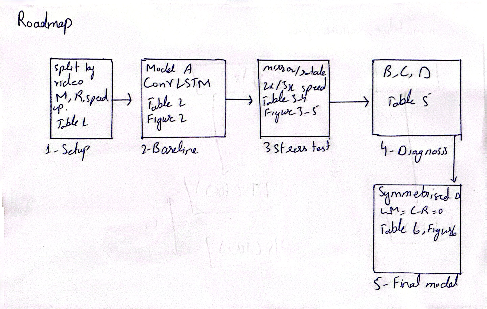

**Diagram D1:** Roadmap of Question 2 and where each table and figure comes from.

## 1. Setup

### Data

Moving MNIST is loaded with `torchvision.datasets.MovingMNIST(root="data", split=None, download=True)`,
giving all 10,000 videos of 20 frames (1×64×64). Videos are split **by index**: 0–7,999 train,
8,000–8,999 validation, 9,000–9,999 test. Frames are kept as `uint8` in memory and converted to
`float32 / 255` per batch on the device. Frames are numbered 1–20 (tensor index = frame − 1).

### Transformations and the symmetry group

* **Mirror** M: `x.flip(-1)`, i.e. (Mx)[i, j] = x[i, 63 − j].
* **Rotation** R: `torch.rot90(x, k=1, dims=(-2, -1))`, 90° anticlockwise.
* **Speed-up** k×: keep every k-th frame.

Mirror and rotation generate the 8 symmetries of the square, G = {Rᵃ, MRᵃ : a = 0..3}, with
MRᵃ = M(Rᵃ(x)) (rotate first, then mirror). Rᵃ is undone by R⁻ᵃ and each MRᵃ is its own inverse;
both properties are asserted in the notebook for all 8 elements.


**Diagram D2:** The 8 elements of G applied to one real test frame. The digit "6" makes it easy to see that
mirroring changes the digit's appearance even though the motion rule is unchanged.

### Windows at different speeds

A window starting at frame t at speed k uses X = (x_t, x_{t+k}, …, x_{t+4k}) and
Y = (x_{t+5k}, …, x_{t+9k}), keeping only target frames ≤ 20. Allowed starts are t ∈ {1..11} for
normal training (models A, B), and t ∈ {1..14} at 1×, {1..8} at 2×, {1, 2} at 3× for speed-augmented
training (models C, D): all five inputs and at least two targets must exist.

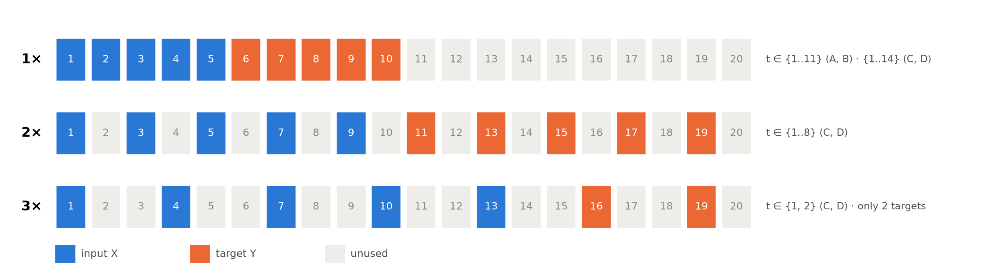

**Diagram D3:** Frames used with t = 1 at 1×, 2× and 3×, and the allowed start frames for each speed.

### Checking the code

**Table 1:** Checks of the transformation and window functions (computed with the same functions the experiments use).

| | Check | Expected | Ours |
|---|---|---|---|
| (a) | max \|M(M(x)) − x\| | 0 | 0 (`torch.equal` = True) |
| (b) | max \|R⁴(x) − x\| | 0 | 0 (`torch.equal` = True) |
| (c) | max \|MRM(x) − R⁻¹(x)\| | 0 | 0 (`torch.equal` = True) |
| (d) | bright pixel of M(p) (frame, row, column) | (7, 10, 43) | (7, 10, 43) |
| (e) | bright pixel of R(p) (frame, row, column) | (7, 43, 10) | (7, 43, 10) |
| (f) | 1× input / target frames | 1–5 / 6–10 | 1–5 / 6–10 |
| (g) | 2× input / target frames | 1, 3, 5, 7, 9 / 11, 13, 15, 17, 19 | 1, 3, 5, 7, 9 / 11, 13, 15, 17, 19 |
| (h) | 3× input / target frames | 1, 4, 7, 10, 13 / 16, 19 | 1, 4, 7, 10, 13 / 16, 19 |

All rows match.

### Is the training data already symmetric?

Dense optical flow (OpenCV Farneback, `0.5, 3, 15, 3, 5, 1.2, 0`, on `uint8` frames) was computed on the
first 50 training videos, all 19 consecutive pairs (950 pairs). Pixels were kept if they are brighter than
0.2 at the same location in both frames and move more than 0.5 px.

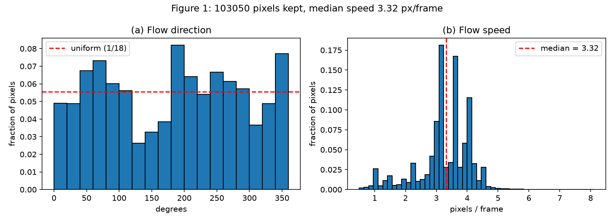

**Figure 1:** Optical flow on the first 50 training videos (950 frame pairs), pooled over **103,050** kept pixels.
(a) Flow direction θ = atan2(−dy, dx), 18 bins of 20°; red line = uniform level 1/18. (b) Flow speed;
**median = 3.32 px/frame**. Both are fractions of kept pixels.

### Q2.1

**Direction.** Yes, mirrored and rotated trajectories are already familiar. Every 20° bin in Figure 1(a)
is non-empty, holding between 0.0263 and 0.0820 of the kept pixels (uniform = 0.0556). A mirror maps
θ → 180° − θ, which reflects the histogram about the 90°/270° axis. A 90° rotation maps θ → θ + 90°, which
shifts it by 4.5 bins. Neither creates a direction that is missing from training, so the transformed motion
stays within what training already covers. Only the digits' appearance is new.

**Speed.** The median speed is **3.32 px/frame**. 72.2 % of kept pixels are between 3 and 4.5 px/frame,
and only 0.465 % are above 5 px/frame. So 2× ≈ **6.64 px/frame** and 3× ≈ **9.95 px/frame** are speeds the
model has essentially never seen in training.

**Overlap bias.** Where digits overlap, flow tends to underestimate speed and adds scattered directions.
The small bump near 1 px/frame in Figure 1(b) is likely this effect. It can only add low speeds and
spread directions out. It cannot create speeds of 6.6–10 px/frame or remove whole directions, so it
cannot change either conclusion.

### Q2.2

| Transformation | Changes motion statistics? | Changes appearance? |
|---|---|---|
| Mirror | No | Yes |
| Rotation | No | Yes (more) |
| Speed-up | Yes | No |

Mirror and rotation do change each digit's velocity (e.g. dx → −dx), but the **distribution** of directions and
speeds stays within what training covers (Q2.1). Each transformation changes **only one thing** and keeps the
physics the same, so if the model fails we know the cause: appearance (mirror or rotation) or motion (speed-up).

\newpage

## 2. Baseline: ConvLSTM (model A)

### Architecture

Model A follows Shi et al. (2015) without peepholes: each frame is folded with `pixel_unshuffle(·, 4)`,
passed through two ConvLSTM layers (64 hidden channels, 3×3 kernels, stride 1, zero padding 1), then a
1×1 convolution (64 → 16), `pixel_shuffle(·, 4)` and a sigmoid. One convolution computes all four gates:

[i, f, o, g] = Conv₃ₓ₃([u_τ, h_{τ−1}]),  c_τ = σ(f) ⊙ c_{τ−1} + σ(i) ⊙ tanh(g),  h_τ = σ(o) ⊙ tanh(c_τ).


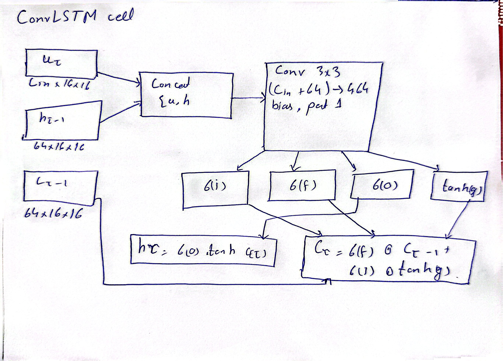

**Diagram D4:** One ConvLSTM cell. A single 3×3 convolution over [u, h] produces the four gates.


**Diagram D5:** Model A with tensor shapes and parameter counts per layer (total **480,784**, matching the handout).

The network runs for 9 steps: steps 1–5 take the true input frames, steps 6–9 take the network's own
previous prediction (no teacher forcing; gradients flow through the fed-back predictions). The outputs of
steps 5–9 form Ŷ.


**Diagram D6:** The 9-step rollout used in both training and evaluation.

### Training and evaluation protocol

| Setting | Value |
|---|---|
| Optimiser | Adam, learning rate 10⁻³, no schedule |
| Batch / epochs | 32 / 30, final-epoch weights kept |
| Epoch | one pass over the 8,000 training videos in shuffled order, one random window per video |
| Loss | squared error averaged over pixels and *available* target frames per video, then over the batch |
| Seeds | 0 and 1 (control initialisation, shuffling, window and augmentation sampling) |
| Hardware | Apple M2 Pro, MPS backend, PyTorch 2.14.1 |
| Training time (A) | 19.9 s/epoch (seed 0), 19.8 s/epoch (seed 1) |

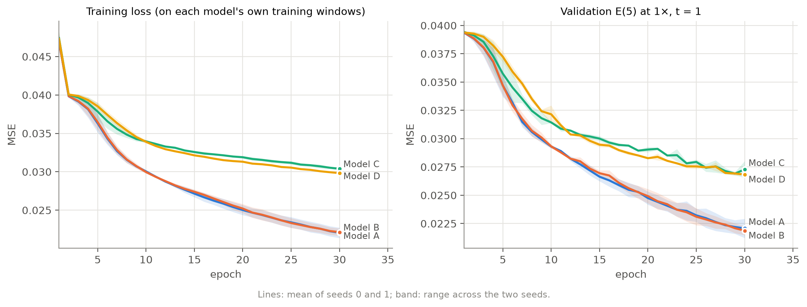

**Plot P1:** Training loss and validation E(5) (1×, t = 1) for models A–D over 30 epochs (mean of the two seeds;
band = range across seeds). Validation error is still falling at epoch 30, so all models are somewhat
under-trained under the fixed protocol. C and D train on harder (faster) windows, so their training loss is higher.

### Results

**Table 2:** Test-set error (1×, t = 1) per forecast horizon and E(5). Model A entries are mean (seed 0, seed 1).

| Model | MSE₁ | MSE₂ | MSE₃ | MSE₄ | MSE₅ | E(5) | Params |
|---|---|---|---|---|---|---|---|
| A | 0.0171 (0.0177, 0.0165) | 0.0205 (0.0213, 0.0197) | 0.0228 (0.0237, 0.0219) | 0.0247 (0.0256, 0.0237) | 0.0265 (0.0275, 0.0255) | **0.0223** (0.0232, 0.0214) | 480,784 |
| Blank | 0.0426 | 0.0426 | 0.0426 | 0.0425 | 0.0425 | 0.0426 | 0 |
| Copy-last | 0.0492 | 0.0604 | 0.0669 | 0.0708 | 0.0732 | 0.0641 | 0 |


**Plot P2:** Table 2 as a chart: model A's error per horizon (band = seed range) against the two reference predictors.


**Figure 2:** Seed-0 model A on test videos 757, 1 and 851 (dataset indices 9757, 9001, 9851). Rows: input
frames 1–5, true future frames 6–10, prediction. Video 757 has no overlap; in videos 1 and 851 the digits
overlap in the future frames.

### Q2.3


**Diagram D8:** Cells (4×4 px each) that one source cell can influence within a single time step. Left: model A
(two 3×3 convolutions). Right: model D (3×3, then 3×3 with dilation 2), used later in Q2.12.

**Reach of model A ≈ 8 px per step (horizontal/vertical), 11.3 px diagonally.**

- `pixel_unshuffle(4)` turns each 4×4 patch into one cell, so **1 cell = 4 pixels**. Folding, unfolding and the 1×1 conv move nothing.
- Each 3×3 conv moves information at most 1 cell, including diagonally.
- Paths within one step: u_τ → conv 1 → conv 2 = **2 convs**; h⁽¹⁾_{τ−1} → conv 1 → conv 2 = **2 convs**;
  h⁽²⁾_{τ−1} → conv 2 = 1 conv. The cell states c are updated element-wise and move nothing.
- So the longest path is 2 convs: **2 cells = 8 px along rows or columns**, and **2√2 cells ≈ 11.3 px diagonally**.

So reach depends on direction: 8 px for horizontal/vertical motion, up to 11.3 px diagonally.
1× (3.32 px/frame) and 2× (6.64 px/frame) are within reach. 3× (9.95 px/frame) exceeds the reach for
horizontal/vertical motion and is close to the diagonal limit, so most 3× motion is at or beyond reach
(revisited with experimental evidence in Q2.13).

### Q2.4

Model A beats both references: E(5) = 0.0223, about half of Blank (0.0426) and a third of Copy-last (0.0641).
Copy-last is worse than Blank because a moved digit is penalised twice: once where it was copied and once where it should be.
A's error grows from 0.0171 (h = 1) to 0.0265 (h = 5), about +55 %, because it feeds back its own blurry predictions.
Figure 2 shows predictions blurring and fading with each frame, with a visible 4×4 block pattern from pixel_shuffle.
When digits overlap, A merges them into one blob and cannot separate them: in video 851 the 3 and 1 overlap at
frame 6 and the 1 never reappears, even though they separate in the truth. In video 1 the 8 and 2 merge into one
vertical blob. Validation E(5) was still falling at epoch 30, so A is somewhat undertrained, which may explain the seed gap
(0.0232 vs 0.0214).

### Q2.5 (written before running Testing the Baseline)

*Reproduced unedited. Committed in `fc4408f` (2026-10-28 18:02) before any Section 3 experiment was run.*

- **Mirror: passes, mostly.** The motion is familiar (Fig. 1a) and only the digit shapes are new, so E_M is a little above 0.0223 and C_M is small.
- **Rotation: fails partly.** The motion is familiar, but the digits look even less familiar, so E_R > E_M and C_R > C_M.
- **Speed:** 2× (6.64 px) is within reach but outside the training speeds, so I expect clear degradation.
  At 3× (9.95 px), horizontal/vertical motion exceeds the 8 px reach, so I expect it to break down: digits stall, blur or vanish.

\newpage

## 3. Testing the Baseline

### Mirror and rotation

If a forecaster f has learned a rule that carries over to the transformed scene, predicting from T(X)
should equal transforming the prediction f(X). The **consistency gap** C_T measures that; the
**transformed error** E_T measures correctness.


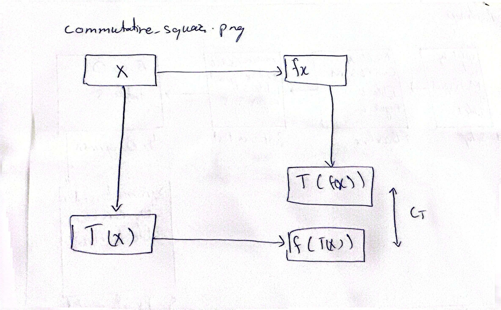

**Diagram D10:** The two paths that should agree. C_T compares the two bottom-right boxes; E_T compares f(T(X)) with the transformed truth T(Y).

**Table 3:** Test-set E(5), consistency gaps C_M, C_R and transformed errors E_M, E_R (1×, t = 1). Model A: mean (seed 0, seed 1).

| Model | E(5) | C_M | E_M | C_R | E_R |
|---|---|---|---|---|---|
| A | 0.0223 (0.0232, 0.0214) | 0.00185 (0.00155, 0.00216) | 0.0230 (0.0236, 0.0223) | 0.00326 (0.00297, 0.00356) | 0.0241 (0.0248, 0.0234) |
| Blank | 0.0426 | 0 | 0.0426 | 0 | 0.0426 |
| Copy-last | 0.0641 | 0 | 0.0641 | 0 | 0.0641 |


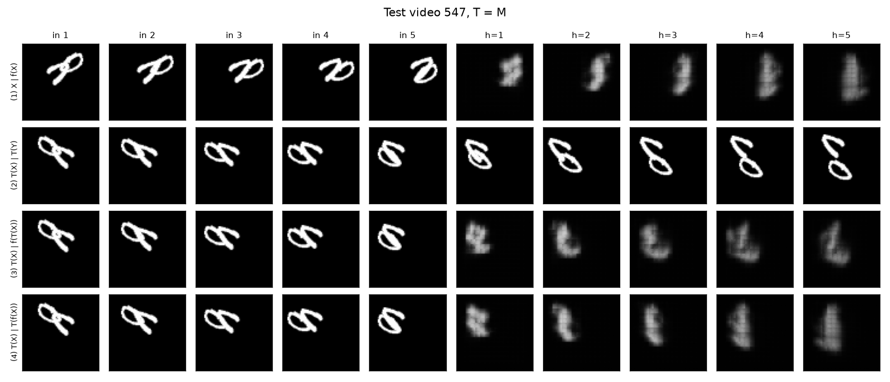
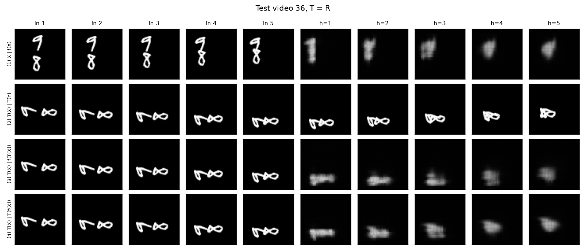
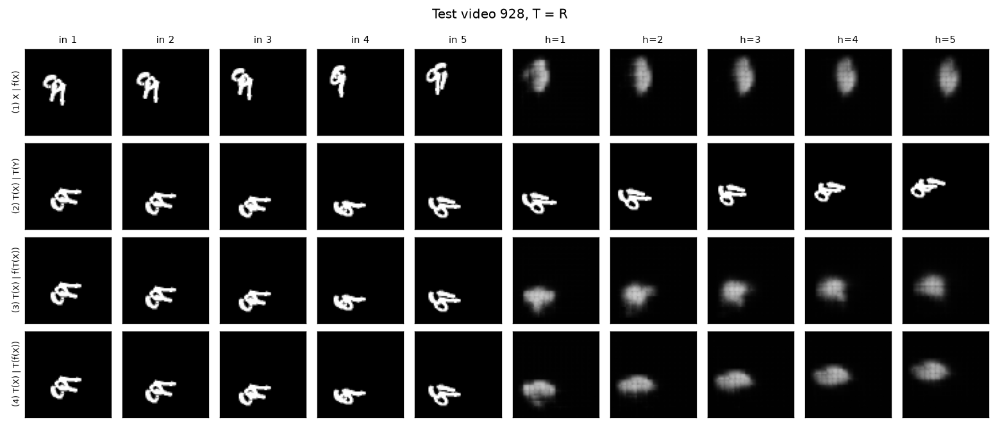

**Figure 3:** Seed-0 model A on the two test videos with the largest C_M (493, 547) and the largest C_R (36, 928).
Rows: (1) X | f(X), (2) T(X) | T(Y), (3) T(X) | f(T(X)), (4) T(X) | T(f(X)); columns 1–5 inputs, 6–10 future.
Animated versions: `Question2/figures/gifs/fig3_M_493.gif`, `fig3_M_547.gif`, `fig3_R_36.gif`, `fig3_R_928.gif`.


**Figure 4:** Per-video C_M and C_R of seed-0 model A over the 1,000 test videos; red lines mark the Figure 3 videos.

### Faster motion

**Table 4:** Model A at different speeds (t = 1), with Blank and Copy-last for comparison. Model A: mean (seed 0, seed 1).

| Model | E(2) 1× | E(2) 2× | E(2) 3× | E(5) 1× | E(5) 2× |
|---|---|---|---|---|---|
| A | 0.0188 (0.0195, 0.0181) | 0.0432 (0.0433, 0.0431) | 0.0478 (0.0492, 0.0464) | 0.0223 (0.0232, 0.0214) | 0.0471 (0.0473, 0.0470) |
| Blank | 0.0426 | 0.0425 | 0.0426 | 0.0426 | 0.0425 |
| Copy-last | 0.0548 | 0.0661 | 0.0703 | 0.0641 | 0.0719 |

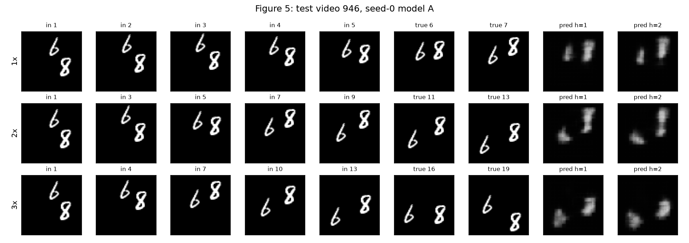

**Figure 5:** Test video 946 (digits do not overlap in any displayed true frame) at 1×, 2× and 3×: five input
frames, first two true future frames, first two predictions (seed-0 model A).

### Q2.6

Blank and Copy-last have C_M = C_R = 0 but the worst errors (E = 0.0426 and 0.0641). A trivial model can be perfectly
consistent while being useless, so a small C_T alone does not mean the model learned motion. E_T must be reported next
to it to show the consistent predictions are also correct.

### Q2.7 (seed-0 model A, test video 493, mirror, 1×, t = 1)

In the truth (row 2) the two overlapping digits separate: the "O" moves up and to the right, and the other digit moves left.
Predicting on the mirrored input (row 3) gives one wide blob that stays low and never separates; the "O" never moves up.
Mirroring the normal prediction (row 4) gives two faint clumps drifting apart, although the "O" does not move up there
either. So on the mirrored clip the model merges both digits into a single smear, while on the original clip it at least
keeps two separate clumps. The video starts with the digits overlapping (frames 1–5), the same situation that broke
model A in Q2.4.

### Q2.8

Yes, for model A at 1× (t = 1). C_R = 0.00326 is about 1.8× C_M = 0.00185, and E_R = 0.0241 > E_M = 0.0230. This holds
for both seeds (C_R / C_M = 1.92 for seed 0 and 1.65 for seed 1), and Figure 4 shows the whole C_R distribution shifted
right. The motion is equally familiar under both (Q2.1: every direction occurs in training), so the difference comes
from appearance: rotated digits look less like the training digits than mirrored ones (Q2.2).

### Q2.9

Model A falls apart at 2×, not 3×: E(2) rises from 0.0188 (1×) to 0.0432 (2×), slightly worse than Blank at the same
speed (Table 4), and to 0.0478 at 3×. This disagrees with Q2.3, because 2× (6.64 px/frame) is within both the 8 px
(horizontal/vertical) and the 11.3 px (diagonal) reach. The estimate missed that reach is only an
upper limit: the network must also have learned to use it, and it was trained only on speeds around 3.3 px/frame.
In Figure 5 (video 946), at 1× the 6 and the 8 are blurry but in roughly the right places. At 2× and 3× they stay two
separate blobs, but both stall near their last input positions: at 2× the 6 and the 8 should keep moving down, and at 3×
the 6 should bounce back up and the 8 should move to the bottom right. Their shapes also dissolve into blobs. A digit
that stalls suggests the model moves digits by at most its familiar training speed. The blurred blobs suggest it is
unsure where the digit went and averages over possible positions instead of tracking it.

### Q2.10

No. Fast motion was never in training and 3× is also beyond the reach, so both explanations predict failure. (The failure
at 2×, which is within reach, does hint that unfamiliarity matters.) Experiment: train the same architecture on 1×, 2× and
3× clips (model C). If C fixes 2× and 3×, the cause is unfamiliar motion. If C fixes 2× but still fails at 3×, while a
larger-reach model trained the same way (model D) succeeds, the 3× failure is architectural reach.

\newpage

## 4. What Can Data Fix?

| Model | Architecture | Training speeds | Symmetry augmentation |
|---|---|---|---|
| A | baseline | 1× | none |
| B | baseline | 1× | g drawn uniformly from G |
| C | baseline | k drawn uniformly from {1, 2, 3} | none |
| D | larger reach (dilated layer 2) | k drawn uniformly from {1, 2, 3} | none |


**Diagram D9:** How one training window is built for each model. Shaded boxes are the single thing each model
changes relative to A (B: symmetry; C: speed; D: speed + architecture, so D differs from C only in architecture).

### Q2.11 (written before training B–D)

*Reproduced unedited. Committed in `4d38afc` (2026-10-28 20:15), before training of B–D started (~20:18).*

B (symmetry augmentation) will shrink C_M, C_R and E_M, E_R, because the mirror/rotation failures come from appearance.

C (speed augmentation) will fix 2× because that failure is unfamiliar motion, but will stay poor at 3×.

D (larger reach + speed augmentation) will also fix 3×, because 3× motion is beyond model A's 8 px reach.

### Model D


**Diagram D7:** Model D. Identical to model A except that ConvLSTM layer 2 uses a 3×3 convolution with
dilation 2 (padding 2). Same 480,784 parameters (limit 721,176), same shapes, rollout and training protocol as C.

### Results

**Table 5:** Models A–D on the test set (t = 1). E(5) and C/E at 1×; E(2) at 1×, 2×, 3×. Inference = time to predict all
1,000 test videos at batch 32 (MPS, Apple M2 Pro). Entries are mean (seed 0, seed 1).

| Model | E(5) 1× | C_M | E_M | C_R | E_R |
|---|---|---|---|---|---|
| A | 0.0223 (0.0232, 0.0214) | 0.00185 (0.00155, 0.00216) | 0.0230 (0.0236, 0.0223) | 0.00326 (0.00297, 0.00356) | 0.0241 (0.0248, 0.0234) |
| B | 0.0221 (0.0225, 0.0217) | 0.00117 (0.00114, 0.00120) | 0.0221 (0.0225, 0.0217) | 0.00142 (0.00130, 0.00154) | 0.0221 (0.0224, 0.0217) |
| C | 0.0276 (0.0283, 0.0269) | 0.00111 (9.02e-04, 0.00131) | 0.0278 (0.0285, 0.0271) | 0.00238 (0.00193, 0.00283) | 0.0287 (0.0293, 0.0281) |
| D | 0.0271 (0.0271, 0.0270) | 7.27e-04 (6.31e-04, 8.24e-04) | 0.0273 (0.0273, 0.0273) | 0.00159 (0.00157, 0.00161) | 0.0281 (0.0282, 0.0280) |

| Model | E(2) 1× | E(2) 2× | E(2) 3× | Params | Train s/epoch | Inference (s) |
|---|---|---|---|---|---|---|
| A | 0.0188 (0.0195, 0.0181) | 0.0432 (0.0433, 0.0431) | 0.0478 (0.0492, 0.0464) | 480,784 | 19.9 (19.9, 19.8) | 0.554 (0.590, 0.518) |
| B | 0.0185 (0.0187, 0.0183) | 0.0432 (0.0422, 0.0441) | 0.0480 (0.0455, 0.0504) | 480,784 | 21.0 (21.7, 20.4) | 0.538 (0.551, 0.524) |
| C | 0.0236 (0.0240, 0.0232) | 0.0291 (0.0295, 0.0288) | 0.0334 (0.0335, 0.0332) | 480,784 | 20.4 (20.5, 20.2) | 0.520 (0.519, 0.520) |
| D | 0.0240 (0.0241, 0.0239) | 0.0287 (0.0287, 0.0287) | 0.0323 (0.0325, 0.0321) | 480,784 | 23.1 (23.1, 23.0) | 0.703 (0.704, 0.703) |


**Plot P3:** E(2) against playback speed (Tables 4–6). Model A collapses to the Blank level at 2×; speed
augmentation (C, D) keeps the error well below Blank at every speed, and D is slightly better than C at 3×.


**Plot P4:** Extra error caused by mirroring or rotating the clip, E_T − E(5) (from Tables 5 and 6). Symmetry
augmentation (B) and symmetrisation remove it; speed augmentation only shrinks it.

### Q2.12

Model D is model A with one change: ConvLSTM layer 2 uses a 3×3 convolution with dilation 2 (padding 2).
Parameters are unchanged at 480,784 (≤ 721,176), and it is trained exactly like C (k drawn from {1, 2, 3}).
**Reach:** 1 cell = 4 px as before. Layer 1's 3×3 conv moves information {−1, 0, +1} cells; layer 2's dilated conv
moves {−2, 0, +2} cells. The longest path within one step (u_τ or h⁽¹⁾_{τ−1} → layer 1 → layer 2) reaches every offset
from −3 to +3 cells with no gaps (Diagram D8, right), so the reach is **3 cells = 12 px** along rows or columns
(3√2 cells ≈ 17.0 px diagonally), compared with 8 px (11.3 px) for model A. Every speed up to 3× (9.95 px/frame)
is now within reach.

### Q2.13

- **Mirror/rotation → appearance.** Measured by the extra error a transformation causes (E_T − E(5), Plot P4):

  | | E_M − E(5) | E_R − E(5) |
  |---|---|---|
  | A | +0.0007 | +0.0018 |
  | B | 0.0000 | 0.0000 |
  | C | +0.0002 | +0.0011 |
  | D | +0.0002 | +0.0010 |

  B removes the penalty completely (E_M = E_R = E(5) = 0.0221); C and D only shrink it. Their smaller C_T partly reflects
  blurrier predictions, not a learned symmetry (Q2.6). So the cause is appearance, and symmetry augmentation fixes it.
- **2× → unfamiliar motion.** C (same reach as A) cuts E(2) at 2× from 0.0432 to 0.0291, so reach was not the problem.
- **3× → mostly unfamiliar motion, small reach effect.** C cuts E(2) at 3× from 0.0478 to 0.0334. D improves it by only
  0.0011 more (0.0323), but consistently across both seeds.
- **"C bad at 3×, D good"** would show that reach is the bottleneck. That is not what we see: C already handles 3× fairly well
  (0.0334 vs Blank 0.0426). This fits Q2.3: 3× (9.95 px) is beyond A's 8 px horizontal/vertical reach but within its 11.3 px
  diagonal reach, so 3× was only partly out of reach. (This also went against my Q2.11 prediction.)
- **Why data can't beat reach:** in one step, information can only travel as far as the network's connections allow.
  If a digit jumps further, there is no path for training to use, so only an architecture change (D) helps.

### Q2.14

- **B:** no cost (E(5) at 1×: 0.0221 vs 0.0223, within seed spread). Worth it.
- **C, D:** yes, E(5) at 1× rises to 0.0276 and 0.0271 (about +22–24 %), because only a third of their training is at 1×.
  Still worth it: 2× and 3× errors drop by about 0.014, so they work at all speeds. D is also slower
  (0.703 s vs 0.554 s inference, 23.1 vs 19.9 s/epoch).

\newpage

## 5. The Final Model

Symmetrised forecaster: f̄(X) = (1/8) Σ_{g∈G} g⁻¹( f( g(X) ) ).


**Diagram D11:** The symmetrised forecaster: transform the input by each of the 8 symmetries, predict with the
same trained model, undo the transformation and average. No retraining is needed.

**Final model: symmetrised D.** The main benefit of symmetry augmentation (model B) is consistency, and symmetrisation
already makes that exact (Table 6: C_M, C_R ≈ 5e-17, E_M = E_R = E(5)). B's gain at 1× was within seed spread
(0.0221 vs 0.0223), so D+B would add little beyond symmetrised D, and we wrap D.

### Why f̄ has C_M = C_R = 0

Take any T ∈ G. Then f̄(T(X)) = (1/8) Σ_g g⁻¹ f(gT(X)). Let h = gT. As g runs over all 8 elements of G, so does h
(G is a group), and g⁻¹ = T h⁻¹. So f̄(T(X)) = (1/8) Σ_h T h⁻¹ f(h(X)) = T(f̄(X)), since T just rearranges pixels and can be
taken outside the average. Therefore f̄(T(X)) = T(f̄(X)) exactly, so C_T = 0 for every T ∈ G, including M and R, for any f.
Numerically we get floating-point error only, because the 8 terms are summed in a different order.

### Results

**Table 6:** Symmetrised B and symmetrised D (final model), same columns as Table 5; mean (seed 0, seed 1).
Training time is that of the underlying model (symmetrisation needs no training). Inference time includes all 8 transformations,
forward passes, inverse transformations and the averaging.

| Model | E(5) 1× | C_M | E_M | C_R | E_R |
|---|---|---|---|---|---|
| sym-B | 0.0215 (0.0219, 0.0211) | 7.81e-17 (7.51e-17, 8.12e-17) | 0.0215 (0.0219, 0.0211) | 7.70e-17 (7.40e-17, 8.00e-17) | 0.0215 (0.0219, 0.0211) |
| **sym-D (final)** | 0.0271 (0.0272, 0.0270) | 5.01e-17 (4.86e-17, 5.16e-17) | 0.0271 (0.0272, 0.0270) | 4.98e-17 (4.83e-17, 5.14e-17) | 0.0271 (0.0272, 0.0270) |

| Model | E(2) 1× | E(2) 2× | E(2) 3× | Params | Train s/epoch | Inference (s) |
|---|---|---|---|---|---|---|
| sym-B | 0.0180 (0.0182, 0.0178) | 0.0423 (0.0414, 0.0432) | 0.0469 (0.0446, 0.0491) | 480,784 | 21.0 (21.7, 20.4) | 4.40 (4.56, 4.25) |
| **sym-D (final)** | 0.0240 (0.0241, 0.0238) | 0.0287 (0.0287, 0.0287) | 0.0322 (0.0324, 0.0320) | 480,784 | 23.1 (23.1, 23.0) | 5.72 (5.71, 5.72) |

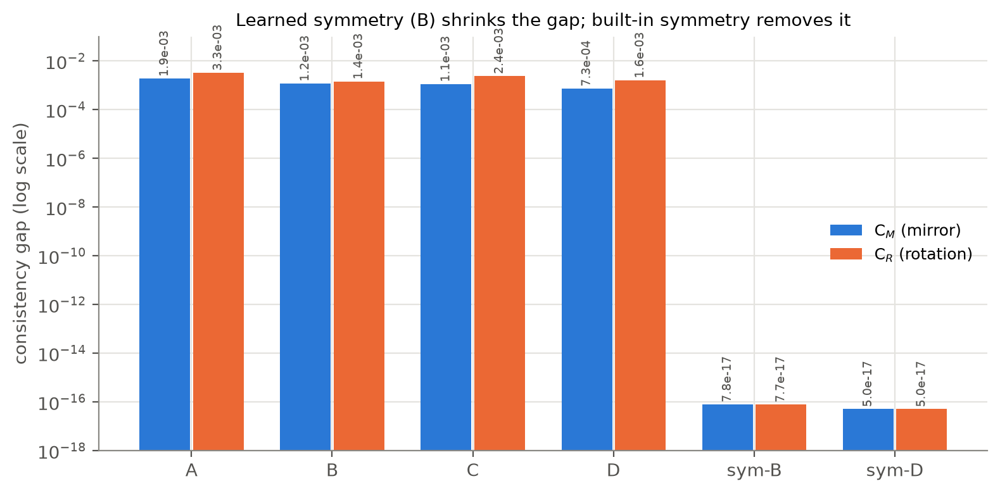

**Plot P5:** Consistency gaps of every model on a log scale (Tables 5–6). Learned symmetry (B) lowers the gap;
built-in symmetry drives it to floating-point level (~10⁻¹⁷), about 13 orders of magnitude lower.


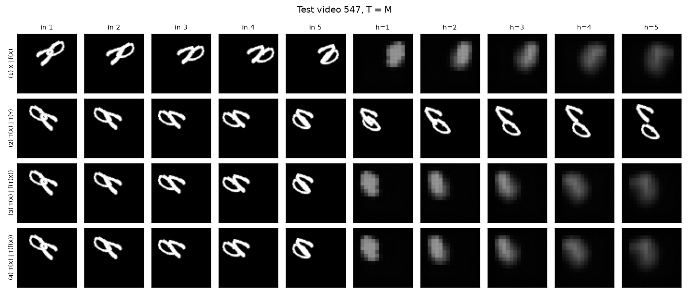
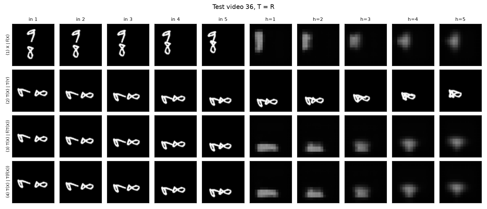
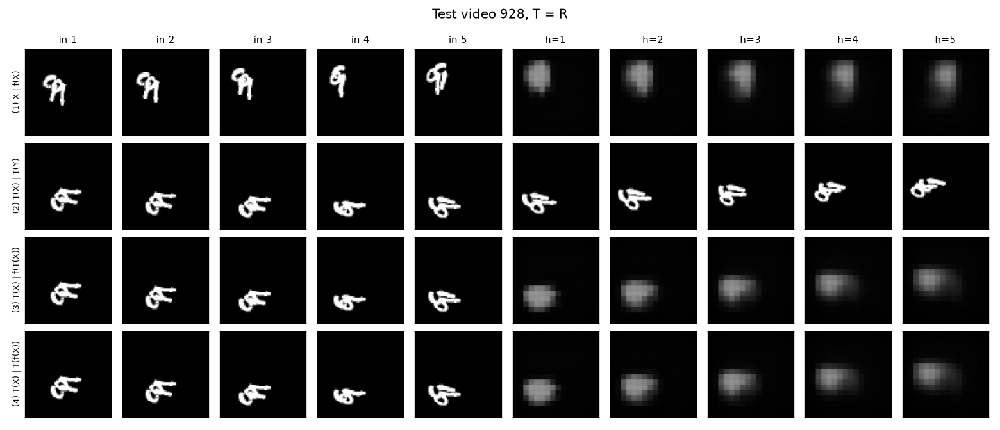

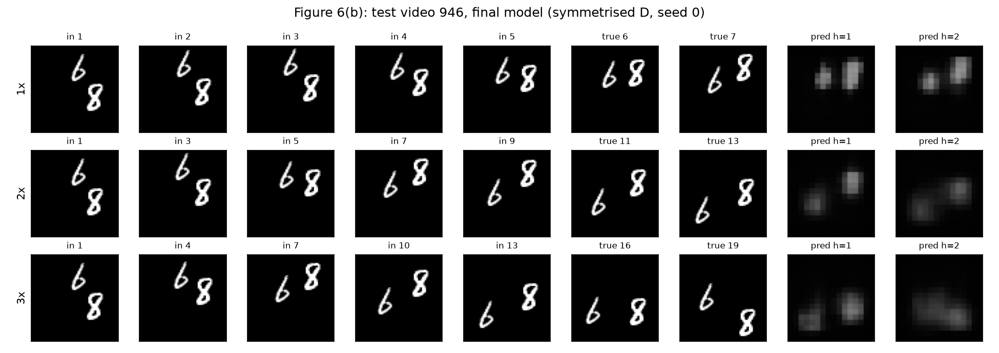

**Figure 6:** Final model (symmetrised D, seed 0). (a) Same videos and layout as Figure 3 (493, 547 mirror; 36, 928 rotation);
GIFs: `Question2/figures/gifs/fig6a_M_493.gif`, `fig6a_M_547.gif`, `fig6a_R_36.gif`, `fig6a_R_928.gif`.
(b) Same video (946) and layout as Figure 5.

### Q2.15

- **Consistency:** built-in symmetry is exact (C_M, C_R ≈ 5e-17 to 8e-17, floating-point error only); learned symmetry is
  approximate (B: C_M = 0.00117, C_R = 0.00142). Built-in is exact by construction: transforming the input only reorders
  the 8 terms of the average (proof above), whatever f has learned. B only learns to be consistent on the training data.
- **Accuracy:** symmetrisation makes transformed clips exactly as easy as originals (E_M = E_R = E(5)) and did not hurt
  accuracy: sym-B improves on B (0.0215 vs 0.0221) and sym-D matches D at 1× (0.0271) while fixing its rotation penalty
  (E_R 0.0281 → 0.0271).
- **Cost:** built-in symmetry is about 8× slower at inference (sym-B 4.40 s vs 0.538 s; sym-D 5.72 s vs 0.703 s); learned symmetry is free.
- **Blur:** averaging 8 different guesses blurs predictions when they disagree. Under MSE, f̄'s error is at most the mean of
  f's errors over the 8 transformed inputs, but it can still be worse than f's original-clip error E(5) when f is much
  worse on transformed inputs (e.g. model A on rotations); that is when symmetrisation hurts. It did not hurt here
  (sym-B 0.0215 vs B 0.0221; sym-D 0.0271 = D), although Figure 6 predictions look smoother and blurrier.

### Q2.16

Partly. In Figure 6(a) rows 3 and 4 are now identical, so the consistency failure is fixed: by symmetrisation, which makes
f(M(X)) = M(f(X)) exactly. But the motion failure is not fixed: the two overlapping digits still come out as one blob that
spreads diagonally and never separates into the "O" moving up-right and the other digit moving left. That part of the failure
comes from overlapping digits, which none of B, C, D or symmetrisation targets.
D's speed augmentation and larger reach play no role here, because 493 is a 1× clip.

### Q2.17

Partly. The final model (symmetrised D) tracks motion at every speed it was trained on: E(2) is 0.0287 at 2× and 0.0322 at 3×,
versus 0.0432 and 0.0478 for model A and 0.0426 for Blank. In Figure 6(b) at 1× and 2×, the 6 and 8 stay as two blobs near
their true positions. Its exact mirror/rotation consistency (C_M, C_R ≈ 5e-17, E_M = E_R = E(5)) is guaranteed by
construction, so on its own it is not evidence of learned motion. Against that, it predicts blurry blobs, is worse than A on
1× clips (0.0271 vs 0.0223), and merges overlapping digits (Figure 6a). A skeptic would want speeds never seen in training
(e.g. 1.5× or 4×), longer rollouts and new shapes. One test it still fails: separating two digits after they overlap.

## 6. Summary of findings

| Failure of model A | Cause | Evidence | What fixed it |
|---|---|---|---|
| Worse on mirrored / rotated clips (rotation worse) | Appearance | Motion statistics already symmetric (Fig. 1); B removes E_T − E(5) (Plot P4) | Symmetry augmentation (B) partly; symmetrisation exactly |
| Collapses at 2× | Unfamiliar motion | 2× is within reach, yet A ≈ Blank; C (same reach) cuts E(2) 0.0432 → 0.0291 | Speed augmentation (C, D) |
| Degrades at 3× | Mostly unfamiliar motion, small reach effect | C cuts 0.0478 → 0.0334; D adds 0.0011 more on both seeds | Speed augmentation + larger reach (D) |
| Overlapping digits merge and never separate | Not addressed by any change | Figures 2, 3, 6(a) | Still open |

\newpage

# Reproducibility

```
Assignment 2/
├── report.md                          ← this report
├── DL4STG_PA2.pdf                     ← handout
├── Question1/
│   ├── Q.md                           ← Question 1 answer (copied into this report)
│   └── figures/                       ← Figures Q1.1–Q1.12 (PNG); src/ holds the scripts (run_all.py)
└── Question2/
    ├── 25280065_Question_2.ipynb       ← all code, tables and figures (Sections 1–5)
    ├── make_report_figures.py         ← regenerates Diagrams D1–D11 and Plots P1–P5
    ├── figures/                       ← Figures 1–6 (PNG)
    │   ├── gifs/                      ← animated Figure 3 and Figure 6(a) panels
    │   ├── diagrams/                  ← Diagrams D1–D11
    │   └── plots/                     ← Plots P1–P5
    ├── checkpoints/                   ← trained weights (git-ignored)
    └── data/                          ← Moving MNIST (downloaded by torchvision, git-ignored)
```

* Seeds 0 and 1 for every learned model; seed 0 is used for all figures and GIFs.
* Pre-registered answers: Q2.5 committed in `fc4408f` before Section 3; Q2.11 committed in `4d38afc` before training B–D.
* Supplementary diagrams and plots: run `../.venv/bin/python -I make_report_figures.py` from `Question2/`.

\newpage

# Use of generative AI

<!-- TODO: review and complete this section before submitting. The handout requires the prompt, its output, and the edits you made. -->

**Question 1.** I used Claude for Questions. It explained the question to me, helped develop my design ideas into the final design

**Question 2.** I used Claude (Anthropic, Claude Code in VS Code) as a reviewer while working on Question 2. All code was written
and run by me; the AI checked it against the handout and suggested corrections.

| # | Prompt (summary) | Output (summary) | Edits I made |
|---|---|---|---|
| 1 | "Strict review of Section 1 line by line against the PDF; PASS/FAIL per item with fixes." | Found: `speed_up` sliced the batch axis; G/G⁻¹ and allowed start frames missing; no guard for t < 1; Q2.1 had 9.96 instead of 9.95, overstated "almost all speeds", and an unsupported overlap argument. | Fixed `speed_up`, added `G`, `G_inv`, `T_NORMAL`, `T_AUG` and asserts; rewrote Q2.1 with numbers computed in the notebook. |
| 2 | "Review Section 2 completely." | Code and Table 2 confirmed (recomputed independently); flagged missing hardware line, wrong Figure 2 caption, missing diagonal reach in Q2.3, Q2.5 not yet committed. | Added hardware; changed Figure 2 to a non-overlapping video (757); added diagonal reach to Q2.3; committed Q2.5 before Section 3. |
| 3 | "Check Section 3." | Tables 3–4 confirmed; Figure 5 video 604 overlapped in the 3× true frames; Figure 4 labels overlapped. | Asked the AI to apply the fixes in the notebook: video 946 for Figure 5, staggered labels, Blank row in Table 4, model/speed labels in Q2.7–Q2.8 and a new Figure 5 description in Q2.9; I re-ran the cells and checked the figures. |
| 4 | "Check Section 4." | Table 5 confirmed; Q2.13 did not answer the "C bad at 3×, D good" question and relied on C_T although C/D are blurrier. | Added the E_T − E(5) table and the missing paragraph to Q2.13; adjusted Q2.14 wording. |
| 5 | "Check Section 5." | Proof and Table 6 confirmed; Q2.17 wrongly called 2×/3× "unfamiliar" and used by-construction consistency as evidence; final-model choice weakly justified. | Rewrote Q2.17 and the final-model justification; clarified the Jensen argument in Q2.15. |
| 6 | "Check the complete notebook end to end." | Flagged an unexecuted cell and out-of-order execution counts; suggested reusing checkpoints so "Run All" is reproducible. | *(describe what you changed)* |
| 7 | "Prepare report.md with all figures and architecture diagrams." | This report skeleton, Diagrams D1–D11 and Plots P1–P5. | *(describe your edits; Diagrams D1, D3–D11 to be redrawn by hand)* |

Q2.5 and Q2.11 were written and committed before the corresponding experiments and were not changed afterwards.

# References

Shi, X., Chen, Z., Wang, H., Yeung, D.-Y., Wong, W.-K., and Woo, W. (2015). Convolutional LSTM Network: A Machine
Learning Approach for Precipitation Nowcasting. *NeurIPS*.

Srivastava, N., Mansimov, E., and Salakhutdinov, R. (2015). Unsupervised Learning of Video Representations using LSTMs. *ICML*.
