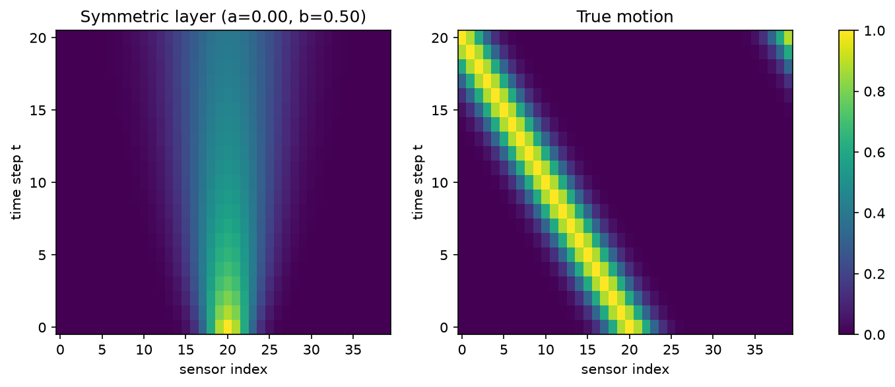
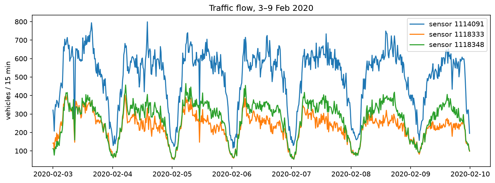
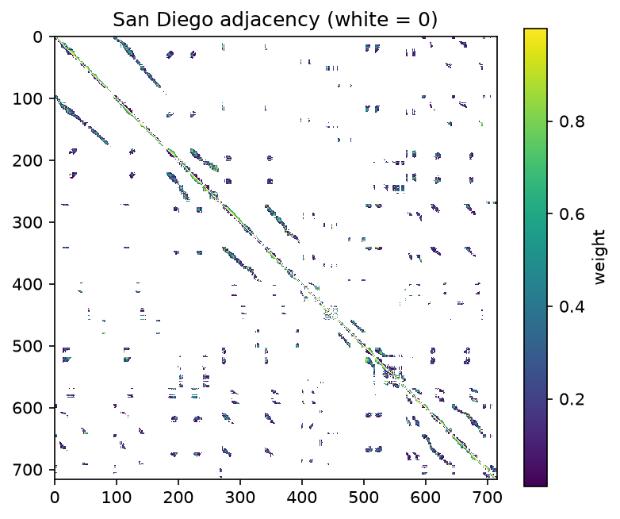
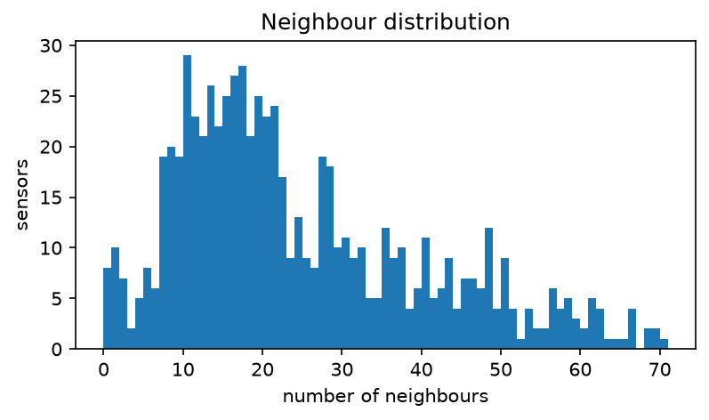
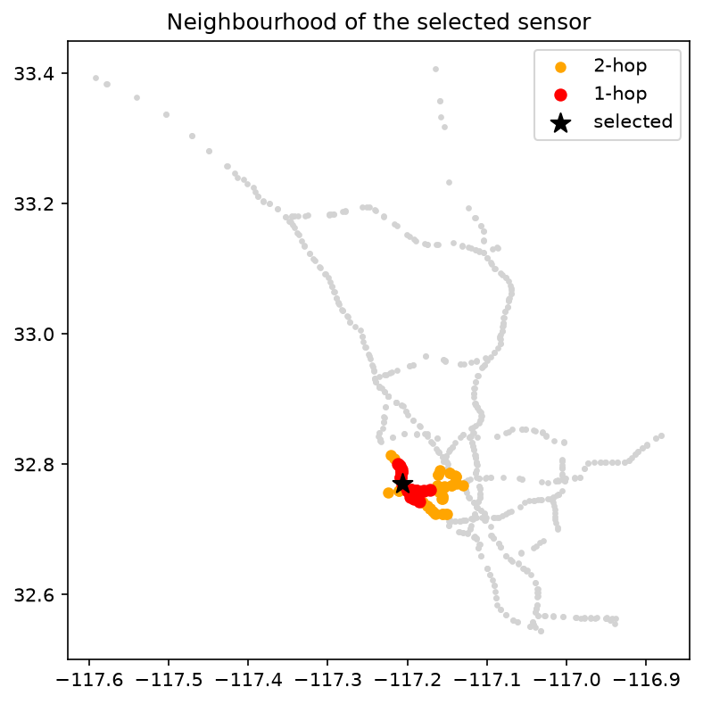
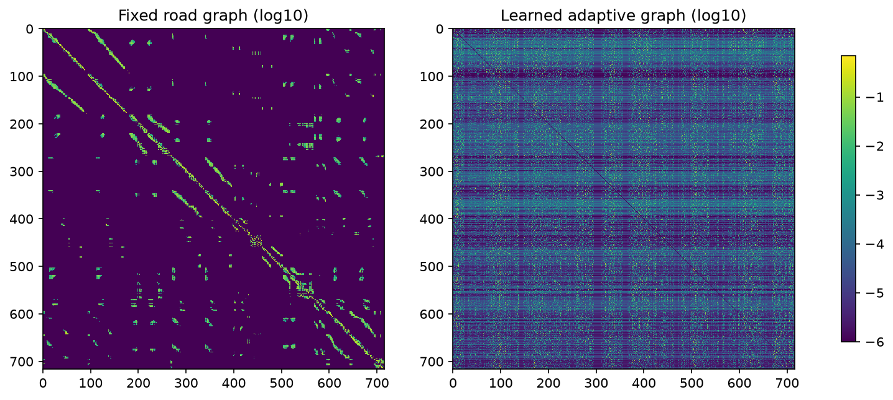
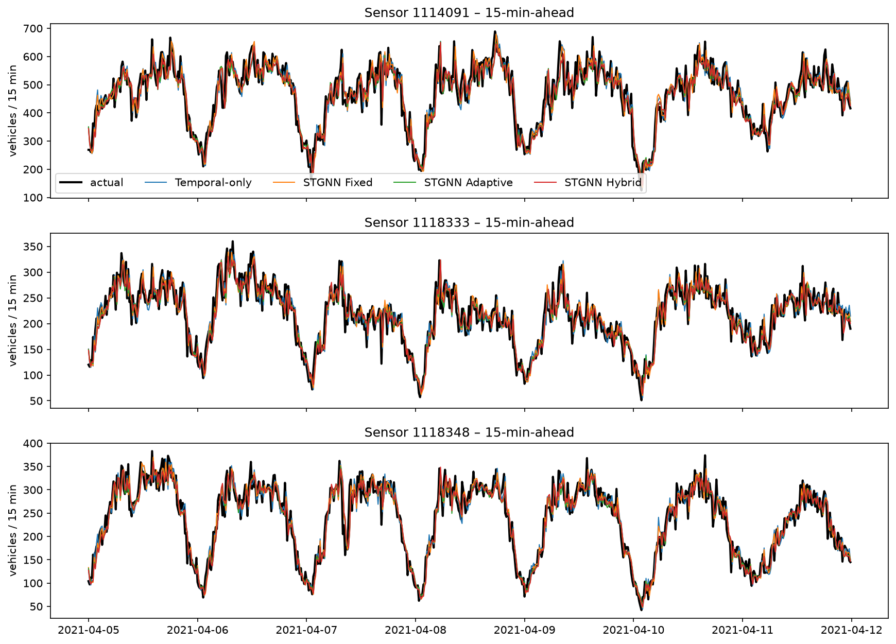
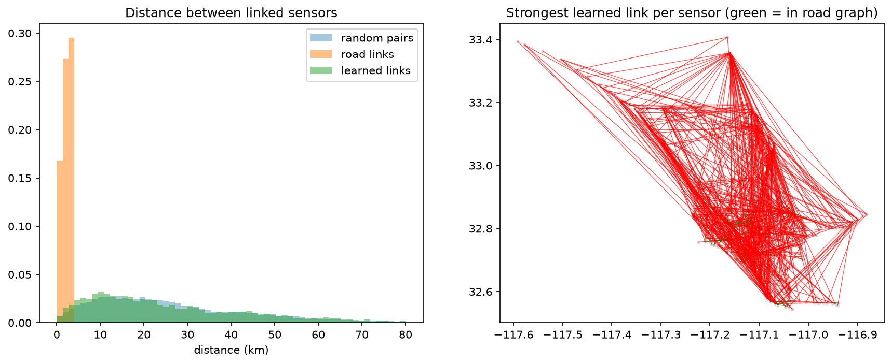

# AI651 – Deep Learning for Space, Time and Graphs — Assignment 3

**Student ID:** 25280065
**GitHub (code):** https://github.com/<your-username>/<your-repo>

---

## Question 1 – What does a sum remember?

### (a) Affine message
With φ(x) = w·x + c, the aggregated message is

**Σ φ(xᵤ) = w·Sᵥ + c·nᵥ**

ρ only receives this number. If two neighbourhoods have the same nᵥ and Sᵥ, then ρ gets the same input, so hᵥ is identical for **every** choice of w, c and ρ.
Example: **A = {0, 0}** (2 steady) and **B = {−1, +1}** (0 steady). Both have nᵥ = 2 and Sᵥ = 0. With w = 2, c = 5, both sums are 10.

### (b) Place-value message
Choose base **B = K + 1** and set **φ(−1) = 1, φ(0) = B, φ(+1) = B²**. With counts a (slowing), b (steady) and c (speeding), the sum is **s = a + b·B + c·B²**. Each count is ≤ K < B, so no "digit" carries over, and the sum is unique.
Decoding: **a = s mod B, b = ⌊s / B⌋ mod B, c = ⌊s / B²⌋**.
For K = 8: φ = (1, 9, 81). NumPy check over all **164** possible neighbourhoods: all sums unique = **True**, decoding correct = **True**. Example: (3, 2, 1) → 3 + 18 + 81 = 102 → (3, 2, 1).
**Counting non-steady neighbours only:** φ(x) = x², i.e. φ(−1) = 1, φ(0) = 0, φ(+1) = 1. The sum equals the number of non-steady neighbours for any neighbourhood size (verified: True).

### (c) Sum vs Mean vs Max (one-hot messages)
Sum keeps **counts**, Mean keeps **proportions** (and loses n), and Max keeps only **presence** of each trend. The table below was verified by brute force over every neighbourhood with 1–8 neighbours.

| Task | Method | Possible? | Reason |
|---|---|---|---|
| Count steady neighbours | Sum | Yes | ρ reads coordinate 2: steady = s₂. |
| Count steady neighbours | Mean | No | {0} and {0,0} both give (0, 1, 0); answers 1 vs 2. |
| Count steady neighbours | Max | No | {0} and {0,0} both give (0, 1, 0); answers 1 vs 2. |
| More than half slowing | Sum | Yes | Test s₁ > s₂ + s₃ (all coordinates). |
| More than half slowing | Mean | Yes | Test m₁ > 0.5 (coordinate 1). |
| More than half slowing | Max | No | {−1,+1} and {−1,−1,+1} both give (1, 0, 1); answers No vs Yes. |
| Any neighbour slowing | Sum | Yes | Test s₁ > 0. |
| Any neighbour slowing | Mean | Yes | Test m₁ > 0. |
| Any neighbour slowing | Max | Yes | Test max₁ = 1. |

---

## Question 2 – Which way is the slowdown moving?

### (a)(i) Symmetric layer on a single spike
Only x₂₀ = 1. Predictions: x̂₁₉ = b, x̂₂₀ = a, x̂₂₁ = b (all others 0). Targets: x₁₉ = 1, all others 0.
Loss L = (b − 1)² + a² + b². Setting ∂L/∂a = 2a = 0 and ∂L/∂b = 2(b − 1) + 2b = 0 gives **a = 0, b = 0.5**, L = 0.5.
NumPy least squares: a = 0.000, b = 0.500, error = 0.500. The layer cannot pick a side, so it puts half the jam on each neighbour.

### (a)(ii) Rolling out a smooth bump

*Left: symmetric layer for 20 steps. Right: true motion. Same colour scale.*

The symmetric layer keeps the bump centred at sensor 20 and spreads it out (wider and flatter, like diffusion). The true rule slides the bump one sensor backwards per step without changing its shape, wrapping around the ring.

### (b) Direction-aware weights
**a = 0, w₋ = 0, w₊ = 1**, so x̂ᵢ(t+1) = xᵢ₊₁(t), which is exactly the true rule (verified on random input: True). Because the layer knows which neighbour is ahead, it can copy from that side only. This breaks the left/right symmetry that made (a) impossible.
**1-D convolution:** kernel **[0, 0, 1]** multiplying [xᵢ₋₁, xᵢ, xᵢ₊₁], with **circular padding** (wrap-around), so sensor 39 sees sensor 0 and sensor 0 sees sensor 39.

### (c) Adding history
**(i)** Backward motion means the reading at i at time t−1 is now at i−1: **xᵢ(t−1) = xᵢ₋₁(t)**. Choose **a = 0, b = 1, c = −1**:
x̂ᵢ(t+1) = xᵢ₋₁(t) + xᵢ₊₁(t) − xᵢ₋₁(t) = **xᵢ₊₁(t)** ✓ (verified: True)
**(ii)** Forward motion: xᵢ(t−1) = xᵢ₊₁(t). Same coefficients:
x̂ᵢ(t+1) = xᵢ₋₁(t) + xᵢ₊₁(t) − xᵢ₊₁(t) = **xᵢ₋₁(t)** = the correct forward step ✓ (verified: True)
**(iii)** The previous snapshot shows where the pattern **came from**. Subtracting it removes the neighbour on that side, and what remains is the neighbour on the side the pattern is **moving towards**. The spatial weights stay symmetric. The direction comes from time, the way two photos show motion and one cannot.

---

## Question 3 – Dataset preparation and graph construction

### (a) Extraction and resampling
San Diego = Caltrans **District 11** in `ca_meta.csv` → **716 sensors**. 2020 and 2021 were kept, giving data shape **(70176, 716)** at 15-minute resolution.
**Aggregation:** LargeST/PeMS flow is a **vehicle count per 5-minute interval**, so counts are **summed** to keep units (vehicles / 15 min). It is computed as mean × 3, which equals the sum when all 3 readings exist and avoids undercounting when 1–2 are missing. It stays missing if all 3 are missing.
**Missing values:** 5.07% of 5-min readings and 5.06% of 15-min values are missing; 43 sensors are more than 50% missing. Handling:
1. A mask marks real readings. Missing targets are **excluded** from the loss and from MAE/RMSE.
2. Model inputs are **forward-filled within each split** (past values only, so no future leakage and nothing crosses a split). Leading gaps get the sensor's **training mean**.

*Traffic flow of three sensors over one week (3–9 Feb 2020).*

### (b) Traffic graph
The adjacency rows and columns were selected with `ID2` from the **same `sd_meta` rows** that order the data columns, so the sensor order matches.

| Property | Value |
|---|---|
| nodes | 716 |
| nonzero edges (no self-loops) | 17319 |
| self-loops on diagonal | 716 |
| symmetric | False |
| density (%) | 3.383 |
| weight range | 0.010 – 1.000 |

Neighbours per sensor: mean 24.19, median 20, max 70.
**Meaning of Aᵢⱼ ≠ 0:** sensors i and j are close **along the road network**. The value is a weight that grows as road distance shrinks (distance kernel, thresholded), so larger means a stronger spatial relationship. Zero means no direct link.

*San Diego adjacency matrix (white = 0).*

*Number of neighbours per sensor.*

### (c) Neighbourhoods
Selected sensor **1126411**: **20 one-hop** and **53 two-hop-only** neighbours. Mean 2020 flow correlation with this sensor: 1-hop 0.918, 2-hop 0.919, all others 0.885.

*One-hop (red) and two-hop (orange) neighbours of the selected sensor.*

- **Why neighbours help:** vehicles pass from one sensor to the next, so jams and rush-hour waves seen upstream or downstream reach this sensor minutes later. Neighbours give an early signal, and their flows are correlated.
- **One-hop vs two-hop:** one graph-convolution layer mixes only direct neighbours. Two layers (or ²) also bring in neighbours of neighbours, covering a wider stretch of road, but that information is more diluted.
- **Too many layers:** repeated averaging makes all node features look alike (**over-smoothing**), so sensor-specific information is lost. Deeper GNNs are also harder to train and can overfit, so performance can drop.

---

## Question 4 – Spatio-temporal traffic forecasting

### (a) Windows
Xₜ = [xₜ₋₇, …, xₜ] (8 × 716 × 1) → Yₜ = [xₜ₊₁, …, xₜ₊₄] (4 × 716 × 1). Chronological splits: train 2020 (35125 windows), validation Jan–Mar 2021 (8629), test Apr–Dec 2021 (26389). Per-sensor z-score normalisation uses **training statistics only**. Windows are built inside each split, so none crosses a boundary.

### (b) Architecture
1. **Temporal encoder:** two Conv1d layers (kernel 3, ReLU) over each sensor's 8 inputs, then a linear layer → Z ∈ ℝ^(B×N×d), d = 32.
2. **Spatial graph convolution:** H = ReLU(Â Z W_g) + Z, applied along the node dimension for each batch item. The residual term "+ Z" keeps each sensor's own temporal features. Without it, the averaging over ~24 road neighbours washed out the sensor's own history: in a first run without the residual, every graph model was worse than the temporal-only baseline (fixed-graph test MAE 96.3 vs 61.3), and the predictions copied neighbours' patterns. The residual is applied identically in the baseline (H = ReLU(Z W_g) + Z), so the comparison stays fair. Â = **D^-1 (A+I) (row-normalised, directed graph)** (the provided graph is not symmetric, so row normalisation (a weighted average over N(i) = {j : Aᵢⱼ ≠ 0} and itself) is used instead of the symmetric form).
3. **Forecast head:** linear layer d → 4 steps.

Training: Adam (lr 0.001), batch 64, up to 30 epochs, early stopping (patience 5) on validation MAE, gradient clipping 5.0, **masked MAE** loss. Metrics are in vehicles / 15 min on real (unmasked) readings only, with predictions clipped at 0.

### (c) Temporal-only baseline
Same encoder, head and residual layer, with  removed (no neighbour mixing), so the parameter count is identical.
Fixed STGNN vs temporal-only on test: MAE **+5.1%**, RMSE **+4.8%** (positive = graph better).
Explicitly modelling spatial dependencies **improves** accuracy: the gain comes only from mixing in neighbours' traffic, since both models have the same size.

---

## Question 5 – Fixed vs learnable adjacency

- **(a) Fixed:** the normalised road graph  = D^-1 (A+I) (row-normalised, directed graph), kept constant during training (the Q4(b) model).
- **(b) Adaptive:** E₁, E₂ ∈ ℝ^(716×10), randomly initialised and trained by backpropagation (training data only). A_adaptive = Softmax(ReLU(E₁E₂ᵀ)) with a row-wise softmax. **No top-k sparsification** was used: the dense 716 × 716 matrix is cheap, so gradients flow to every entry through the softmax.
- **(c) Hybrid:** A_hybrid = α·D⁻¹(A+I) + (1−α)·A_adaptive. Both parts are row-normalised (rows sum to 1), so they are on the same scale. α = sigmoid(θ) is learned (starts at 0.5). Final **α = 0.020**, so the model puts less weight on the road graph than on the learned graph.

All four models share the same encoder, head, splits, seed (42) and training protocol, so differences come from the graph.

*Fixed road graph vs learned adaptive graph (log10 weights).*

---

## Question 6 – Experimental analysis

### (a) Forecasting comparison (test set, vehicles / 15 min)
| Model | Adjacency | Test MAE | Test RMSE | Training time (s) | Epochs |
|---|---|---|---|---|---|
| Temporal-only | None | 61.58 | 96.77 | 723.4 | 30 |
| STGNN | Fixed | 58.42 | 92.09 | 743.21 | 29 |
| STGNN | Adaptive | 52.46 | 83.07 | 766.96 | 30 |
| STGNN | Hybrid | 52.68 | 83.43 | 775.99 | 30 |

Validation:

| Model | Adjacency | Val MAE | Val RMSE |
|---|---|---|---|
| Temporal-only | None | 52.96 | 85.37 |
| STGNN | Fixed | 49.38 | 79.77 |
| STGNN | Adaptive | 43.24 | 70.23 |
| STGNN | Hybrid | 43.49 | 70.67 |

Test MAE per horizon:

| Horizon | None | Fixed | Adaptive | Hybrid |
|---|---|---|---|---|
| +15 min | 43.86 | 42.57 | 39.86 | 39.79 |
| +30 min | 56.66 | 53.83 | 49.1 | 49.34 |
| +45 min | 67.5 | 63.61 | 56.83 | 57.36 |
| +60 min | 78.3 | 73.67 | 64.06 | 64.24 |

Best model: **STGNN (Adaptive)**. Error grows with the forecast horizon, as expected.

*Predicted vs actual flow (15 min ahead) for three sensors, first test week.*

### (b) Graph structure analysis
For each sensor, its 10 strongest learned links were compared with the road graph and with straight-line distance:

| Measure | Value |
|---|---|
| % in road graph | 5.11 |
| % within 2 road hops | 11.66 |
| % new links (not in road graph) | 94.89 |
| random baseline % (road density) | 4.11 |
| median km learned links | 21.25 |
| median km road links | 2.37 |
| median km random pairs | 23.02 |

*Left: distance of linked sensors. Right: strongest learned link of each sensor (green = in road graph).*

1. **Overlap with road graph:** 5.1% of the strongest learned links are road links, 1.2× the random baseline (4.11%). The learned graph is largely different from the road network.
2. **Geography:** median distance of learned links is 21.2 km, vs 2.4 km for road links and 23.0 km for random pairs. Learned links are not much more local than random pairs, so the model links sensors by traffic pattern rather than distance.
3. **New dependencies:** 94.9% of learned links are **not** in the road graph, so the model does capture dependencies absent from the physical graph (e.g. sensors with similar daily patterns or on the same commuter routes).
4. **Better or worse?** The adaptive graph gave lower test MAE than the fixed one. A learned graph is tuned directly to the forecasting loss and can add long-range links the road map misses. But it starts random, adds 2 × 716 × 10 parameters, ignores known road structure, and can fit coincidental correlations (overfitting).

### (c) Critical discussion
- **Lower error ≠ true road connectivity.** The learned graph is optimised only for forecast error. It can link sensors that merely behave alike (correlation, not a road), and many different graphs can give similar error. Low error shows the graph is **useful**, not that it is **physically correct**.
- **Why a hybrid can win.** The road graph gives reliable structure from the start, especially for sensors with noisy or missing data, and the learned part adds links the map misses. The hybrid does not have to rediscover roads from random initialisation. In our results the hybrid was not the best graph model, which suggests one graph source already captured most of the useful structure for this setup.
- **Limits of a static graph.** Dependencies change through the day: rush-hour congestion spreads upstream, sensors are nearly independent at night, and incidents, roadworks and weekends change patterns. A single matrix uses the same weights at 8 am and 3 am, so it can only learn an average. Time-varying or input-dependent graphs (e.g. attention, or graphs conditioned on current traffic and time of day) address this.

---

## Question 7 – Reproducibility

- **Code:** https://github.com/<your-username>/<your-repo> — run `pip install -r requirements.txt`, put the 4 LargeST files in `data/`, then run `25280065_PA3.ipynb` top to bottom.
- **Random seed:** 42 (NumPy and PyTorch, reset before each model)
- **Hyperparameters:** {'d_hidden': 32, 'emb_dim': 10, 'lr': 0.001, 'batch_size': 64, 'epochs': 30, 'patience': 5, 'grad_clip': 5.0, 'seed': 42}
- **Epochs run (early stopping):** Temporal-only: 30, Fixed: 29, Adaptive: 30, Hybrid: 30
- **Training times (s):** Temporal-only: 723, Fixed: 743, Adaptive: 767, Hybrid: 776

**Hardware**
- **OS:** macOS-27.2.1-arm64-arm-64bit-Mach-O
- **Python:** 3.14.2
- **PyTorch:** 2.15.0
- **Device:** mps
- **Chip:** Apple M2 Pro
- **RAM (GB):** 17.2

Full configuration: `outputs/run_config.json`; results: `outputs/final_results.csv`; figures: `outputs/figures/`.

---

## Use of generative AI
*(Required by the course AI policy — review and edit this section.)*

- **Tool:** Claude (Anthropic).
- **Prompts (summary):** asked for a plain-language explanation of the assignment; asked for code for each question in a fixed 4-cell format (imports, helper functions, calls, results); asked for simpler code and explanations; asked for a requirements file; asked for the full Q3–Q7 implementation and this report template.
- **Output:** explanations of the concepts, the notebook code for Q1–Q7, and the report structure/text in this file (numbers are filled automatically from my own runs).
- **My edits:** *(describe what you changed, checked or ran yourself — e.g. ran all experiments on my machine, verified results, edited wording.)*
